# Snapdragon Game Studio

A self-hosted Godot 4 WASM game studio and portal — authors build RPG and visual-novel titles using the built-in makers, players enjoy them through an **Angular** shell with live SSE multiplayer sessions, and the **Snapdragon Gaming BFF** (Spring Boot) handles game state, controls, and role management. Authentication via **Casdoor** (OAuth2/OIDC); the Casdoor admin UI is never exposed to the network.

The flagship title is *Three Wizards In A Trenchcoat* — a JRPG romp across cave depths and open fields. The catalog also ships a *Spinning Dodecahedron* tech demo to show off the chrome-less standalone-WASM path (no HUD, no controls overlay, no quests/items).

> Branch policy: please work on your own branches and open PRs rather than committing directly to `main`.

---

## Quick links

| Resource | Link |
|---|---|
| Issue Tracker | [Snapdragon-Systems/snapdragon.games/issues](https://github.com/Snapdragon-Systems/snapdragon.games/issues) |
| Pull Requests | [Snapdragon-Systems/snapdragon.games/pulls](https://github.com/Snapdragon-Systems/snapdragon.games/pulls) |
| **Wiki (in-repo)** | [docs/wiki/](docs/wiki/) — architecture chapters, audience guides, how-to recipes, decisions |
| Godot developer guide | [docs/GODOT_DEVELOPER_GUIDE.md](docs/GODOT_DEVELOPER_GUIDE.md) |
| LAN access (workstation) | [`lan.properties`](lan.properties) + `make lan-info` / `make lan-up` / `make lan-up-tls` |
| Production deploy notes | [decision 019](docs/wiki/decisions/019-production-rate-limits.md) |
| Contributor onboarding | [CLAUDE.md](CLAUDE.md) |
| **Build status** | [What builds today + the key dev commands](#build-status) |
| **Roadmap** | [Done / in progress / planned](#roadmap) |

The [in-repo wiki](docs/wiki/) is the fastest way into the codebase. Start with [Intro for coders](docs/wiki/guides/intro-for-coders.md) for an orientation, [Architecture overview](docs/wiki/architecture/01-overview.md) for the typeset reference, or jump straight to a [how-to](docs/wiki/howto/) for a specific task.

---

## Build status

Five components build from the monorepo, chained by the root [`Makefile`](Makefile):

| Component | Toolchain | Build command | Status |
|---|---|---|---|
| **Snapdragon Gaming BFF** | Java 21 / Spring WebFlux (Maven wrapper) | `make build-backend` (`./mvnw package`) | Builds + tests pass on a host with JDK 21. |
| **Angular host + remotes** | Node 20 / Angular 19, [native-federation](docs/wiki/decisions/001-native-federation.md) | `make build-frontend` (host) · `make build-frontend-all` (host + every remote bundle) | Builds + Karma unit tests pass (frontend tests run in a Chromium-baked Docker image, so the host needs no browser). |
| **snapdragon-bridge** (Rust → native `.so`) | `cargo build --release --features api-custom` | `make build-rust` | Builds + `cargo test` pass on a host with `cargo` + Godot (gdext regenerates `extension_api.json` against your Godot binary). |
| **snapdragon-bridge** (Rust → WASM) | `wasm32-unknown-emscripten` | `make build-rust-wasm` (dockerised emsdk) | Needs emscripten. Built via a pinned `rust + emsdk` Docker image ([`tools/build-rust-wasm/Dockerfile`](tools/build-rust-wasm/Dockerfile)) so the host never installs emscripten; produces a 3.3 MB `snapdragon_bridge.wasm`. Skipped with a warning if Docker/emsdk is absent — normal browser play does not depend on it (the GDScript path covers the bridge events). |
| **Godot 4.6 web export** | Godot 4.6 CLI + export templates | `make build-godot` (one bundle per export preset, per game) | Needs the Godot 4.6 binary on `PATH` *and* installed 4.6 export templates. Writes one WASM bundle per chapter under `backend/src/main/resources/assets/levels/<slug>/`, then runs [`scripts/patch-godot-html.py`](scripts/patch-godot-html.py). |

`make build` runs all of the above in dependency order (`build-rust → build-godot → build-backend → build-frontend`).

**Tests.** `make test` fans out to `test-rust` (cargo), `test-backend` (`./mvnw test`), and `test-frontend` (Karma in Docker). End-to-end is Playwright against the live Docker Compose stack: `make e2e` (canonical suite — TLS, all images, self-isolation specs), `make e2e-bdd` (Gherkin `.feature` files with per-step screenshots), and `make e2e-native` (the same suite against the GraalVM native image overlay). Godot has no GDScript unit suite yet — the runtime layer is exercised by `make e2e` loading the real WASM bundle in a browser.

**Run it.** `docker compose up -d` brings up Postgres + Cassandra + Casdoor + BFF + the Angular host + the federated remotes; Liquibase migrates the schema on first boot. `make lan-up` / `make lan-up-tls` expose the stack to the LAN via [`lan.properties`](lan.properties). Dev servers: `make dev-backend` (`:8080`) and `make dev-frontend` (`:4200`, proxied to the BFF). See [architecture · 06 — build and deploy](docs/wiki/architecture/06-build-and-deploy.md) for the full chain and the Docker 29.x buildx caveat.

**CI is GitLab, not GitHub Actions.** [`.gitlab-ci.yml`](.gitlab-ci.yml) builds + pushes one Docker image per deployable component (`backend`, `frontend`, `rpg-builder`, `vn-builder`, `wasm-fragment`) to the in-cluster GitLab container registry, in parallel on a privileged x86 runner, on the default branch and tags. Images carry no secrets — key material is supplied from USB at first boot.

**Opt-in / external-toolchain paths.** The GraalVM native image (`make build-backend-native`, `make e2e-native`; see [decision 004](docs/wiki/decisions/004-graalvm-native.md)) needs ~6–8 GB RAM for the AOT compile and is not gated on PR CI. The Rust→WASM bridge and the Godot export both need toolchain (emsdk / Godot binary + templates) the base JVM/Angular flow does not.

---

## Roadmap

Status as of the current `main` plus the in-flight `feat/domain-foundation` work. Phase-2 detail lives in [`docs/PLAN-module-federation-and-native.md`](docs/PLAN-module-federation-and-native.md); per-brand tenancy detail in decisions [025](docs/wiki/decisions/025-bff-domain-guard.md) and [026](docs/wiki/decisions/026-games-catalog-domain-partitioning.md).

### Done — merged on `main`

- **Module Federation (host + remotes + fragment).** Done. Angular host shell loads `login` / `admin` / `mod` / `publisher` / per-game remotes at runtime via native-federation, plus a `wasm-fragment` nginx serving Godot bundles; manifest is DB-backed (`GET /api/federation/manifest`). See [decision 001](docs/wiki/decisions/001-native-federation.md) and PLAN sections A & F.
- **Native / Godot run path + per-game project layout.** Done. Per-game Godot 4.6 projects under `games/<slug>/`, the canonical `snapdragon-bridge` Rust crate (`HostBridge`), per-game WASM bundles, and the GraalVM native-image build profile + `e2e-native` overlay. PLAN sections D & G.
- **Hot upload + cryptographic launch UIDs.** Done. `POST /api/admin/games/upload` install pipeline (validate → SHA-256 → atomic move → one R2DBC tx → version pinning + pruner); `POST /api/games/{slug}/launch` mints launch UIDs with admin revoke + sweeper. PLAN sections C & H.
- **JWT roles + per-game access policy + mod/publisher RBAC.** Done. `game_access` scopes, `RoleProxyController`, per-game `mod_game_scopes` / `publisher_game_scopes`. Decisions [009](docs/wiki/decisions/009-game-access-scopes.md), [011](docs/wiki/decisions/011-mod-publisher-rbac.md).
- **The makers (RPG + VN editors).** Done. `/rpg-maker` and `/vn-maker` federated remotes backed by the `rpg-builder/` + `vn-builder/` Spring services compile authored projects to upload-ready Godot bundles. [Decision 018](docs/wiki/decisions/018-rpg-and-vn-makers.md).
- **Per-brand domain foundation (the `DOMAIN_` authority).** Done (merged via PR #65). The games BFF now derives a tenant the way snapdragon-gateway does — `DomainRegistry` (issuer → brand), `CasdoorAuthorities` stamping exactly one issuer-derived `DOMAIN_<x>` per token with a reserved-prefix anti-forgery guard, and `Roles.isSuperadmin` / fail-closed `Roles.domainOf`. *Note:* PR #65 stamps the authority and adds the converter hardening; it deliberately stops at the seam — **enforcement** (the BFF-side guard and catalog partitioning below) is the in-progress work, not yet on `main`.

### In progress — `feat/domain-foundation` (unmerged), enforcing the `DOMAIN_` authority

- **BFF-side `DOMAIN_` guard.** In progress. `DomainGuardFilter` — a reactive `WebFilter` re-running the gateway's per-instance domain hard-deny as defence-in-depth for callers that reach the BFF without traversing the gateway. Gated on `app.tenancy.domain`; a complete no-op when unset (single-tenant today). [Decision 025](docs/wiki/decisions/025-bff-domain-guard.md), 16-spec `DomainGuardFilterTest`.
- **Per-brand games-catalog domain partitioning.** In progress. `games.domain` column (migration 043, defaults `'default'` = unscoped), `Roles.domainApplies` predicate, `DomainScopeService.requireGameDomain`, server-controlled first-writer-wins upload stamping (untrusted-`register.sql`-proof), and the `GameAccessController` list/grant/revoke enforcement surface. [Decision 026](docs/wiki/decisions/026-games-catalog-domain-partitioning.md).
- **Domain-scope fan-out across the management controllers.** In progress (uncommitted working-tree changes on `feat/domain-foundation`). The deferred follow-on from decision 026: `requireGameDomain` plumbed into `GameLaunchController` (`launch` + `adminRevoke`), `ModerationController` (`stop` / `kick`), and `PublisherController` (`grantMod` / `revokeMod`), plus `DomainScopeService.requireSessionDomain` resolving `sessionId → game_slug → domain` for the session-targeting moderation actions. Accompanied by new `*DomainScopeTest` suites for each controller.

### Planned — platform integration (gated on broader Snapdragon-Systems rollout)

- **Games app-store.** Planned. Per-domain catalog of dockerized FOSS game servers: a new `games-services` role lets domain admins add/run servers from a Postgres-backed catalog, superadmin gates instance creation, and mods may create/run instances. Gated on `games-up`.
- **`games` subdomain + two-Casdoor architecture.** Planned. The games realm runs its own Casdoor distinct from the platform Casdoor (the two-Casdoor split the `DOMAIN_` foundation above is built for); the portal defaults to a `games.<domain>` subdomain until a dedicated TLD is obtained.
- **Optional-service add/remove + graceful degradation.** Planned. The games subdomain is an add/remove-by-command optional service on any deployment; federation and UI surfaces degrade gracefully (greyed-out) when the games realm is omitted.
- **Multi-brand e2e.** Planned. A second Casdoor issuer in the integration-test harness so the domain guard + catalog partitioning are exercised end-to-end (today the `make e2e` stack runs a single Casdoor; the filter logic is pinned by unit suites).

---

## Multiplayer sessions

The portal supports multiple concurrent **named sessions** per game, each with its own slot-bound players. Click a game card on the home page to open the session picker; pick an existing session or start a new one. The Three Wizards game spawns one wizard `CharacterBody3D` per registered slot — the local player drives their slot via `/api/controls/{characterId}` while remote-slot movement events arriving on the per-session SSE stream drive the other wizards.

| Surface | What it does |
|---|---|
| `POST /api/sessions` | Create a named session for a game (creator becomes slot 0). |
| `GET /api/sessions?gameSlug=` | List open sessions for the game-menu picker. |
| `POST /api/sessions/{id}/join` | Join an existing session at a free slot. |
| `GET /api/game/stream?sessionId=` | Per-session SSE stream — only this session's movement / world / character / view events. |
| `GET /api/admin/sessions/{id}/stream` | Admin-only per-session merged stream including the `view` channel. |

The per-session SSE sinks are **isolated by construction** ([decision 010](docs/wiki/decisions/010-per-session-sse-sinks.md)) — a subscriber to session A never sees session B's events. The contract is locked in at three layers: [`SessionIsolationTest`](backend/src/test/java/games/snapdragon/bff/service/SessionIsolationTest.java) (BFF unit), [`multiplayer-same-session.spec.ts`](e2e/tests/multiplayer-same-session.spec.ts) (two players, one session — strict positive), and [`cross-session-isolation.spec.ts`](e2e/tests/cross-session-isolation.spec.ts) (two players, two sessions — strict negative). The e2e suite passes 21/21; see [howto/run-multi-user-e2e.md](docs/wiki/howto/run-multi-user-e2e.md) for adding new specs.

When two players legitimately use the same `character_id` in different sessions, the BFF resolves the ambiguity via [`findActiveOwnerInSession(sessionId, characterId)`](backend/src/main/java/games/snapdragon/bff/repository/SessionMemberRepository.java) — `POST /api/controls/{id}` threads the `X-Session-Id` header through to a session-scoped overload of `authorizeControl` so neither side 403s.

## Roles

| Role | Capability | Scope |
|---|---|---|
| `player` | Play unlocked games, create/join sessions. | Global. |
| `mod` | Stop sessions + kick players. | Per-game (`mod_game_scopes`). |
| `publisher` | Upload game bundles + grant the `mod` role. | Per-game (`publisher_game_scopes`). |
| `admin` | Everything, including granting publisher / mod scope. | Global. |

Casdoor owns role membership; per-game scope rows in Postgres decide which games each mod / publisher may act on. Admins manage both via `/api/admin/role-grants/*`. Per-game seeded users (`mod-three-wizards`, `publisher-dodecahedron`, etc.) are pre-loaded on first boot — passwords printed by `casdoor/entrypoint.sh`. See [decision 011](docs/wiki/decisions/011-mod-publisher-rbac.md) and [howto/grant-mod-or-publisher.md](docs/wiki/howto/grant-mod-or-publisher.md).

The frontend ships **separate federated remotes** for each role — `/admin`, `/mod`, `/publisher` — each loaded by the host shell only when the matching role is in the JWT. A fourth federated remote, `/admin/docs`, embeds an OpenAPI explorer (live `/v3/api-docs` with a static `openapi.fallback.json` backup) and is gated to admins via the federation manifest's `requires: ROLE_ADMIN` metadata. Per-audience guides cover each role end-to-end: [admin](docs/wiki/guides/administration.md), [mod](docs/wiki/guides/moderator.md), [publisher](docs/wiki/guides/publisher.md), plus the [maintainer runbook](docs/wiki/guides/maintainer-runbook.md) for on-call.

The `/publisher` console exposes **two more federated remotes** for authoring new games end-to-end without touching Godot directly:
- `/rpg-maker` — Mudlet-shaped editor (areas / rooms / 6+1-direction exits / items / NPCs / scripts) backed by the [`rpg-builder/`](rpg-builder/) Spring service and its dedicated Postgres DB.
- `/vn-maker` — godot-2d-visual-novel-shaped editor (acts / characters / backgrounds / scenes / dialogue / branching choices) backed by the [`vn-builder/`](vn-builder/) Spring service and its dedicated Postgres DB.

Each maker compiles the project to a Snapdragon-bridge-aware Godot 4 WASM bundle (one per Area/Act → one per Chapter), zips it, and POSTs to the BFF `/api/admin/games/upload` endpoint with the originating user's bearer token, so the produced game federates under the building user just like any uploaded bundle. See [decision 018](docs/wiki/decisions/018-rpg-and-vn-makers.md).

## Security primitives

All URL-facing identifiers are derived through [`Crypto.mintUid()`](backend/src/main/java/games/snapdragon/bff/util/Crypto.java) — a SHA3-256 digest of 64 random bytes drawn from a BouncyCastle SP800-90A HMAC-SHA256 DRBG, encoded as 43-character URL-safe base64. Launch tokens, session ids, session tokens, and pod ids all share this shape, so a leak through a log line is equally hard to backtrack regardless of category. Liquibase 036 widens legacy `varchar(36)` columns to fit; old UUID-shape rows continue to work.

JWT role extraction goes through one seam — [`Roles`](backend/src/main/java/games/snapdragon/bff/security/Roles.java). New role checks call `Roles.has(jwt, "ADMIN")` or `Roles.fromAuthentication(auth)`; `@PreAuthorize("hasRole('ADMIN')")` is the preferred form at controller boundaries. No copy-pasted extraction helpers anywhere else in the codebase.

## Diagnostic capture is admin-only and off by default

`POST /api/diagnostics/wasm-console` is gated on `ROLE_ADMIN` AND a runtime flag `wasm_console_debug_enabled` (default off). Admins flip the flag at `PUT /api/admin/debug-mode/wasm-console` while triaging an iframe issue. Non-admin players' iframe console captures are never forwarded to the BFF. See [decision 012](docs/wiki/decisions/012-debug-mode-gate.md).

---

## Content hierarchy — games → chapters → scenes

The project is organised in three tiers:

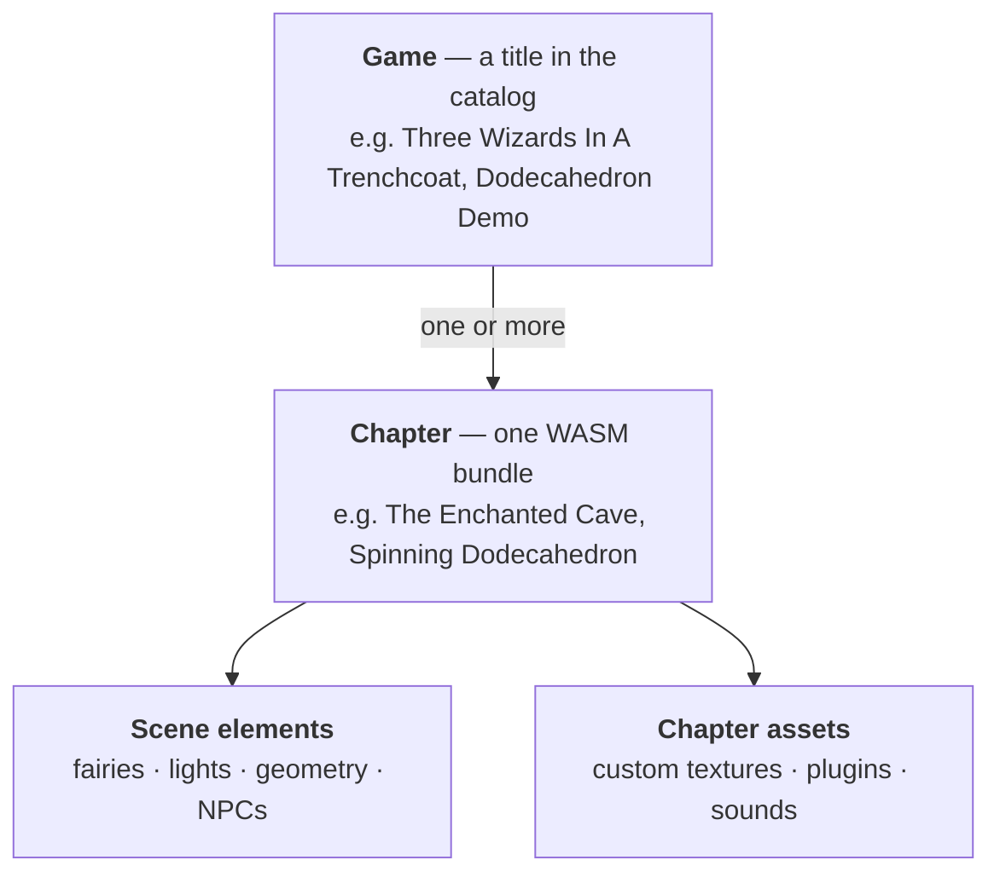

- A **Game** is one row in the `games` table — it appears as a card on the Snapdragon
  Games portal home page. Today the catalog ships *Three Wizards In A Trenchcoat* (a
  JRPG with quests, HUD, and movement controls) and the *Dodecahedron Demo* (a
  chrome-less single-scene tech demo with no HUD, no quests, no items).
- Each **Chapter** inside a game is its own compiled Godot WASM bundle, served from
  `/api/assets/levels/{slug}/` (filesystem path kept for back-compat). Chapter transitions
  unload the current WASM and mount the next one in the Angular iframe (see "Chapter transitions" below).
- A chapter whose `scene_type` is in the `CHROMELESS_SCENE_TYPES` set in
  [home.component.ts](frontend/src/app/home/home.component.ts) (currently just
  `dodecahedron`) renders without `app-game-hud` or `app-game-controls` — useful for
  pure-visual demos that don't have a character / quest / spell loadout.
- **Scene elements** and user-registered **chapter assets** (textures, plugins,
  sounds) are fetched by the running Godot bundle from the API at load time.
- Chapters gate on completed **Quests** via `chapter_prerequisites`: complete all
  prerequisite quests → the next chapter unlocks. Games with no quests (like the
  Dodecahedron Demo) just have an unconditionally-unlocked chapter.

Adding levels and assets is a documented workflow — see the
[Godot developer guide](docs/GODOT_DEVELOPER_GUIDE.md).

---

## Architecture

Up to 3 players may be connected simultaneously; exactly one holds the **controller** role and can send input. All game state originates in the Spring Boot API and propagates to every connected client over a single SSE stream with nine typed event channels.

The Angular shell is a [native-federation](https://www.npmjs.com/package/@angular-architects/native-federation) host: at runtime it loads role-gated sibling bundles (`login`, `admin`, `mod`, `publisher`, `games-three-wizards`, `games-dodecahedron`, `games-rpg-maker`, `games-vn-maker`, `registration`, `producer-registration`, `banned`, `api-docs`) plus a `wasm-fragment` asset-tier nginx, all served by per-remote services on the compose network and proxied through the host's nginx at `/_remotes/<slug>/`. The runtime data flow below describes the **post-federation** rendering path; legacy `<app-game-canvas>` stays as a fallback for sceneTypes outside `SCENE_TYPE_TO_GAME_SLUG`. See *Module Federation: host + remotes + a fragment* under [Key architectural decisions](#key-architectural-decisions) for the bundle-view companion to this runtime view.

All browser traffic enters through the **snapdragon-gateway** (Spring Cloud Gateway). The gateway terminates TLS, enforces the primary rate-limit, holds the revocation list (stamps `X-Revoked` on requests from banned keys), and routes `/api/*` to the BFF and everything else to the Angular host nginx. The BFF runs the same revocation + rate-limit checks as defence-in-depth (`RevocationListService` / `RateLimitFilter`), so service-to-service traffic on the compose network that bypasses the gateway stays gated.

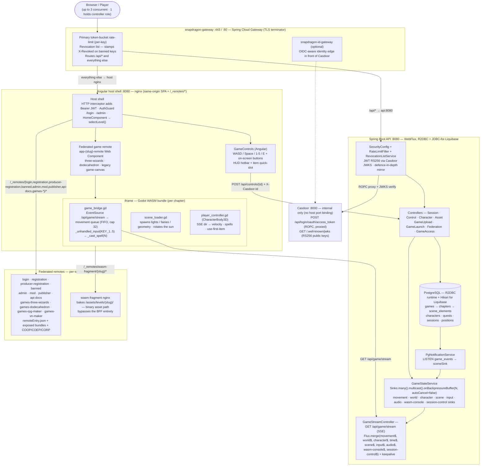

### Key architectural decisions

**Per-chapter WASM bundles.**
Each chapter compiles to its own Godot export under `/api/assets/levels/{slug}/` (filesystem path kept for back-compat). The iframe URL carries `?chapter_id=N`; `index.html` prefetches `/api/chapters/N/scene` early so scene config is ready before the 30 s+ WASM compile finishes. The prefetch now checks `if (!r.ok) throw new Error(...)` so a BFF error falls to `.catch()` with a console warning instead of silently becoming an empty scene config. Adding a new chapter = new `.tscn` + new preset in `export_presets.cfg` + new row in `chapters` — see [docs/GODOT_DEVELOPER_GUIDE.md](docs/GODOT_DEVELOPER_GUIDE.md).

**All controls authenticate through a session.**
Every `POST /api/controls/{charId}` is JWT-authenticated; the server rejects it with 403 unless the JWT subject is the holder of the controller role. `HomeComponent.ngOnInit` auto-calls `session.connect()` → `session.claimControl()` on page load so solo play "just works". If the BFF restarts (clearing the in-memory `activeSessions`/`currentController`), `game_bridge.gd` detects the first 403, posts `SD_SESSION_EXPIRED` to the host shell, and `ApiBridgeService` automatically re-runs connect + claim — the next keypress works without a page reload. Up to 3 players may be connected simultaneously; only one holds the controller role at a time.

**Spells fire both client-side and server-side.**
The key handler in `game_bridge.gd` calls `player._cast_spell(N)` directly in-WASM so the visual is instant and doesn't depend on the SSE round-trip. The same keypress also POSTs `/api/controls/1` so the server can eventually apply MP cost / XP / cooldown. Angular's hotbar handler additionally fires a CSS overlay as a guaranteed-visible cue — useful for debugging iframe focus issues.

**Nine typed SSE channels on one stream.**
`GameStreamController` merges eight `Sinks.Many` from `GameStateService` (movement, world, character, scene, input, audio, wasm-console, session-control) + one from `GameTimeService` (time) + a keepalive `Flux.interval(Duration.ZERO, 15s)` into a single `Flux<ServerSentEvent>`. The immediate first-tick keepalive forces response headers to flush at connect time, so browser `EventSource.onopen` fires in milliseconds instead of waiting for the first real event. Each payload carries an `event:` field so clients register per-type listeners.

**SSE sinks must not autoCancel.**
`Sinks.many().multicast().onBackpressureBuffer(N)` defaults to `autoCancel=true` — when every subscriber disconnects (iframe remount, EventSource reconnect, network blip), the sink terminates permanently and all subsequent `tryEmitNext` calls silently drop. Every sink in this project passes `autoCancel=false` explicitly. Producing a "first keypress works, then everything dies" symptom until this was fixed.

**Movement queue, not latest-wins.**
`window._twMovementQueue` is an array that the JS SSE listener pushes to per-event. Previously the listener stored only the latest payload, so rapid keydown+keyup pairs (exactly what spell keys produce) collapsed into just the keyup and the `pressed=true` event was lost between Godot's 16 ms polls. `_drain_movement_queue` now splices the array atomically each frame and emits `state_updated` in FIFO order.

**Casdoor kept internal; JWKS at `/.well-known/jwks`.**
`docker-compose.yml` exposes no host port for Casdoor. Spring Security's JWT decoder is wired to the anonymous `/.well-known/jwks` — **not** `/api/get-jwks`, which requires admin auth and would return an error payload that throws `"Missing required keys member"` on every Bearer-tagged request, including permitAll ones.

**R2DBC + JDBC coexistence.**
Runtime data access is non-blocking R2DBC. Liquibase needs a blocking JDBC `DataSource`. Spring Boot 3 skips `DataSourceAutoConfiguration` when an R2DBC `ConnectionFactory` bean is present, so `JdbcDataSourceConfig` creates an explicit `@Primary HikariDataSource` for Liquibase only (pool size 3).

**Per-brand domain isolation, mirrored from snapdragon.systems.**
The BFF derives a tenant the way the snapdragon-gateway does: one Casdoor per brand ⇒ a distinct, cryptographically-validated `iss`, mapped to a brand by `DomainRegistry`, stamped as exactly one `DOMAIN_<x>` authority by `CasdoorAuthorities` (with a reserved-prefix guard so a `permissions:["DOMAIN_other"]` entry can't forge a tenant). `DomainGuardFilter` is the first consumer: when `app.tenancy.domain` names the brand this instance serves, it 403s any authenticated token whose `DOMAIN_<x>` ≠ that brand (SUPERADMIN exempt) — the BFF-side, defence-in-depth mirror of the gateway's domain hard-deny, for traffic that reaches the BFF on the compose network bypassing the edge. Unset (the single-Casdoor default) ⇒ a complete no-op. An optional `app.tenancy.issuers` CSV swaps in a per-brand multi-issuer decoder (`TenancyResourceServerConfig`). See [decision 025](docs/wiki/decisions/025-bff-domain-guard.md).

**Module Federation: host + twelve remotes + a fragment.**
The Angular shell is a [native-federation](https://www.npmjs.com/package/@angular-architects/native-federation) host. It loads role-gated sibling bundles at runtime, served by per-remote nginx services on the compose network and proxied through the host's nginx at `/_remotes/<slug>/`:

| Slug | Kind | Exposes | Where in the host |
|---|---|---|---|
| `login` | `remote-shell` | `./LoginComponent` | `loadComponent` for `/login` |
| `admin` | `remote-shell` | `./AdminShell` + `./UploadShell` | `loadComponent` for `/admin` and `/admin/games` |
| `mod` | `remote-shell` | `./ModShell` | `loadComponent` for `/mod` (per-game moderation surface; gated by `mod_game_scopes`) |
| `publisher` | `remote-shell` | `./PublisherShell` | `loadComponent` for `/publisher` (uploads + per-game grants; gated by `publisher_game_scopes`) |
| `producer-registration` | `remote-shell` | `./RegistrationComponent` | `loadComponent` for `/register` (intake form → `POST /api/producer-contacts`) |
| `banned` | `remote-shell` | `./BannedComponent` | `loadComponent` for `/banned` (auth-error interceptor redirects on `X-Revoked`; resolves appeal email via `GET /api/security/appeal-contact`) |
| `games-three-wizards` | `remote-game` | `./GameRoot` | `<app-three-wizards-remote>` Web Component (cave + field) |
| `games-dodecahedron` | `remote-game` | `./GameRoot` | `<app-dodecahedron-remote>` Web Component (chrome-less demo) |
| `games-rpg-maker` | `remote-shell` | `./RpgMakerRemote` | RPG maker UI; drives the `rpg-builder/` side service (decision 018) |
| `games-vn-maker` | `remote-shell` | `./VnMakerRemote` | VN maker UI; drives the `vn-builder/` side service (decision 018) |
| `wasm-fragment` | `fragment` | — (asset tier) | Redirects `?slug=` to `/api/assets/levels/<slug>/index.html` |

`HomeComponent` forks the renderer on `SCENE_TYPE_TO_GAME_SLUG` (cave/field → `three-wizards`, dodecahedron → `dodecahedron`); chapters with sceneTypes outside that map fall through to the legacy in-tree `<app-game-canvas>` iframe. SessionService.connect + the `TW_CHAPTER_TRANSITION` window listener live on `HomeComponent` so they fire regardless of which renderer mounts.

The host's `main.ts` calls `initFederation(...)` BEFORE `bootstrapApplication` (split into `bootstrap.ts` because `@angular/*` imports can't resolve before the import map exists). Federated route components reach the federation runtime via `globalThis.__SNAPDRAGON_LOAD_REMOTE_MODULE__`, which `main.ts` stashes after `initFederation` resolves — keeps the federation package out of karma's static graph and out of route-handler bundles. The federation manifest is fetched from `GET /api/federation/manifest` (DB-backed, see migration `018-federation-modules.xml`) so a new remote can come online without redeploying the host.

---

## Data model

### SSE event types — `GET /api/game/stream`

| Event name | Payload fields | Emitted when | Delivery |
|---|---|---|---|
| `movement` | `x`, `y`, `z`, `rotationY`, `action`, `pressed`, `tick` | Every control event (press AND release, see `pressedChanged` gate) | Queued FIFO in-bridge |
| `world` | `sessionId`, `tick`, `timestamp`, `characters[]` | When any character's state changes | Latest-wins snapshot |
| `character` | `health`, `mana`, `level`, `xp`, `xpToNext` | Stat patch or item use | Latest-wins snapshot |
| `time` | `dayNumber`, `hour`, `minute` | Every game-minute (~10 s real) | Latest-wins snapshot |
| `scene` | `sceneId`, `sceneName`, `sceneType`, `eventType` | Scene transition / scene_element NOTIFY | Latest-wins snapshot |
| `input` | `eventKind`, `eventType`, `payload` | Generalised input emit (gamepad / mouse / keyboard / touch / world / control) | Latest-wins snapshot |
| `audio` | `eventKind`, `eventType`, `payload` | Audio cue from Godot bundle | Latest-wins snapshot |
| `wasm-console` | `line`, `level`, `timestamp` | WASM iframe console capture (admin-only + debug flag) | Latest-wins snapshot |
| `session-control` | `sessionId`, `eventType` | Session pause / resume / close lifecycle | Latest-wins snapshot |
| `:keepalive` (SSE comment) | — | `t=0` on connect, then every 15 s | Flushes response headers so `onopen` fires immediately |

### HUD layout

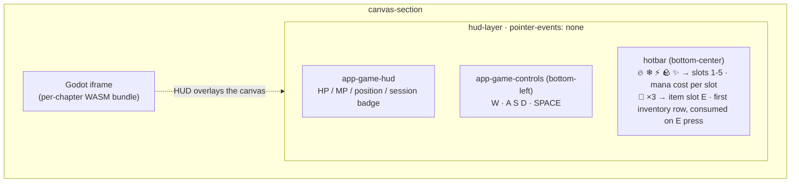

### Input flow — keypress to visible effect

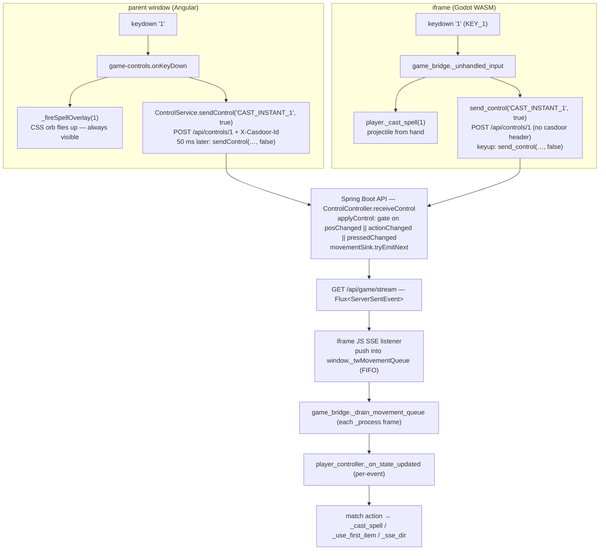

Spells cast via two redundant paths — the direct in-WASM call fires the visual instantly; the round-trip through the API exists so the server can eventually subtract MP, grant XP, resolve collisions with enemies, etc.

### `ControlEvent` — `POST /api/controls/{characterId}` body

| Field | Type | Values |
|---|---|---|
| `action` | `String` | `MOVE_FORWARD`, `MOVE_BACKWARD`, `MOVE_LEFT`, `MOVE_RIGHT`, `JUMP`, `INTERACT`, `CAST_INSTANT_1/2/3/4/5` |
| `pressed` | `boolean` | `true` = key down, `false` = key up |
| `timestamp` | `long` | Client epoch-ms |

### `SceneDto` — `GET /api/chapters/{id}/scene` response

| Field | Type | Description |
|---|---|---|
| `id` | `Long` | Chapter ID |
| `name` | `String` | Display name |
| `slug` | `String` | URL slug (matches classpath directory) |
| `sceneType` | `String` | `cave`, `field`, … |
| `assetUrl` | `String` | Path to this chapter's Godot WASM bundle entry-point |
| `elements` | `List<SceneElementDto>` | Scene elements with positions, rotations, properties |

### Chapter transitions — `TW_CHAPTER_TRANSITION` postMessage

When a running Godot WASM needs to hand off to another chapter's bundle:

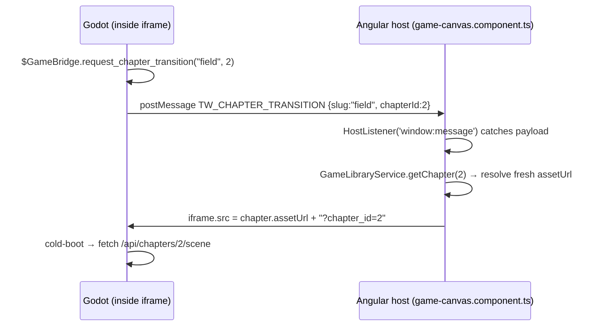

The previous WASM is fully unloaded — persist any in-memory state via the API
(`PUT /api/characters/{id}` etc) *before* calling `request_chapter_transition`.

---

## API reference

The reactive endpoints below are drawn as **pipeline flowcharts** — a request flows
left-to-right through the Reactor operators to a terminal emission:

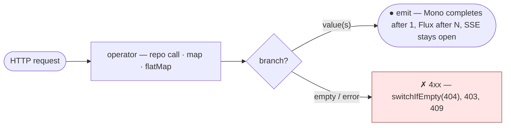

- `([ … ])` rounded ends — the incoming request and the terminal emission(s).
- plain boxes — Reactor operators (`findById`, `map`, `flatMap`, `save`, …).
- `{ … }` diamond — a branch (found vs empty, controller vs not).
- red `✗` node — an error / 4xx terminal (`switchIfEmpty`, `403`, `404`, `409`).
- A `Mono` completes after one value, a `Flux` after N; an SSE stream stays open until the client disconnects.

---

### `AuthController` — `/api/auth`  *(public)*

#### `POST /api/auth/token`

Exchanges username + password for a Casdoor OAuth2 access token via the Resource Owner Password Credentials grant. The `client_secret` is injected server-side — the browser never sees it.

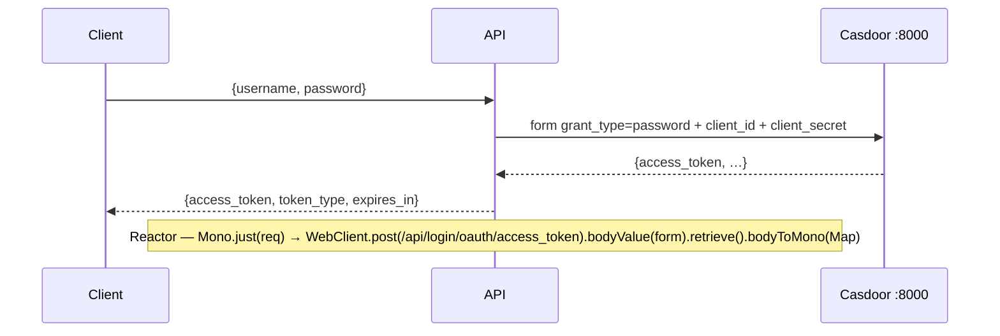

---

### `GameStreamController` — `/api/game`  *(public)*

#### `GET /api/game/stream`

Multiplexed SSE stream. Nine typed channels plus a keepalive are merged into a single connection; each event carries an `event:` type field so clients can register per-type listeners.

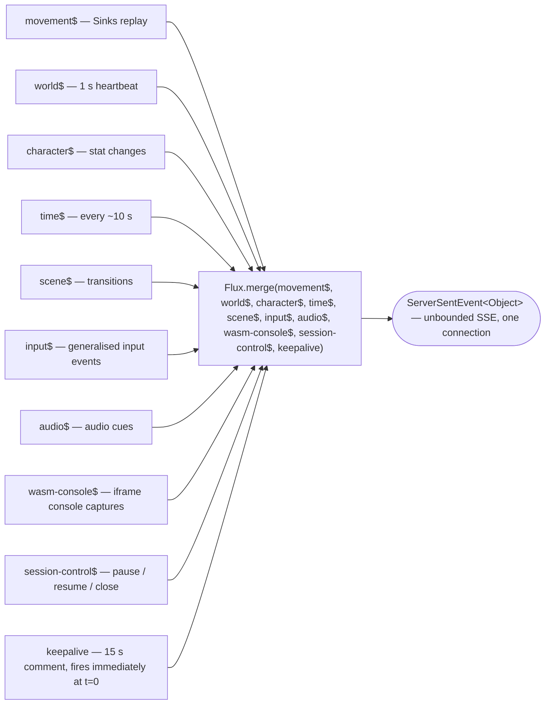

#### `GET /api/game/state`

Snapshot of the current game state without subscribing to the stream.

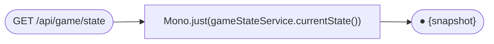

---

### `GameController` — `/api/games`  *(public)*

Umbrella tier. Each game groups one or more Levels.

#### `GET /api/games` · `GET /api/games/{id}`

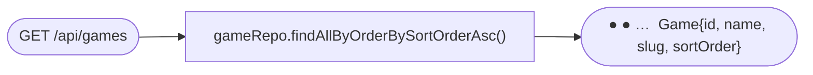

#### `GET /api/games/{id}/chapters`

Returns every Chapter inside the umbrella game, ordered by sort_order.

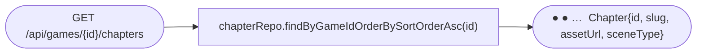

#### `GET /api/games/available/{characterId}`

Nested structure — every umbrella game with its chapters, each chapter annotated
with `unlocked` / quest-progress for the caller's character. Drives the home
page games-with-chapters drilldown.

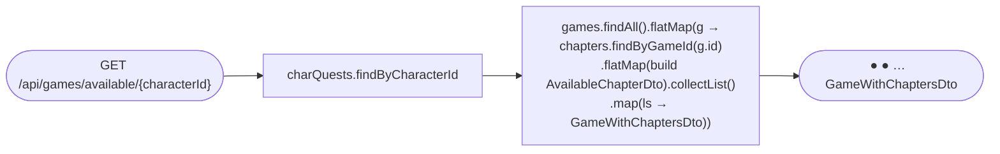

### `ChapterController` — `/api/chapters`  *(public)*

One chapter = one compiled Godot WASM bundle.

#### `GET /api/chapters` · `GET /api/chapters/{id}`

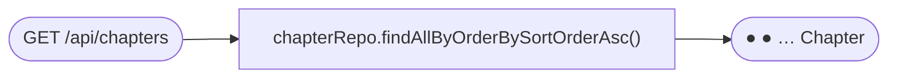

#### `GET /api/chapters/{id}/scene`

The descriptor consumed by `scene_loader.gd` at bundle startup.

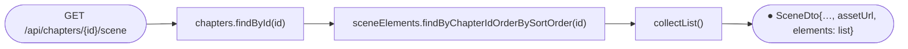

### `ChapterAssetController` — `/api/chapters/{chapterId}/assets`  *(public)*

Registry for user-added textures / plugins / sounds attached to a chapter. GDScript
uses labels to look up assets without hardcoding filenames.

#### `GET /api/chapters/{chapterId}/assets`

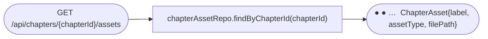

#### `GET /api/chapters/{chapterId}/assets/by-label/{label}`

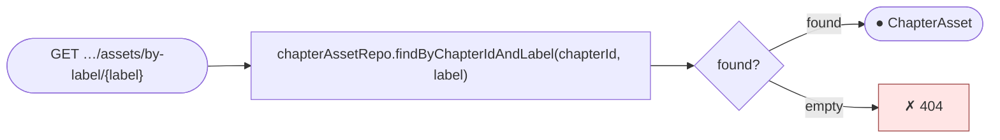

#### `POST /api/chapters/{chapterId}/assets`

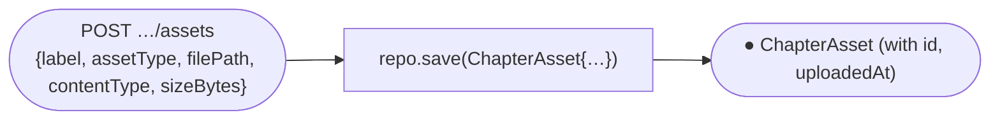

#### `DELETE /api/chapters/{chapterId}/assets/{assetId}`

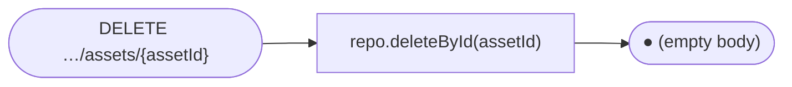

---

### `AssetController` — `/api/assets`  *(public)*

#### `GET /api/assets/levels/{slug}/{filename}`

**Primary path** for per-level WASM bundles. Each level's compiled files live under
`classpath:assets/levels/{slug}/`. The Angular iframe mounts `index.html` from here
and Godot fetches its `.wasm`/`.pck` from the same directory.

#### `GET /api/assets/{filename}`

Root-level static assets fetched directly from the classpath. Reserved for
backward-compat with content that hasn't been moved to the `levels/` hierarchy yet.

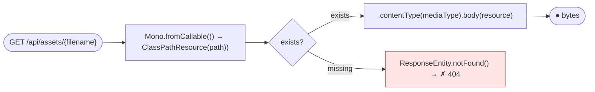

Supported extensions → content-types:

| ext | type |
|---|---|
| `html` | `text/html` |
| `js` | `application/javascript` |
| `wasm` | `application/wasm` |
| `pck` | `application/octet-stream` |
| `png`/`jpg` | `image/png` · `image/jpeg` |
| `glb`/`gltf` | `model/gltf-binary` · `model/gltf+json` |

---

### `ControlController` — `/api/controls`  *(public — validated by session)*

#### `POST /api/controls/{characterId}`

Accepts control events. Validates that the `X-Casdoor-Id` header matches the session marked `is_controller = true`. Non-controllers receive `403`.

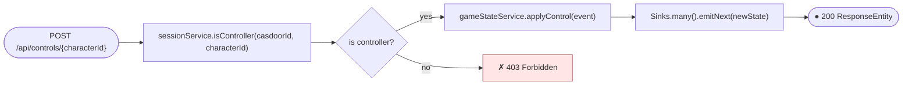

---

### `SessionController` — `/api/sessions`  *(authenticated)*

#### `POST /api/sessions/connect`

Creates or resumes a player session, enforcing the 3-player cap.

```mermaid
flowchart LR
    R(["POST /api/sessions/connect"]) --> C["sessionRepo.countActiveSessions()"] --> D{"under 3-player cap?"}
    D -->|"yes — count under 3"| OK["createOrResumeSession()<br/>first joiner auto-claims controller"] --> O(["● {sessionToken, isController, playerCount}"])
    D -->|"no — count = 3"| F["✗ 409 Conflict"]:::err
    classDef err fill:#ffe5e5,stroke:#a14a4a;
```

#### `POST /api/sessions/control`

Attempts to claim the exclusive controller role.

```mermaid
flowchart LR
    R(["POST /api/sessions/control"]) --> C["sessionRepo.countByIsControllerTrue()"] --> D{"count = 0?"}
    D -->|"count = 0"| OK["setController(true)"] --> O1(["● {claimed: true}"])
    D -->|"count over 0"| O2(["● {claimed: false}"])
```

#### `DELETE /api/sessions/me`

```mermaid
flowchart LR
    R(["DELETE /api/sessions/me"]) --> S["sessionRepo.deleteByCasdoorId(casdoorId)"] --> O(["● (no body)"])
```

---

### `CharacterController` — `/api/characters`  *(authenticated)*

#### `GET /api/characters`

```mermaid
flowchart LR
    R(["GET /api/characters"]) --> Q["characterRepo.findAll()"] --> Mp["map(toDto)"] --> O(["● ● ● …  CharacterDto"])
```

#### `GET /api/characters/{id}`

```mermaid
flowchart LR
    R(["GET /api/characters/{id}"]) --> F["characterRepo.findById(id)"] --> D{"found?"}
    D -->|found| OK["map(toDto)"] --> O(["● CharacterDto"])
    D -->|empty| NF["switchIfEmpty(404) → ✗"]:::err
    classDef err fill:#ffe5e5,stroke:#a14a4a;
```

#### `PUT /api/characters/{id}`

Patches HP, MP, level, XP, ability stats, and current scene, then notifies the SSE character channel.

```mermaid
flowchart LR
    R(["PUT /api/characters/{id}"]) --> F["characterRepo.findById(id)"] --> P["map(applyPatch)"] --> S["characterRepo.save()"] --> N["gameStateService.notifyCharacterChange()"] --> O(["● CharacterDto (updated)"])
```

#### `PUT /api/characters/{id}/quests/{questId}/complete`

Marks the quest complete and, if it has a `reward_skill_id`, grants the character that skill (idempotent).

```mermaid
flowchart TB
    R(["PUT /api/characters/{id}/quests/{questId}/complete"]) --> F["charQuests.findByCharacterIdAndQuestId(id, qid)"] --> D{"found?"}
    D -->|empty| NF["switchIfEmpty(404) → ✗"]:::err
    D -->|found| S["status='completed' · completedAt=NOW()<br/>charQuests.save()"]
    S --> Q["questRepo.findById(qid)"] --> RW{"reward_skill_id present?"}
    RW -->|no| O(["● CharacterQuest (updated)"])
    RW -->|yes| H["charSkills.findByCharacterId<br/>.filter(skillId == reward).hasElements()"] --> HD{"already has?"}
    HD -->|"already has"| O
    HD -->|new| GR["charSkills.save({charId, rewardSkillId})"] --> O
    classDef err fill:#ffe5e5,stroke:#a14a4a;
```

#### `POST /api/characters/{id}/use-first-item`

Consumes the lowest-id inventory item (typically a potion), applies its JSON effect, decrements quantity, and broadcasts the updated character over SSE so the HUD HP/MP bars update instantly.

```mermaid
flowchart TB
    R(["POST /api/characters/{id}/use-first-item"]) --> F["charItems.findByCharacterId(id)<br/>.filter(qty &gt; 0).sort(by id).next()"] --> D{"found?"}
    D -->|empty| NF["✗ 404 — no usable item"]:::err
    D -->|found| I["itemRepo.findById"]
    I --> P["parse effect_json:<br/>heal:N → currentHp += N (cap maxHp)<br/>mana:N → currentMp += N (cap maxMp)"]
    P --> S1["charItems.save(qty-1)"] --> S2["characters.save(updated)"] --> N["gameStateService.notifyCharacterStatChange"] --> O(["● CharacterDto (updated)"])
    classDef err fill:#ffe5e5,stroke:#a14a4a;
```

#### `GET /api/characters/{id}/dashboard`

Passive snapshot for the player dashboard — character stats, time, games with levels, quests, session playtime — without loading the game canvas.

```mermaid
flowchart LR
    R(["GET /api/characters/{id}/dashboard"]) --> Z["zip(<br/>characterRepo.findById(id).map(toDto),<br/>progression.availableGamesWithLevels(id).collectList(),<br/>charQuests.findByCharacterId(id).flatMap(cq → questRepo.findById → toDto).collectList(),<br/>sessions.findHistoryByCasdoorId(char.casdoorId).collectList())"]
    Z --> Mp["map"] --> O(["● DashboardDto{character, gameTime, games,<br/>quests, totalPlayMinutes, totalSessions}"])
```

---

### `SkillController` — `/api/skills`  *(authenticated)*

#### `GET /api/skills`

```mermaid
flowchart LR
    R(["GET /api/skills"]) --> Q["skillRepo.findAll()"] --> Mp["map(toDto)"] --> O(["● ● ● …  SkillDto"])
```

#### `GET /api/skills/character/{characterId}`

```mermaid
flowchart LR
    R(["GET /api/skills/character/{characterId}"]) --> Q["characterSkillRepo.findByCharacterId(id)"] --> FM["flatMap(cs → skillRepo.findById(cs.skillId))"] --> Mp["map(toDto)"] --> O(["● ● …  SkillDto (learned only)"])
```

#### `GET /api/skills/character/{characterId}/slots`

```mermaid
flowchart LR
    R(["GET /api/skills/character/{characterId}/slots"]) --> Q["slotRepo.findByCharacterIdOrderBySlotNumber(id)"] --> Mp["map(slot → {slotNumber, skill or null})"] --> O(["● ● …  {slot:1, skill:{…}}<br/>{slot:2, skill:null} — empty slot"])
```

#### `PUT /api/skills/character/{characterId}/slots/{slot}`

```mermaid
flowchart LR
    R(["PUT /api/skills/character/{characterId}/slots/{slot}"]) --> S["slotRepo.save(CharacterSkillSlot{charId, slot, skillId})"] --> O(["● (no body)"])
```

---

### `ItemController` — `/api/items`  *(authenticated)*

#### `GET /api/items/character/{characterId}/inventory`

```mermaid
flowchart LR
    R(["GET /api/items/character/{characterId}/inventory"]) --> Q["charItemRepo.findByCharacterId(id)"] --> FM["flatMap(ci → itemRepo.findById(ci.itemId)<br/>.map(item → ItemDto{…, quantity: ci.quantity}))"] --> O(["● ● …  ItemDto (with quantity)"])
```

#### `GET /api/items/character/{characterId}/equipment`

```mermaid
flowchart LR
    R(["GET /api/items/character/{characterId}/equipment"]) --> Q["charEquipRepo.findByCharacterId(id)"] --> FM["flatMap(ce → itemRepo.findById(ce.itemId))"] --> Mp["map(item → {slot, item or null})"] --> O(["● ● …  {slot:head, item:{…}}<br/>{slot:chest, item:null} — empty"])
```

#### `PUT /api/items/character/{characterId}/equipment/{slot}`

```mermaid
flowchart LR
    R(["PUT /api/items/character/{characterId}/equipment/{slot}"]) --> S["charEquipRepo.save(CharacterEquipment{charId, slot, itemId})"] --> O(["● (no body)"])
```

---

### `QuestController` — `/api/quests`  *(authenticated)*

#### `GET /api/quests`

```mermaid
flowchart LR
    R(["GET /api/quests"]) --> Q["questRepo.findAll()"] --> Mp["map(toDto)"] --> O(["● ● …  QuestDto"])
```

#### `GET /api/quests/character/{characterId}`

```mermaid
flowchart LR
    R(["GET /api/quests/character/{characterId}"]) --> Q["charQuestRepo.findByCharacterId(id)"] --> FM["flatMap(cq → questRepo.findById(cq.questId)<br/>.map(q → QuestDto{…, status, completedAt}))"] --> O(["● ● …  QuestDto (character-specific status)"])
```

---

### `AdminController` — `/api/admin`  *(ROLE_ADMIN only)*

#### `GET /api/admin/sessions`

```mermaid
flowchart LR
    R(["GET /api/admin/sessions"]) --> Q["sessionRepo.findAll()"] --> O(["● ● …  SessionDto"])
```

#### `DELETE /api/admin/sessions/{casdoorId}`

Force-disconnects a player session regardless of controller status.

```mermaid
flowchart LR
    R(["DELETE /api/admin/sessions/{casdoorId}"]) --> S["sessionRepo.deleteByCasdoorId(casdoorId)"] --> O(["● (no body)"])
```

#### `GET /api/admin/characters`

```mermaid
flowchart LR
    R(["GET /api/admin/characters"]) --> Q["characterRepo.findAll()"] --> Mp["map(toDto)"] --> O(["● ● …  CharacterDto"])
```

#### `PUT /api/admin/characters/{id}`

Same patch pipeline as the player `CharacterController`, without the ownership check.

```mermaid
flowchart LR
    R(["PUT /api/admin/characters/{id}"]) --> F["characterRepo.findById(id)"] --> P["map(applyPatch)"] --> S["characterRepo.save()"] --> O(["● CharacterDto (updated)"])
```

---

### `GameTimeController` — `/api/time`  *(public)*

#### `GET /api/time`

Returns the current in-game clock state. The `GameTimeService` scheduler advances 1 game-minute every ~10 real seconds and persists to `game_time_state`.

```mermaid
flowchart TB
    subgraph sched["GameTimeService scheduler — every 10 s real"]
        direction LR
        T["──tick── loop"] --> Inc["minute++ · day++ at 23:59"] --> Persist["persist + emit time$ SSE event"]
    end
    R(["GET /api/time"]) --> Q["timeRepo.findFirst()"] --> Mp["map(toDto)"] --> O(["● {dayNumber, hour, minute}"])
```

---

### `FederationController` — `/api/federation`  *(public)*

#### `GET /api/federation/manifest`

Returns the active rows of `federation_modules` (slug + display name + kind + remote_entry_url + exposed_module + version + metadata) ordered by kind/slug. The Angular host calls this BEFORE `bootstrapApplication` and feeds the result into `initFederation(...)`. Public on purpose: the host needs the `login` remote URL before any user authenticates.

```mermaid
flowchart LR
    R(["GET /api/federation/manifest"]) --> Q["fedRepo.findAllByEnabledTrueOrderByKindAscSlugAsc()"] --> Mp["map(FederationRemoteDto::from) · collectList"] --> O(["● {generatedAt, remotes: list}"])
```

---

### `GameLaunchController` — `/api/games`  *(authenticated; admin endpoints under /api/admin/launches)*

#### `POST /api/games/{slug}/launch`

Mints a 256-bit URL-safe `launch_uid` for the active session, persists a `game_launches` row with a 15-minute TTL (with `version_dir` snapshot from `games.current_version_dir`), and returns `{uid, expiresAt, gameSlug}`. The federated remote threads the uid into the iframe URL as `?launch_uid=…` for traceability; `AssetController.getLevelAssetByUid` validates it on the legacy launch-uid-gated asset path.

#### `DELETE /api/games/launches/{uid}`

Self-terminate. The owner of the launch (matched by JWT subject vs `game_launches.casdoor_user_id`) can clear the `terminated_at` column. Mismatched user → 403.

#### `DELETE /api/admin/launches/{uid}`  *(ROLE_ADMIN)*

Admin force-terminate. Skips the ownership check; surfaces from the admin UI's "kick" button alongside the active-launches list.

---

### `GameUploadController` — `/api/admin/games`  *(ROLE_ADMIN)*

#### `POST /api/admin/games/upload`

Multipart bundle zip → install pipeline (validate manifest_json schema_version=2 + slug regex + zip-slip-safe paths → SHA-256 the bundle/ tree → atomic move to `<gamesDir>/<slug>/<sha-prefix>` → ONE R2DBC tx that inserts `game_uploads`, runs the bundle's `register.sql` statement-by-statement, UPDATEs `games.current_version_dir`, and supersedes prior uploads). Returns `{slug, contentHash, versionDir, uploadedAt}`. Bound by the `app.uploads.versions-to-keep` (default 3) `GameUploadPruner` scheduled task.

#### `GET /api/admin/games/{slug}/uploads`

Rollback history for a slug — newest first. Each row carries `supersededAt` (NULL = current).

---

### `GameAccessController` — `/api/admin/games`  *(ROLE_ADMIN)*

#### `POST /api/admin/games/{slug}/access`

Body: `{scope:"all"|"role"|"user", value?:"<role-name | casdoor-user-id>"}`. Adds a row to `game_access`. Idempotent — duplicates absorbed by the `uq_game_access_triple` unique constraint.

#### `DELETE /api/admin/games/{slug}/access?scope=…&value=…`

Removes the matching `game_access` row.

#### `GET /api/admin/games/{slug}/access`

Lists active access policies for a slug. Multiple rows are additive (union).

---

### `RoleProxyController` — `/api/admin/roles`  *(ROLE_ADMIN)*

#### `GET /api/admin/roles`

Proxies Casdoor's `/api/get-roles?owner=threewizards` so the admin UI's "grant role" dropdown loads from the live Casdoor catalog instead of a free-text input. The BFF holds the Casdoor admin client_secret; the browser doesn't.

---

## Database schema

```mermaid
erDiagram
    games ||--o{ chapters : "game_id"
    chapters ||--o{ scene_elements : "chapter_id"
    chapters ||--o{ chapter_assets : "chapter_id"
    chapters ||--o{ chapter_prerequisites : "chapter_id"
    quests ||--o{ chapter_prerequisites : "required_quest_id"
    chapters ||--o{ player_characters : "current_chapter_id"
    player_characters ||--o{ player_sessions : "character_id"
    player_characters ||--o{ player_positions : "character_id"
    chapters ||--o{ player_positions : "chapter_id"
    player_characters ||--o{ character_skills : "character_id"
    skills ||--o{ character_skills : "skill_id"
    player_characters ||--o{ character_skill_slots : "character_id"
    skills ||--o{ character_skill_slots : "skill_id"
    player_characters ||--o{ character_items : "character_id"
    items ||--o{ character_items : "item_id"
    player_characters ||--o{ character_equipment : "character_id"
    items ||--o{ character_equipment : "item_id"
    player_characters ||--o{ character_quests : "character_id"
    quests ||--o{ character_quests : "quest_id"
    quests ||--o{ quest_objectives : "quest_id"
    skills ||--o{ quests : "reward_skill_id — granted on complete"
    chapters ||--o{ quests : "chapter_id"

    games {
        bigint id PK
        text name
        text slug
        int sort_order
        text thumbnail_url
        timestamp created_at
    }
    chapters {
        bigint id PK
        bigint game_id FK
        text slug
        text scene_type
        text asset_url
        jsonb scene_config
        int sort_order
    }
    scene_elements {
        bigint id PK
        bigint chapter_id FK
        text element_type
        float position_x_y_z
        jsonb properties
    }
    chapter_assets {
        bigint id PK
        bigint chapter_id FK
        text label
        text asset_type
        text file_path
        bigint size_bytes
    }
    chapter_prerequisites {
        bigint id PK
        bigint chapter_id FK
        bigint required_quest_id FK
    }
    player_characters {
        bigint id PK
        text casdoor_id
        int level "XP level"
        int current_hp
        int current_mp
        bigint current_chapter_id FK
    }
    player_sessions {
        bigint id PK
        text session_token
        bigint character_id FK
        bool is_controller
        timestamp disconnected_at "null = active"
    }
    player_positions {
        bigint id PK
        bigint character_id FK
        bigint chapter_id FK
        float pos_x_y_z
        timestamp updated_at "drives pg NOTIFY trigger"
    }
    game_time_state {
        bigint id PK
        int day_number
        int hour
        int minute
    }
    skills {
        bigint id PK
        text name
        text skill_type
        int mana_cost
        jsonb effect_json
    }
    character_skills {
        bigint character_id FK
        bigint skill_id FK
        timestamp learned_at
    }
    character_skill_slots {
        bigint character_id FK
        int slot_number
        bigint skill_id FK
    }
    items {
        bigint id PK
        text name
        text item_type
        jsonb effect_json
    }
    character_items {
        bigint character_id FK
        bigint item_id FK
        int quantity
    }
    character_equipment {
        bigint character_id FK
        text slot
        bigint item_id FK
    }
    quests {
        bigint id PK
        text name
        int reward_xp
        int reward_gold
        bigint reward_skill_id FK
        bigint chapter_id FK
    }
    quest_objectives {
        bigint id PK
        bigint quest_id FK
        text description
        int required_count
    }
    character_quests {
        bigint character_id FK
        bigint quest_id FK
        text status
        timestamp completed_at
    }
```

### Spell catalog (migration 014)

Five starter spells auto-slotted for character 1 at slots 1–5; five advanced spells granted by completing the five quests.

| Slot | Starter spell | Element | MP | Damage | Quest reward → Advanced |
|---|---|---|---|---|---|
| 1 | Fireball | fire | 10 | 25 | Into the Cave → **Inferno Lance** (55 dmg, 22 MP) |
| 2 | Ice Shard | ice | 8 | 20 | The Cottage Secret → **Glacial Storm** (48 dmg, slow, 20 MP) |
| 3 | Thunder Bolt | lightning | 12 | 28 | Voice of the Storm → **Chain Lightning** (62 dmg, chain-3, 25 MP) |
| 4 | Stone Spike | earth | 11 | 24 | Heart of the Mountain → **Earthquake** (58 dmg, 28 MP) |
| 5 | Holy Light | light | 14 | 18 + heal 20 | Dawn at the Cottage → **Solar Flare** (70 dmg + heal 40, 30 MP) |

Projectile size scales with tier: starter radius ≈ 0.6, advanced ≈ 1.0.

---

## Godot asset pipeline

Each game lives in its **own** Godot project under `games/<game-slug>/`, and
each level inside that project compiles to its **own** WASM bundle. Per-game
`export_presets.cfg` holds one preset per level; the Makefile walks
`GAME_PROJECTS` and the per-game `PRESETS_<dir>` variable, runs
`godot --headless --export-release "<preset>"` from each game's directory, and
writes the output under `backend/src/main/resources/assets/levels/<slug>/`.

```mermaid
flowchart TB
    subgraph br["make build-rust"]
        direction TB
        BR1["cd extensions/snapdragon-bridge · cargo build --release<br/>→ target/release/libsnapdragon_bridge.so"]
        BR2["cp libsnapdragon_bridge.so → games/(game)/bin/ — each game"]
        BR3["cargo build --release --target wasm32-unknown-emscripten<br/>skipped if emsdk missing"]
        BR1 --> BR2 --> BR3
    end
    subgraph bg["make build-godot — depends on build-rust"]
        direction TB
        BG1["for game in GAME_PROJECTS · for preset in PRESETS_(game)<br/>cd games/(game) · godot --headless --export-release preset"]
        BG2["→ backend/src/main/resources/assets/levels/(slug)/<br/>index.html · index.wasm · index.pck · index.js · index.side.wasm"]
        BG3["scripts/patch-godot-html.py on (slug)/index.html + index.side.wasm"]
        BG4["✓ all bundles exported"]
        BG1 --> BG2 --> BG3 --> BG4
    end
    subgraph sd["make seed-db"]
        SD1["scripts/seed-games.sql — ON CONFLICT (slug) DO UPDATE<br/>upserts game + chapter rows · asset_url = /api/assets/levels/(slug)/index.html"]
    end
    br --> bg --> sd --> Deploy["make deploy = build-godot + seed-db<br/>then rebuild api + wasm-fragment images so new classpath assets ship"]
```

The federated path serves the same exports through `wasm-fragment/` (an
nginx that bakes `assets/levels/` and emits the COOP/COEP/CORP headers WASM
games need) at `/_remotes/wasm-fragment/<slug>/index.html`. The Angular host's
`HomeComponent` selects between the legacy classpath URL and the federated
one via `SCENE_TYPE_TO_GAME_SLUG`.

Adding a new level touches four places — the game's `export_presets.cfg`,
the Makefile's `PRESETS_<game>`, the `levels` DB row, and (optionally)
`level_prerequisites`. Adding a brand-new game touches a fifth (a row in
`federation_modules`) — or you can let the editor's *Snapdragon Export*
plugin produce an upload zip and let `GameUploadController` register
everything atomically. Full walk-through with naming rules and common
mistakes: see the [Godot developer guide](docs/GODOT_DEVELOPER_GUIDE.md).

### User-added assets (textures, plugins, sounds)

Drop a file into `backend/src/main/resources/assets/levels/<slug>/` then register
it so GDScript can resolve it by label:

```
curl -X POST http://localhost:8080/api/chapters/<id>/assets \
  -H 'Content-Type: application/json' \
  -d '{"label":"oak-bark","assetType":"texture",
       "filePath":"/api/assets/levels/field/oak.png",
       "contentType":"image/png"}'
```

(The on-disk path keeps `/levels/` per the rename holdout — only the API path flipped to `/chapters/`.)

From GDScript (editor or web, via the `ApiClient` helper):

```gdscript
var api := ApiClient.new(); add_child(api)
api.resolve_asset(chapter_id, "oak-bark", func(url):
    # … HTTPRequest the url and apply as albedo_texture …
)
```

Level transitions from inside the game are one call:

```gdscript
$GameBridge.request_chapter_transition("field", 2)
```

See the [Godot developer guide](docs/GODOT_DEVELOPER_GUIDE.md#mid-game-level-transitions) for the full flow.

---

## Prerequisites

| Tool | Version | Purpose |
|---|---|---|
| Rust + Cargo | stable (1.78+) | GDExtension + optional WASM |
| Godot 4 | 4.6 | Game engine / WebGL export |
| Java (JDK) | 21 | Spring Boot API |
| Node.js | 20 LTS | Angular frontend |
| npm | 10+ | JS package manager |
| Angular CLI | 19 | Frontend build tool |
| Make | any | Build orchestration |
| Docker + Compose | 24+ / v2 | Full stack (Postgres, Casdoor, API, nginx) |
| Emscripten | 3.1+ | *(optional)* Rust → WASM |

---

## Installation — Linux

### 1. Rust + Cargo

```bash
curl --proto '=https' --tlsv1.2 -sSf https://sh.rustup.rs | sh
source "$HOME/.cargo/env"
cargo --version
```

Optional WASM target:
```bash
rustup target add wasm32-unknown-emscripten
```

### 2. Godot 4.6

Download the **Linux (64-bit)** export from [godotengine.org/download](https://godotengine.org/download/linux/).

```bash
unzip Godot_v4.6-stable_linux.x86_64.zip -d ~/tools/godot
sudo ln -s ~/tools/godot/Godot_v4.6-stable_linux.x86_64 /usr/local/bin/godot
godot --version
```

**Export templates** are required for `make build-godot`:

1. Open Godot → Editor → Manage Export Templates
2. Download templates for **4.6 stable**
3. Or place them manually at `~/.local/share/godot/export_templates/4.6.stable/`

### 3. Java 21

```bash
# Debian/Ubuntu
sudo apt update && sudo apt install -y openjdk-21-jdk

# Fedora/RHEL
sudo dnf install java-21-openjdk-devel

# Arch
sudo pacman -S jdk21-openjdk

# SDKMAN (distro-agnostic)
curl -s "https://get.sdkman.io" | bash
source "$HOME/.sdkman/bin/sdkman-init.sh"
sdk install java 21.0.4-tem
```

### 4. Node.js 20 + npm

```bash
curl -o- https://raw.githubusercontent.com/nvm-sh/nvm/v0.39.7/install.sh | bash
source ~/.bashrc
nvm install 20 && nvm use 20
node --version && npm --version
```

### 5. Angular CLI

```bash
npm install -g @angular/cli@19
ng version
```

### 6. Make

```bash
# Debian/Ubuntu
sudo apt install -y make
# Fedora
sudo dnf install make
# Arch
sudo pacman -S make
```

### 7. Docker + Compose

```bash
# Debian/Ubuntu (official repo)
sudo apt install -y docker.io docker-compose-plugin
sudo usermod -aG docker $USER   # re-login after this
docker compose version
```

### 8. Emscripten + WASM Rust target (optional, but required for `wasm32-unknown-emscripten`)

The Rust GDExtension (`extensions/snapdragon-bridge/`) compiles to a native
`.so` for the editor and to `wasm32-unknown-emscripten` for the web build.
The native path needs no extra tooling; the WASM path needs **two** things
that distro Rust packages typically don't ship together — emscripten itself,
and the `wasm32-unknown-emscripten` Rust standard library.

```bash
# 1. emscripten via emsdk
git clone https://github.com/emscripten-core/emsdk.git ~/Tools/emsdk
cd ~/Tools/emsdk && ./emsdk install latest && ./emsdk activate latest
source ./emsdk_env.sh

# 2. wasm32-unknown-emscripten target. If your distro Rust ships it, skip
#    rustup. Otherwise install rustup parallel to system Rust (no sudo,
#    no PATH writes — call ~/.cargo/bin/cargo directly when needed):
rustup-init -y --no-modify-path --default-toolchain stable --profile minimal
~/.cargo/bin/rustup target add wasm32-unknown-emscripten

# 3. Build (the Makefile's `build-rust` target does this automatically when
#    emcc is on PATH):
source ~/Tools/emsdk/emsdk_env.sh
PATH=$HOME/.cargo/bin:$PATH cargo build --release \
  --target wasm32-unknown-emscripten \
  --manifest-path extensions/snapdragon-bridge/Cargo.toml
# → extensions/snapdragon-bridge/target/wasm32-unknown-emscripten/release/snapdragon_bridge.wasm
```

godot-rust gates the WASM target behind an `experimental-wasm` Cargo
feature; `extensions/snapdragon-bridge/Cargo.toml` enables it by default
via the local `wasm-opt-in` feature, so a plain `cargo build` works on
both target triples without extra flags.

Add `source ~/Tools/emsdk/emsdk_env.sh` to your shell profile to persist it.

---

## Installation — Windows

### 1. Rust + Cargo

```powershell
winget install Rustlang.Rustup
# Restart terminal
cargo --version
```

### 2. Godot 4.6

Download the **Windows (64-bit)** zip from [godotengine.org/download](https://godotengine.org/download/windows/).

1. Extract to `C:\tools\godot\`
2. Rename `Godot_v4.6-stable_win64.exe` → `godot.exe`
3. Add `C:\tools\godot` to your `PATH`
4. Open Godot → Editor → Manage Export Templates → Download for **4.6 stable**

### 3. Java 21

```powershell
winget install Microsoft.OpenJDK.21
java -version
```

### 4. Node.js 20 + npm

```powershell
winget install OpenJS.NodeJS.LTS
node --version && npm --version
```

### 5. Angular CLI

```powershell
npm install -g @angular/cli@19
```

### 6. Make

```powershell
# Via Chocolatey (run as Administrator):
choco install make

# Or use Git for Windows — make.exe is at C:\Program Files\Git\usr\bin\
```

### 7. Docker Desktop

Download from [docs.docker.com/desktop/install/windows-install](https://docs.docker.com/desktop/install/windows-install/). Enable WSL 2 backend.

---

## Running with Docker Compose (recommended)

```bash
# First run: Casdoor generates random credentials and prints them to its logs
docker compose up -d

# Check Casdoor seed credentials (client-id, client-secret, admin/player passwords)
docker compose logs casdoor | grep -A 6 "Casdoor seed"

# Open the app
open http://localhost:4200
```

The `api` container waits for both `postgres` (healthcheck) and `casdoor` (healthcheck) before starting. Liquibase runs schema migrations automatically on first boot.

To override credentials:
```bash
CASDOOR_CLIENT_SECRET=mysecret CASDOOR_ADMIN_PASS=mypass docker compose up -d
```

### Staging and production overlays

The portal is deployed at:

- Production:  `snapdragon.games` (apex host) and `<service-or-game>.snapdragon.games` per-service / per-game subdomains.
- Staging:     `staging.snapdragon.games` and `<service-or-game>.staging.snapdragon.games`.

Two compose overlays sit on top of the dev `docker-compose.yml` for these targets:

```bash
# Staging — pin a build tag, narrow CORS to *.staging.snapdragon.games:
SNAPDRAGON_TAG=2026-04-26.42 \
  docker compose -f compose.yml -f compose.staging.yml up -d

# Production — same pattern, narrower allowlist + separate volumes:
SNAPDRAGON_TAG=2026-04-26.42 \
  docker compose -f compose.yml -f compose.prod.yml up -d
```

Each app service is tagged `snapdragon-games/<svc>:${SNAPDRAGON_TAG:-dev}` in the dev compose so the same images are pushable to a registry; staging and prod overlays require `SNAPDRAGON_TAG` to be set explicitly (no `:dev` fallback). The image-name map:

| Compose service | Image |
|---|---|
| `api`                  | `snapdragon-games/bff` |
| `frontend`             | `snapdragon-games/portal-host` |
| `login`                | `snapdragon-games/login-remote` |
| `admin`                | `snapdragon-games/admin-remote` |
| `api-docs`             | `snapdragon-games/api-docs-remote` |
| `games-three-wizards`  | `snapdragon-games/three-wizards-remote` |
| `games-dodecahedron`   | `snapdragon-games/dodecahedron-remote` |
| `wasm-fragment`        | `snapdragon-games/wasm-fragment` |

**CORS posture across environments.** `WebConfig.java` ships a development-friendly default allowlist (localhost + e2e + `*.snapdragon.games` + `*.staging.snapdragon.games`); the overlays narrow it via `SPRING_WEB_CORS_ALLOWED_ORIGINS` so a production BFF only accepts requests whose `Origin` header is on `snapdragon.games` / `*.snapdragon.games`. The two values are merged so a developer pointing a local browser at a staging BFF for debugging still works.

**Casdoor public URL.** Both overlays set `CASDOOR_PUBLIC_BASE_URL` to the matching environment's Casdoor host (`login.staging.snapdragon.games` / `login.snapdragon.games`) so OAuth2 redirect URIs match the public DNS.

**Large-file upload + storage.** Game bundle zips can run into the gigabyte range. The relevant Spring + compose env vars (default in parens):

| Var | Default | Purpose |
|---|---|---|
| `APP_MAX_IN_MEMORY` | `1MB` (dev), `2MB` (prod) | Heap-buffered prefix of each multipart part. |
| `APP_MAX_PART_SIZE` | `1024MB` (dev), `2048MB` (staging), `4096MB` (prod) | Per-part on-disk cap; spilling above this aborts the request. |
| `APP_MAX_PARTS` | `32` | Max parts per request. |
| `APP_CODEC_MAX` | `16MB` | WebFlux codec in-memory ceiling for non-multipart bodies. |
| `APP_UPLOADS_GAMES_DIR` | `/var/snapdragon/games` | In-container path the BFF writes installed bundles into. |
| `APP_GAMES_UPLOAD_HOST_DIR` | (named volume in dev; required in prod) | **Host** path the in-container `/var/snapdragon/games` is bind-mounted from. Set to a fast SSD / NFS / managed volume in staging+prod. |

Production refuses to start without `APP_GAMES_UPLOAD_HOST_DIR` set — `compose.prod.yml` declares it required so a misconfigured deploy fails fast instead of silently writing into ephemeral storage.

### Gamepad / generalised input / WASM error capture

Liquibase changeset 026 added a generalised input surface covering everything Godot can consume — gamepad button / axis, mouse motion / button / wheel, keyboard up / down, touch gestures, audio cues, world events, plus the legacy JRPG control commands as one kind among many. Three reference tables anchor it:

- `input_event_kinds` — closed vocabulary (`gamepad`, `mouse`, `keyboard`, `touch`, `audio`, `world`, `control`).
- `input_event_types` — **composite** primary key on `(kind, type)`. Per-kind type vocabulary + example payloads.
- `game_event_support` — per-game opt-in. **Composite** key `(game_slug, event_kind, event_type)`. The Snapdragon Export plugin writes this on upload; the BFF refuses input emits whose triple isn't enabled.

Plus a `games.features` JSONB column with per-game feature flags so JRPG-only subsystems (spell loadout / quests / items / character progression) and per-input-kind flags can be flipped off for non-JRPG games.

The browser-tier [`GamepadService`](frontend/src/app/services/gamepad.service.ts) polls `navigator.getGamepads()` every animation frame, diffs, and forwards canonical input events both into the active game iframe (via `postMessage` for Godot) and to the BFF (`POST /api/input/{characterId}`). A connected Nintendo Pro Controller (or any standard-mapped gamepad) drives gameplay without any per-game JS — [`wasm-fragment/snapdragon-shim.js`](wasm-fragment/snapdragon-shim.js) is injected via `nginx sub_filter` into every Godot bundle's `index.html` and exposes the inputs through `window._sdInputQueue`, which the GDScript glue drains every frame and dispatches through `HostBridge` so the Rust extension's typed signals (`gamepad_received`, `mouse_received`, `keyboard_received`, `touch_received`, `audio_received`) fire in-game.

The same shim wraps `console.error` / `window.onerror` / `unhandledrejection` and forwards captures to `POST /api/diagnostics/wasm-console`, fanning out on the new `wasm-console` SSE channel so admin devtools mirror crashes from inside the WASM iframe.

---

## Building the project

### First-time setup

```bash
make install
```

This installs frontend `node_modules` and generates the Maven wrapper.

### Full production build

```bash
make build
```

Order: `cargo build --release` → `godot --export-release` → `patch-godot-html.py` → `mvn package` → `ng build`

### Individual steps

```bash
make build-rust            # Rust GDExtension → extensions/snapdragon-bridge/bin/
make build-godot           # Godot WebGL export + HTML patch → backend classpath assets
make build-backend         # Spring Boot JAR (artifact: snapdragon-gaming-bff)
make build-backend-native  # GraalVM native-image of the BFF (~70s, ~335 MB image)
make build-frontend        # Angular dist (project: snapdragon-games-frontend)
make seed-db               # Upsert game records with asset_url in running Postgres
make seed-roles            # Idempotent per-game Casdoor role create (post-deploy)
make deploy                # build-godot + seed-db (rebuild api image afterwards)
```

### GraalVM native-image build (BFF)

The native build trades ~5–10× longer compile time for sub-second cold start
and ~70 % smaller container. Flow:

```bash
make build-backend-native        # one-shot: docker build -f backend/Dockerfile.native
make e2e-native                  # full Playwright suite against the native image
```

**Prerequisites + tradeoffs**:
- The AOT compiler (GraalVM `native-image`) wants **6–8 GB of free RAM** during
  the compile pass. On a 16 GB laptop the build takes ~5–10 minutes; on
  smaller machines it OOMs partway through with no graceful fallback. Run
  the JVM build (`make build-backend`) on memory-constrained hosts.
- The build is **not** wired into PR CI by default — it's gated behind a
  `[native]` commit-message marker so a normal PR doesn't pay the 5–10 min
  compile tax. Flip on when a release branch is being prepared.
- Image runtime size is ~150 MB (vs ~600 MB for the JVM build). Cold start
  is **~0.4 s** (vs ~3 s JVM). RSS at idle is ~100 MB (vs ~400 MB JVM).
- Liquibase migrations run from a separate init container at startup
  (see `docker-compose.native.yml`) — the native binary itself has
  `SPRING_LIQUIBASE_ENABLED=false`. New migrations land transparently;
  no rebuild of the native image is required for schema-only changes.

Implementation notes — gotchas surfaced and fixed during initial
verification, all visible in [SnapdragonRuntimeHints.java](backend/src/main/java/com/threewizards/aot/SnapdragonRuntimeHints.java) +
[backend/pom.xml](backend/pom.xml) `native` profile:

- **Liquibase moves to a separate init container** ([docker-compose.native.yml](docker-compose.native.yml)).
  Spring's auto-Liquibase requires reflection metadata for ~30+ ServiceLocator
  classes; running migrations from the official `liquibase/liquibase` image
  (with `SPRING_LIQUIBASE_ENABLED=false` on the api) sidesteps the entire
  reflection chain.
- **Netty's jctools-shaded MPSC queues** read field offsets via `Unsafe` at
  class-init. Spring Boot 3.4's bundled GraalVM reachability metadata pins
  netty 4.1.80 but the runtime is 4.1.115 — the Producer/Consumer/Limit
  index-field classes drift out of coverage. Fixed by deferring init of
  `io.netty.util.internal.shaded.org.jctools` to runtime AND registering
  the index-field classes for `DECLARED_FIELDS`.
- **R2DBC ↔ Postgres `timestamptz`** returns `OffsetDateTime`; entities use
  `Instant`. Spring auto-registers a converter on the JVM but the
  reflection-based discovery skips it under native-image. Fixed by
  registering an explicit `R2dbcCustomConversions` bean in
  [R2dbcConvertersConfig.java](backend/src/main/java/com/threewizards/config/R2dbcConvertersConfig.java).
- **Per-level WASM bundles** ship as classpath resources under
  `assets/levels/<slug>/`. native-image strips classpath resources by default;
  added `-H:IncludeResources=assets/.*` to the `native` profile build args.

Cold-start measurement: 0.39 s on the test rig (vs ~3 s JVM). The image
runtime base is `debian:bookworm-slim` with `wget` + `ca-certificates`
added so the `make e2e-native` health-check loop and outbound HTTPS to
Casdoor work.

### Testing

Per-project unit tests are wired into `make`. Each one runs in isolation; `make test`
chains them sequentially.

```bash
make test            # rust + backend + frontend (chains through all three)
make test-rust       # cargo test in extensions/snapdragon-bridge (host toolchain; needs cargo)
make test-backend    # mvnw test in backend/ (host toolchain; needs JDK 21)
make test-frontend   # ng test inside Docker (Chromium baked into the image,
                     # so the host doesn't need a browser installed)
```

The frontend runner builds [frontend/Dockerfile.test](frontend/Dockerfile.test) once
(node:20-bookworm-slim + chromium) and reuses it on every run. Karma is configured
with the `ChromeHeadlessCI` launcher (no-sandbox flags so it runs inside containers).

### Cross-platform end-to-end test

> **Docker buildx required.** Docker 29+ deprecated the legacy
> builder; without `docker-buildx` installed every `docker compose
> build` (and therefore `make e2e`) hangs silently with a
> "Building" status that never progresses. On Gentoo:
> `sudo emerge -av app-containers/docker-buildx`. On distros without
> a system package, drop the v0.18+ binary into
> `~/.docker/cli-plugins/docker-buildx` (chmod +x); user-local
> install needs no root and `docker buildx version` confirms it.

```bash
make e2e             # full Docker stack + Playwright browser test
make e2e-down        # tear down the e2e compose stack manually
make e2e-logs        # tail logs from the running e2e stack
```

`make e2e` boots the entire stack with TLS (self-signed certs auto-generated under
`e2e/certs/`, or set `CERT_PATH=/abs/path` to use your own), waits for the
`cassandra-init → api → frontend` chain to become healthy, then runs the Playwright
suite which: logs in, opens the cave level (asserts WASM/PCK assets serve), closes
it, opens the Dodecahedron Demo (asserts it loads chrome-less — no HUD, no controls
overlay). Override the player password with `E2E_PLAYER_PASSWORD=...`.

### Clean

```bash
make clean
```

---

## Running in development

Open **two terminals**:

**Terminal 1 — Spring Boot API (port 8080):**
```bash
make dev-backend
```

**Terminal 2 — Angular dev server (port 4200):**
```bash
make dev-frontend
```

Open [http://localhost:4200](http://localhost:4200).

> **Important:** Do not use the VS Code Spring Boot Dashboard or the IntelliJ Spring Boot run config to start the backend — these tools start from stale compiled classes. Always use `make dev-backend`, which runs `./mvnw clean spring-boot:run`.

> The Godot game iframe only appears after `make build-godot` has been run at least once. Until then the canvas area will be blank.

---

## Camera and controls

### Camera

- **Third-person** by default. The camera orbits a pivot at shoulder height inside the player node.
- **Mouse wheel** zooms in and out (arm length 0–12 units).
- **Click and drag** on the viewport orbits the camera (yaw and pitch).
- When the arm length drops below 0.5 units the camera automatically switches to **first-person**.
- The player body rotates with the camera yaw so "forward" always matches the camera facing direction.

### Keyboard shortcuts

| Key | Alt | Action |
|---|---|---|
| W | ↑ | Move forward (camera-relative) |
| S | ↓ | Move backward |
| A | ← | Strafe left |
| D | → | Strafe right |
| Space | — | Jump |
| E | — | Interact |
| 1 | — | Cast Spell 1 (Fire) |
| 2 | — | Cast Spell 2 (Ice) |
| 3 | — | Cast Spell 3 (Lightning) |

Keyboard input works both from the Angular page and from inside the Godot canvas. Both paths POST to `/api/controls/{characterId}`. Only the session holding `is_controller = true` has its events applied.

---

## Project structure

```
portal/                                   # Snapdragon Game Studio repo
├── Makefile                              # Master build + seed-db + e2e + e2e-native
├── scripts/
│   ├── patch-godot-html.py              # Patches WASM sizes + scene prefetch
│   ├── gen-certs.sh                     # Self-signed TLS certs for `make e2e`
│   ├── seed-games.sql                   # Idempotent game record upserts
│   └── seed-roles.sh                    # Casdoor role seeder (per-game ROLE_PLAY_*)
├── docker-compose.yml                   # postgres + cassandra + casdoor + api + frontend
│                                          + 4 federated remotes + wasm-fragment
├── docker-compose.e2e.yml               # TLS overlay: nginx HTTPS on :8443, e2e service
├── docker-compose.native.yml            # Native-image overlay: GraalVM api + Liquibase init
├── docker/
│   ├── postgres-init.sql                # Creates casdoor + threewizards DBs
│   └── cassandra-init.cql               # Cross-pod session/cache keyspace
├── casdoor/
│   ├── conf/app.conf                    # Casdoor config (postgres, origin, initDataFile)
│   ├── init_data.json.tpl               # Org / app / user / role seed template
│   └── entrypoint.sh                    # Substitutes env vars, generates random secrets
├── extensions/snapdragon-bridge/        # Reusable Rust GDExtension (replaces game/rust/)
│   ├── Cargo.toml                       # crate-type cdylib (native + WASM target)
│   ├── src/
│   │   ├── lib.rs                       # Crate entry, registers HostBridge
│   │   └── host_bridge.rs               # HostBridge node: typed signals + Standalone mode
│   └── example/bridge_glue.gd           # Reference glue script for new game projects
├── games/                               # Per-game Godot 4.6 projects
│   ├── three-wizards-in-a-trenchcoat/  # Flagship JRPG (cave + field)
│   │   ├── project.godot
│   │   ├── export_presets.cfg           # Cave + Field web export presets
│   │   ├── scenes/{cave,field}.tscn
│   │   ├── scripts/                     # game_bridge.gd, player_controller.gd,
│   │   │                                  scene_loader.gd, camera_controller.gd,
│   │   │                                  fairy.gd, api_client.gd, bridge_glue.gd
│   │   ├── addons/snapdragon_export/   # Project → Tools → Snapdragon → Export plugin
│   │   ├── bin/                         # libsnapdragon_bridge.so (per-project copy)
│   │   └── snapdragon_bridge.gdextension
│   └── dodecahedron-demo/               # Chrome-less single-scene tech demo
│       ├── project.godot
│       ├── scenes/dodecahedron.tscn
│       ├── scripts/dodecahedron_spinner.gd
│       └── (same export plugin + bridge layout)
├── frontend/                            # Angular 19 host shell
│   ├── nginx.conf / nginx-tls.conf     # Reverse-proxy /api/* and /_remotes/<slug>/
│   ├── Dockerfile                       # ng build under @angular-architects/native-federation
│   ├── federation.config.js             # Host-side federation config
│   ├── federation-base.js               # Shared shareAll/skip helpers (host + 4 remotes)
│   ├── projects/                        # Federated remote bundles (per-remote Angular projects)
│   │   ├── login/                       # remote-shell — exposes ./LoginComponent
│   │   ├── admin/                       # remote-shell — exposes ./AdminShell + ./UploadShell
│   │   ├── games-three-wizards/         # remote-game  — exposes ./GameRoot (cave + field)
│   │   └── games-dodecahedron/          # remote-game  — exposes ./GameRoot
│   └── src/app/                         # Host shell sources
│       ├── http-auth.interceptor.ts    # Attaches Bearer token to /api/* requests
│       ├── auth.guard.ts                # Route guard: AuthService.isAuthenticated()
│       ├── app.routes.ts                # /login + /admin + /admin/games via loadRemote()
│       ├── home/                        # Game listing + federated render fork
│       ├── game-canvas/                 # Legacy iframe path (fallback, sceneType not in
│       │                                  SCENE_TYPE_TO_GAME_SLUG)
│       ├── game-controls/ + game-hud/   # WASD/spell overlays, character status
│       └── services/                    # auth/control/game-state/federation/remote-loader
├── wasm-fragment/                       # Asset-tier nginx (federated WASM bundle serving)
│   ├── Dockerfile                       # Bakes classpath /assets/levels/<slug>/ into nginx
│   └── nginx.conf                       # COOP/COEP/CORP headers, .wasm/.pck MIME, /<slug>/
└── backend/                             # Spring Boot 3.4 / Java 21 / WebFlux + R2DBC
    ├── pom.xml                          # `native` profile for GraalVM AOT
    ├── Dockerfile / Dockerfile.native  # JVM image / GraalVM native-image multi-stage
    └── src/main/java/com/threewizards/
        ├── aot/SnapdragonRuntimeHints.java  # Native-image reflection hints
        ├── config/
        │   ├── JdbcDataSourceConfig.java   # @Primary HikariDataSource for Liquibase
        │   ├── R2dbcConvertersConfig.java  # OffsetDateTime ↔ Instant (native-image)
        │   ├── SecurityConfig.java         # JWT resource server, path rules
        │   └── WebConfig.java              # CORS
        ├── controller/                     # See API Reference below — 14 controllers,
        │                                     federation/admin-uploads/launches/access added
        ├── model/                          # R2DBC entities + DTOs + records
        ├── repository/                     # ReactiveCrudRepository interfaces
        └── service/
            ├── GameStateService.java       # @DependsOn(liquibase) — 4 typed Sinks
            ├── GameTimeService.java        # @DependsOn(liquibase) — 10s = 1min scheduler
            ├── GameUploadService.java      # Hot-upload pipeline: validate → stage → tx-install
            ├── GameUploadPruner.java       # @Scheduled — keep-last-N version_dir trees
            ├── GameLaunchSweeper.java      # @Scheduled — bulk-terminate expired launches
            ├── PgNotificationService.java  # LISTEN game_events → SSE scene$
            ├── SessionService.java         # 3-player cap + controller arbitration
            └── AdminPasswordService.java   # Dev profile: prints credentials at startup
```

---

## SSE debugging

```bash
# Watch the full multiplexed stream (all 5 event types)
curl -N http://localhost:8080/api/game/stream

# Filter to a single channel
curl -N http://localhost:8080/api/game/stream | grep -A1 "^event: time"
```

Example events:
```
event: movement
data: {"x":3.2,"y":0.9,"z":-1.4,"rotationY":1.05,"action":"MOVE_FORWARD","pressed":true}

event: time
data: {"dayNumber":1,"hour":8,"minute":12}

event: world
data: {"sessionId":"abc123","tick":441,"timestamp":1714000800000}
```

To enable DEBUG logging:
```yaml
# backend/src/main/resources/application.yml
logging:
  level:
    com.threewizards: DEBUG
```

---

## Troubleshooting — recurring gotchas

Symptoms and the underlying causes that have already bitten this project. If you
hit one of these again, start with the listed file rather than chasing the
symptom across the stack.

### Every API request returns 500 with `Missing required "keys" member`

Spring Security's reactive JWT decoder is fetching JWKs from a non-JWK endpoint.
Casdoor exposes both `/api/get-jwks` (admin-auth required, returns an error
JSON) and `/.well-known/jwks` (anonymous, real JWK Set). Always use the
well-known path:

```yaml
spring:
  security:
    oauth2:
      resourceserver:
        jwt:
          jwk-set-uri: ${CASDOOR_ENDPOINT}/.well-known/jwks
```

### Iframe blocked by Firefox / Chrome refuses to embed the WASM bundle

`SecurityConfig` must call `.headers(h -> h.frameOptions(fo ->
fo.mode(SAMEORIGIN)))`. Spring Security WebFlux defaults to
`X-Frame-Options: DENY` which blocks even same-origin embedding.

### "API offline" stays on for 30 s after every page load

`Flux.interval(period)` first emits at `t = period`, and Reactor-Netty doesn't
flush response headers until the first body chunk — so the browser's
`EventSource` never fires `onopen` and the Angular `connected$` BehaviorSubject
stays `false`. The fix in `GameStreamController` is `Flux.interval(Duration.ZERO,
Duration.ofSeconds(15))` so a `:keepalive` comment ships immediately.

### Liquibase fails on `relation "games_pkey" already exists`

`<renameTable>` in PostgreSQL renames the table only — the backing PK index,
unique constraints, and sequences keep their original names. The `012-5b`
changeset renames `games_pkey` / `games_slug_key` / `games_id_seq` to
`levels_*` (with `IF EXISTS` guards) before `012-6` creates the new
umbrella `games` table. Any future `<renameTable>` migration needs a
matching cleanup changeset.

### Cave loads but is empty (no lights, fairies, or geometry)

Two distinct GD bugs both produce this:

- `add_child` from inside `_ready()` or `_process()` while the scene tree is
  still propagating `_ready` to siblings. Godot 4 emits `Parent node is busy
  setting up children, add_child() failed`. Always use
  `node.add_child.call_deferred(child)` for tree mutations from these callbacks.
  In `scene_loader.gd` both the loading-overlay attachment to the tree root and
  the per-element `_apply(config)` are deferred.
- `JavaScriptBridge.eval(...) != true` is unreliable Variant comparison. Use
  `bool(JavaScriptBridge.eval("!!window.foo"))` so the bridge marshals a real
  JS boolean. Without this the polling loop never advances and the loading
  dots animate forever.

### Iframe shows a stale Godot bundle after rebuild

Browsers aggressively cache iframe contents even when `Cache-Control:
no-store` is set, because the URL didn't change between mounts. The Angular
game-canvas component now appends `&t=${Date.now()}` to the iframe `src` so
each mount gets a unique URL and Firefox refetches.

### Movement events silently dropped at the API

`POST /api/controls/{characterId}` returns `403` when the caller is not the
holder of the controller role. The frontend must call `POST /api/sessions/connect`
on login (which auto-grants controller to the first joiner) before any
controls fire — otherwise the server logs `Not the current controller` and
no movement reaches the SSE stream. The Angular dashboard / home-page
session bootstrap is responsible for that handshake.
