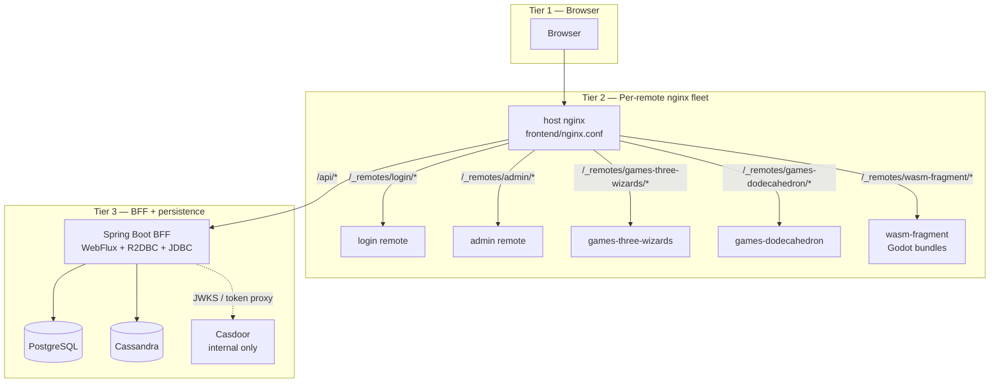
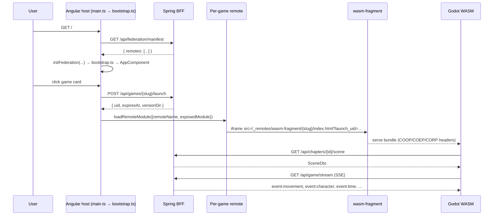

# 02 — Runtime architecture

> Mirror of [`chapters/02-runtime-architecture.tex`](../../publishing/architecture/chapters/02-runtime-architecture.tex).

The runtime data flow has three tiers:

1. **The player's browser** — federated Angular host, the active remote module, the WASM iframe.
2. **Per-remote nginx fleet** — host nginx, four route-or-game remotes, the asset-tier `wasm-fragment`.
3. **BFF + persistence** — Spring Boot WebFlux on top of Postgres and Cassandra, behind Casdoor.

## Three-tier topology



Each box is a Docker container. Arrows are HTTP routes proxied by the host nginx. The BFF is the only container that talks to Postgres / Cassandra / Casdoor.

## Browser-side flow



`SCENE_TYPE_TO_GAME_SLUG` forks the renderer; federated games mint a `launch_uid` for operational visibility; `TW_LEVEL_TRANSITION` `postMessage` is caught at the host level so it works regardless of which renderer is mounted.

### Why `globalThis` and not a service

The federation runtime can't be reached through Angular's DI without making `@angular-architects/native-federation` a static import into a route-handler chunk, which puts it on karma's module graph and breaks tests that don't load the federation runtime at all. Stashing the function on `globalThis` after bootstrap keeps the package out of karma's static graph and out of every route bundle that doesn't need it. See [decision 001](../decisions/001-native-federation.md).

## The host shell

The host nginx serves the host bundle plus a set of `location /_remotes/<slug>/` blocks that proxy each remote's `remoteEntry.json` and chunks. For `wasm-fragment` the host strips upstream COOP / COEP duplicates with `proxy_hide_header` and re-emits the canonical set so the WASM iframe loads with isolated headers.

## The remotes

| Slug | Kind | What it exposes / does |
|---|---|---|
| `login` | `remote-shell` | `./LoginComponent` — mounted via `loadComponent` on `/login`. Inline `POST /api/auth/token` + `sessionStorage.tw_auth` write, mirrors the host `AuthService.StoredAuth` shape. |
| `admin` | `remote-shell` | `./AdminShell` + `./UploadShell` — both expose under `federation_modules.slug='admin'` so `/admin` and `/admin/games` share a build. |
| `games-three-wizards` | `remote-game` | `./GameRoot` — Web Component (`createCustomElement`) with `@Input levelSlug + levelId + launchUid`. Renders cave and field. |
| `games-dodecahedron` | `remote-game` | `./GameRoot` — same pattern, single chrome-less scene. |
| `wasm-fragment` | `fragment` | Asset-tier nginx; bakes `backend/src/main/resources/assets/levels/` and serves at `/_remotes/wasm-fragment/<slug>/index.html`. |

## The BFF

[`backend/`](../../../backend/) runs as a single Spring Boot 3.4 application with both WebFlux (R2DBC, runtime path) and JDBC (Liquibase, blocking) wired in. Spring auto-config skips `DataSourceAutoConfiguration` when an R2DBC `ConnectionFactory` is present, so `JdbcDataSourceConfig` declares an explicit `@Primary HikariDataSource` of pool size 3 just for Liquibase to acquire on boot. See [decision 002](../decisions/002-r2dbc-jdbc-coexistence.md).

## Authentication and access

Casdoor is reachable only from inside the compose network. The host BFF proxies the login flow at `/api/auth/*` and verifies JWTs against the anonymous `/.well-known/jwks` endpoint (not `/api/get-jwks`, which requires admin auth and would 401 on every request). Per-game visibility is enforced by the `game_access` table — see [04 — Data model](04-data-model.md).

## Server-Sent Events — eight channels on one stream

[`GameStreamController`](../../../backend/src/main/java/games/snapdragon/bff/controller/GameStreamController.java) merges **eight** SSE channels onto a single `Flux<ServerSentEvent>`:

- Seven `Sinks.Many` from `GameStateService`: `movement`, `world`, `character`, `scene`, `input`, `audio`, `wasm-console`
- One from `GameTimeService`: `time`
- Plus a 15-second `Flux.interval` keepalive that fires immediately on subscribe so the response headers flush at connect time and the browser `EventSource.onopen` fires in milliseconds.

The latter three channels (`input`, `audio`, `wasm-console`) are part of the generalised input surface introduced for gamepad / mouse / keyboard / touch / audio support — see [04 — Data model](04-data-model.md#generalised-input-event-surface). Subscribers opt into individual channels via the EventSource event-listener model (`source.addEventListener('input', cb)`); merging onto the single connection keeps the host page from needing N EventSources.

### ⚠ The `autoCancel` trap

`Sinks.many().multicast().onBackpressureBuffer(N)` defaults to `autoCancel=true`. When every subscriber disconnects (iframe remount, EventSource reconnect, network blip), the sink terminates **permanently** and all subsequent `tryEmitNext` calls silently drop.

**Every sink in this project passes `autoCancel=false` explicitly.** If a freshly-deployed sink "works once and then silently dies", this is the cause. See [decision 003](../decisions/003-autocancel-false.md).

## Per-session SSE sink isolation

Multiplayer sessions add a new layer: `GameStateService` keeps a `ConcurrentHashMap<String, SessionSinks>` of per-session sink bundles alongside the legacy global sinks. When a control event arrives with a `sessionId`, the resulting `PlayerMovement` / `WorldState` / `CharacterDto` / `PlayerViewEvent` fans out on **both**:

- the **legacy global sink** (so the admin firehose at `/api/admin/stream` still sees everything across the fleet), and
- the **session-scoped sink** keyed by `sessionId` (so a subscriber to `/api/game/stream?sessionId=A` sees only session A's events).

The isolation contract is locked in by [`SessionIsolationTest`](../../../backend/src/test/java/games/snapdragon/bff/service/SessionIsolationTest.java) — emit on session A's sinks, assert session B's per-session subscriber sees nothing. Five specs cover movement, world, view, bidirectional isolation, and the legacy single-player path's non-leakage.

```mermaid
flowchart LR
    A[Player A — session α] -->|POST /api/controls/{cidA}<br/>X-Session-Id: α| BFF
    B[Player B — session β] -->|POST /api/controls/{cidB}<br/>X-Session-Id: β| BFF
    BFF --> Global[Global sink<br/>admin firehose]
    BFF --> SinkA[SessionSinks α]
    BFF --> SinkB[SessionSinks β]
    Global --> AdminAll[GET /api/admin/stream]
    SinkA --> SubA[GET /api/game/stream?sessionId=α]
    SinkB --> SubB[GET /api/game/stream?sessionId=β]
    classDef noleak fill:#ffe5e5,stroke:#a14a4a;
    SinkA -.|never reaches B| SubB:::noleak
    SinkB -.|never reaches A| SubA:::noleak
```

A new **`view`** channel carries per-player camera/orientation samples (~10 Hz) that the Rust GDExtension's `view_egress` signal feeds. Admins watch via `/api/admin/sessions/{id}/stream`. See [decision 010](../decisions/010-per-session-sse-sinks.md) and [decision 013](../decisions/013-player-view-channel.md).

---

Previous: [01 — Overview](01-overview.md) · Next: [03 — Module Federation](03-federation.md).
