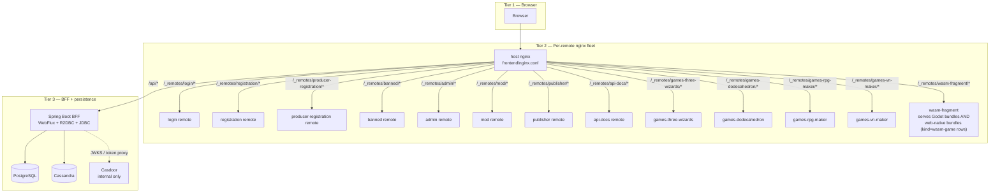
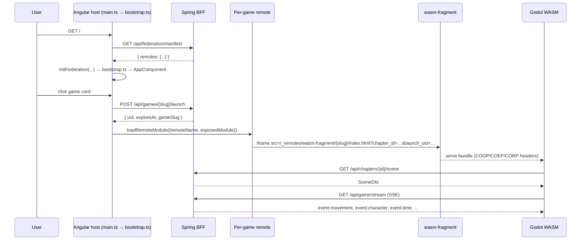
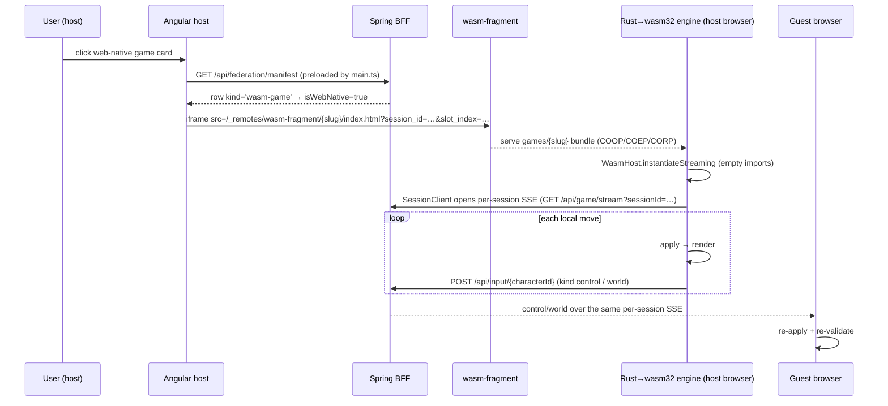
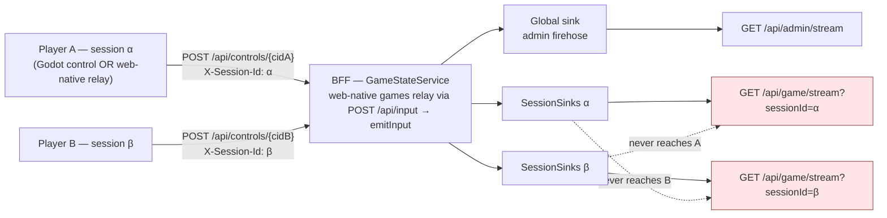

# 02 — Runtime architecture

> Mirror of [`chapters/02-runtime-architecture.tex`](../../publishing/architecture/chapters/02-runtime-architecture.tex).

Data flows through three tiers:

1. **The player's browser**: the federated Angular host, the active remote module, and the WASM iframe (Godot or web-native).
2. **Per-remote nginx fleet**: the host nginx, twelve remotes, and the asset-tier `wasm-fragment`, which serves both the Godot bundles and the web-native bundles.
3. **BFF + persistence**: Spring Boot WebFlux on top of Postgres and Cassandra, behind Casdoor.

## Three-tier topology

Each box is a Docker container. Arrows are HTTP routes proxied by the host nginx. The BFF is the only container that talks to Postgres, Cassandra or Casdoor.

## Browser-side flow

`SCENE_TYPE_TO_GAME_SLUG` (in `home.component.ts`) picks the renderer. Every launch path mints a `launch_uid` for operational visibility. `HomeComponent` catches the `TW_CHAPTER_TRANSITION` `postMessage`, so it works whichever renderer is mounted. The sequence above is the **Godot** (server-authoritative) launch path.

### Browser-side flow — web-native (host-authoritative)

The 14 web-native titles take a different path. The host reads `isWebNative` off the manifest (`kind='wasm-game'`), mounts the `games/<slug>` bundle from `wasm-fragment`, and the **host browser runs the Rust engine**.

The host POSTs control and world events to `/api/input/{characterId}`. `GameStateService.emitInput` puts them on the session's SSE sinks. A `world` event goes to the session's `worldNative` sink, which `GameStreamController` merges into the `world` SSE event. The guest re-applies and re-validates.

Reference: [`games/_shared/README.md`](../../../games/_shared/README.md) (the `WasmHost` / `SessionClient` / `mountGame` shell) and [decision 016](../decisions/016-rust-extension-and-fragment-relay.md).

### Why `globalThis` and not a service

Angular's DI cannot reach the federation runtime unless `@angular-architects/native-federation` becomes a static import in a route-handler chunk. That puts the package on karma's module graph and breaks tests that never load the federation runtime. `main.ts` stashes the function on `globalThis` instead. This keeps the package out of karma's static graph and out of every route bundle that doesn't need it. See [decision 001](../decisions/001-native-federation.md).

## The host shell

The host nginx serves the host bundle and a set of `location /_remotes/<slug>/` blocks that proxy each remote's `remoteEntry.json` and chunks. For `wasm-fragment`, it strips the upstream COOP / COEP headers with `proxy_hide_header` and emits one canonical set, so the WASM iframe loads with isolated headers.

## The remotes

| Slug | Kind | What it exposes / does |
|---|---|---|
| `login` | `remote-shell` | `./LoginComponent`, mounted via `loadComponent` on `/login`. Posts `/api/auth/token` and writes `localStorage.tw_auth`, mirroring the host `AuthService.StoredAuth` shape. |
| `registration` | `remote-shell` | `./RegistrationComponent`, an intake form. Built, proxied and seeded (changelog 039), but `app.routes.ts` has no route that loads it. |
| `producer-registration` | `remote-shell` | `./ProducerRegistrationComponent`, the producer/mod application form. POSTs to `/api/producer-contacts`. Seeded by changelog 040; `app.routes.ts` has no route that loads it. |
| `banned` | `remote-shell` | `./BannedComponent`. Resolves the appeal email via `GET /api/security/appeal-contact`. The host does not load it. `/banned` is the host's own `BannedPageComponent`, which the auth guard and `AdminActionsListenerService` reach after `GET /api/me/ban-status`. |
| `admin` | `remote-shell` | `./AdminShell`, `./UploadShell` and `./SessionsShell`. All three expose under `federation_modules.slug='admin'`, so `/admin`, `/admin/games` and `/admin/sessions` share a build. |
| `mod` | `remote-shell` | `./ModShell`, the per-game moderation surface. Mounted on `/mod`, gated by `mod_game_scopes`. |
| `publisher` | `remote-shell` | `./PublisherShell`: uploads and per-game grants. Mounted on `/publisher`, gated by `publisher_game_scopes`. |
| `api-docs` | `remote-shell` | `./DocsShell` (plus `./ApiExplorer` and `./ApiReference`), an OpenAPI explorer: live `/v3/api-docs`, with a fallback path per service. Mounted at `/admin/docs`. The BFF serves `/v3/api-docs` to admins only in the prod profile. |
| `games-three-wizards` | `remote-game` | `./GameRoot`, a Web Component (`createCustomElement`) with `@Input`s `chapterSlug`, `chapterId`, `launchUid`, `sessionId`, `slotIndex` and `localCharacterId`. Renders cave and field. |
| `games-dodecahedron` | `remote-game` | `./GameRoot`, same pattern, single chrome-less scene. Takes `launchUid` only. |
| `games-rpg-maker` | `remote-shell` | `./RpgMakerShell`, a Mudlet-shaped RPG editor. Drives the `rpg-builder/` side service at `/api/rpg/*`. Mounted at `/rpg-maker`. |
| `games-vn-maker` | `remote-shell` | `./VnMakerShell`, a visual-novel editor. Drives the `vn-builder/` side service at `/api/vn/*`. Mounted at `/vn-maker`. |
| `wasm-fragment` | `fragment` | Asset-tier nginx. Bakes in `backend/src/main/resources/assets/levels/` and serves it at `/_remotes/wasm-fragment/<slug>/index.html`. Serves **both** the Godot bundles **and** the web-native bundles, with no per-game container for the latter. |
| `<game-slug>` (×18) | `wasm-game` | The 14 web-native titles (seeded by [`051-web-game-federation.xml`](../../../backend/src/main/resources/db/changelog/051-web-game-federation.xml)) **plus** four Godot games that use this kind instead of a per-game Angular remote: `games-chess-godot` ([`053`](../../../backend/src/main/resources/db/changelog/053-chess-godot-federation.xml)), `games-connect-four-godot` ([`055`](../../../backend/src/main/resources/db/changelog/055-connect-four-godot-federation.xml)), `games-shadows-of-the-net` ([`056`](../../../backend/src/main/resources/db/changelog/056-shadows-of-the-net-federation.xml), the pure-GDScript XR chat room) and `games-character-forge` ([`062`](../../../backend/src/main/resources/db/changelog/062-character-forge-federation.xml), the single-player character maker). `remote_entry_url` points **directly** at `/_remotes/wasm-fragment/<slug>/index.html` (not a `remoteEntry.json`), `exposed_module=NULL`, and `game_slug` carries the catalog slug. The host reads `isWebNative` off the manifest and mounts the bundle as a parametrised iframe. `main.ts` passes only `remote-game` and `remote-shell` rows to `initFederation`, so `wasm-game` rows stay out of it. See [decision 016](../decisions/016-rust-extension-and-fragment-relay.md). |

## The BFF

[`backend/`](../../../backend/) is one Spring Boot 4.0 application. WebFlux with R2DBC is the runtime path, and blocking JDBC runs Liquibase. Spring auto-config skips `DataSourceAutoConfiguration` when an R2DBC `ConnectionFactory` exists, so `JdbcDataSourceConfig` declares an explicit `@Primary HikariDataSource` with pool size 3. Liquibase uses it at boot and nothing else does. See [decision 002](../decisions/002-r2dbc-jdbc-coexistence.md).

## Authentication and access

Casdoor is reachable only from inside the compose network. The BFF exchanges credentials for tokens at `POST /api/auth/token`. It verifies JWTs against the anonymous `/.well-known/jwks` endpoint, not `/api/get-jwks`, which needs admin auth and would 401 on every request. The `game_access` table enforces per-game visibility; see [04 — Data model](04-data-model.md).

## Server-Sent Events — nine channels on one stream

[`GameStreamController`](../../../backend/src/main/java/games/hugmesh/bff/controller/GameStreamController.java) merges **nine** SSE channels onto a single `Flux<ServerSentEvent>`:

- Eight `Sinks.Many` from `GameStateService`: `movement`, `world`, `character`, `scene`, `input`, `audio`, `wasm-console`, `session-control`.
- One from `GameTimeService`: `time`.
- A 15-second `Flux.interval` keepalive. It fires on subscribe, so the response headers flush at connect time and the browser's `EventSource.onopen` fires within milliseconds.

The `input`, `audio` and `wasm-console` channels belong to the generalised input surface for gamepad, mouse, keyboard, touch and audio; see [04 — Data model](04-data-model.md#generalised-input-event-surface). The `session-control` channel carries session lifecycle events (pause / resume / close): per-session when a `sessionId` is supplied, global otherwise.

A keepalive is an SSE comment line, not a named event. A stream opened with `?sessionId=` needs a JWT and an active membership in that session (401 or 403 otherwise). Admins may watch any session. The global stream stays open to anonymous spectators.

Subscribers pick channels with the EventSource listener model (`source.addEventListener('input', cb)`). One merged connection spares the host page from opening N EventSources.

### ⚠ The `autoCancel` trap

`Sinks.many().multicast().onBackpressureBuffer(N)` defaults to `autoCancel=true`. When every subscriber disconnects (iframe remount, EventSource reconnect, network blip), the sink terminates **permanently** and every later `tryEmitNext` call silently drops.

**Every sink in this project passes `autoCancel=false` explicitly.** If a freshly deployed sink "works once and then silently dies", this is the cause. See [decision 003](../decisions/003-autocancel-false.md).

## Per-session SSE sink isolation

Multiplayer sessions add a layer. `GameStateService` keeps a `ConcurrentHashMap<String, SessionSinks>` of per-session sink bundles beside the legacy global sinks. When a control event arrives with a `sessionId`, the resulting `PlayerMovement` / `WorldState` / `CharacterDto` / `PlayerViewEvent` fans out on **both**:

- the **legacy global sink**, so the admin firehose at `/api/admin/stream` still sees everything across the fleet, and
- the **session-scoped sink** keyed by `sessionId`, so a subscriber to `/api/game/stream?sessionId=A` sees only session A's events.

[`SessionIsolationTest`](../../../backend/src/test/java/games/hugmesh/bff/service/SessionIsolationTest.java) locks in the contract: emit on session A's sinks, assert that session B's subscriber sees nothing. Eight specs cover movement (both directions), world, view, input, an input with no session, bidirectional isolation, and the legacy single-player path's non-leakage.

The same per-session sinks carry the **web-native game relay**. When a host browser posts a control or world event to `/api/input/{characterId}`, `GameStateService.emitInput` fans it out to that session's `input` sink (and, for `world`, the `worldNative` sink). The isolation guarantee above therefore covers web-native multiplayer.

`reemitToSession` is the other path. It is private, and only the Kafka cross-pod handlers call it (see [04](04-data-model.md#streaming-audit--telemetry-pipeline-kafka--clickhouse)).

A **`view`** channel carries per-player camera and orientation samples (~10 Hz) from the Rust GDExtension's `view_egress` signal. Admins watch it at `/api/admin/sessions/{id}/stream`. See [decision 010](../decisions/010-per-session-sse-sinks.md) and [decision 013](../decisions/013-player-view-channel.md).

---

Previous: [01 — Overview](01-overview.md) · Next: [03 — Module Federation](03-federation.md).
