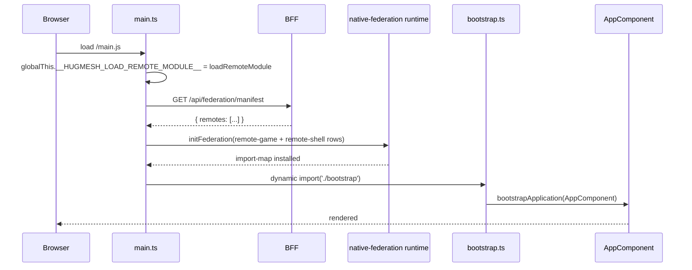

# 03 — Module Federation

> Mirror of [`chapters/03-federation.tex`](../../publishing/architecture/chapters/03-federation.tex).

The host shell loads *everything* above the WASM iframe through `@angular-architects/native-federation`. Adding a new route-bearing remote means adding a row to `federation_modules`, shipping a per-remote bundle, and pointing `loadComponent` at the exposed module. Adding a new game means the same plus an `<app-<slug>-remote>` Web Component the host can place in its template.

See also: [howto/add-federated-route.md](../howto/add-federated-route.md).

## The two ordering rules

1. **`initFederation` before `bootstrapApplication`.** [`frontend/src/main.ts`](../../../frontend/src/main.ts) dynamic-imports `bootstrap.ts` after the federation runtime resolves. Static imports of `@angular/*` from `main.ts` would be evaluated before the import map is installed and would therefore fail to resolve.
2. **Remote-loader access through `globalThis`.** Route handlers reach the federation runtime through `globalThis.__HUGMESH_LOAD_REMOTE_MODULE__`. `main.ts` sets it at the top of the file, before it fetches the manifest; `loadRemote` rejects with `initFederation didn't run` if it is missing. This keeps `@angular-architects/native-federation` out of karma's static graph and out of every route-handler bundle.

## Federation bootstrap



The host fetches the manifest once per page load (`main.ts` preloads it into `__HUGMESH_FEDERATION_MANIFEST__`, and `FederationService` caches it), so a new row shows up on the next page load. A new `wasm-game` row needs no host change at all. A new route-bearing remote also needs a route in `app.routes.ts`, so it needs a host rebuild.

## The manifest endpoint

`GET /api/federation/manifest` is **DB-backed and public on purpose** because the host needs the `login` remote URL before any user has authenticated. It returns the active rows of `federation_modules` ordered by `kind, slug`:

```json
{
  "generatedAt": "2026-04-26T05:30:11Z",
  "remotes": [
    { "slug": "login",  "kind": "remote-shell",
      "remoteEntryUrl": "/_remotes/login/remoteEntry.json",
      "exposedModule": "./LoginComponent", "gameSlug": null,
      "displayName": "Login",  "version": "0.1.0", "metadata": "{\"public\":true}" },
    { "slug": "admin",  "kind": "remote-shell",
      "remoteEntryUrl": "/_remotes/admin/remoteEntry.json",
      "exposedModule": "./AdminShell", "gameSlug": null,
      "displayName": "Admin Console",  "version": "0.1.0", "metadata": "{\"requiresRole\":\"admin\"}" }
    /* ...games-three-wizards, games-dodecahedron, wasm-fragment... */
  ]
}
```

## Shared dependencies

[`frontend/federation-base.mjs`](../../../frontend/federation-base.mjs) (the configs import the `.mjs`; a `.js` twin sits beside it) holds the shared-package configuration, so the host and every remote share one set of packages:

```javascript
// frontend/federation-base.mjs (abridged)
export const STD_SKIP = ['rxjs/ajax', 'rxjs/fetch', 'rxjs/testing', 'rxjs/webSocket'];
export const STD_SHARED = shareAll({
  singleton: true, strictVersion: true, requiredVersion: 'auto',
});
export function hugmeshRemote({ name, exposes, extraSkip = [] }) { /* withNativeFederation(...) */ }
export function hugmeshHost({ name = 'hugmesh-host', extraSkip = [] } = {}) { /* withNativeFederation(...) */ }
```

`shareAll` with `singleton: true` and `strictVersion: true` loads each shared package **once per page**. Mismatched versions across remotes produce the `NG0203 inject() must be called from an injection context` runtime error, the federation-shaped variant of the more familiar `NullInjectorError`.

## Routing into a remote

The `loadRemote<T>` helper in [`frontend/src/app/app.routes.ts`](../../../frontend/src/app/app.routes.ts) is what every federated route reaches for:

```ts
export function loadRemote<T>(remoteName: string, exposedModule: string, exportName: string): Promise<Type<T>> {
  const fn = (globalThis as { __HUGMESH_LOAD_REMOTE_MODULE__?: LoadRemoteModuleFn }).__HUGMESH_LOAD_REMOTE_MODULE__;
  if (!fn) return Promise.reject(new Error(`[routes] loadRemoteModule missing — initFederation didn't run`));
  return fn({ remoteName, exposedModule }).then(mod => {
    const cls = mod[exportName];
    if (typeof cls !== 'function') throw new Error(`[routes] ${remoteName}/${exposedModule}: export "${exportName}" not a class`);
    return cls as Type<T>;
  });
}
```

Each federated route wraps it in `loadComponent: () => loadRemote(...)`:

```ts
{ path: 'login',          loadComponent: () => loadRemote('login',           './LoginComponent',  'LoginRemoteComponent')     },
{ path: 'admin',          loadComponent: () => loadRemote('admin',           './AdminShell',      'AdminRemoteComponent')     },
{ path: 'admin/games',    loadComponent: () => loadRemote('admin',           './UploadShell',     'UploadRemoteComponent')    },
{ path: 'admin/sessions', loadComponent: () => loadRemote('admin',           './SessionsShell',   'SessionsRemoteComponent')  },
{ path: 'admin/docs',     loadComponent: () => loadRemote('api-docs',        './DocsShell',       'DocsShellComponent')       },
{ path: 'mod',            loadComponent: () => loadRemote('mod',             './ModShell',        'ModRemoteComponent')       },
{ path: 'publisher',      loadComponent: () => loadRemote('publisher',       './PublisherShell',  'PublisherRemoteComponent') },
{ path: 'rpg-maker',      loadComponent: () => loadRemote('games-rpg-maker', './RpgMakerShell',   'RpgMakerRemoteComponent')  },
{ path: 'vn-maker',       loadComponent: () => loadRemote('games-vn-maker',  './VnMakerShell',    'VnMakerRemoteComponent')   },
```

Those nine are the only federated routes. `/banned` is the host's own `BannedPageComponent`, and no route loads the `registration`, `producer-registration` or `banned` remotes. Per-game rendering is not a route: `HomeComponent` picks the renderer from `SCENE_TYPE_TO_GAME_SLUG`.

## Maker remotes (RPG + VN)

Two more federated remotes — `games-rpg-maker` and `games-vn-maker` — mount at `/rpg-maker` and `/vn-maker`. They are *editor* remotes, not game remotes: the host shell loads them as plain Angular components (no Web-Component wrapper, no iframe), and they POST to side-service REST surfaces (`/api/rpg/*` and `/api/vn/*`) backed by the [`rpg-builder/`](../../../rpg-builder/) and [`vn-builder/`](../../../vn-builder/) Spring services. Their `federation_modules` rows are seeded by [`037-rpg-and-vn-maker-federation.xml`](../../../backend/src/main/resources/db/changelog/037-rpg-and-vn-maker-federation.xml). The publisher console has "Launch RPG Maker" / "Launch Visual Novel Maker" buttons that `window.open` these in a new tab (`noopener`), so a publisher can keep the upload form alive while authoring. See [decision 018](../decisions/018-rpg-and-vn-makers.md).

## Per-game federation

A game remote exposes a *Web Component* (built with `createCustomElement` and registered with `customElements.define`). The host places it as a normal element:

```html
@switch (activeRemoteSlug) {
  @case ('three-wizards') {
    <app-three-wizards-remote
      [chapterSlug]="activeLevel.sceneType"
      [chapterId]="activeLevel.id"
      [launchUid]="activeLaunchUid"
      [sessionId]="activeSessionId"
      [slotIndex]="activeSlotIndex"
      [localCharacterId]="characterId" />
  }
  @case ('dodecahedron') {
    <app-dodecahedron-remote [launchUid]="activeLaunchUid" />
  }
}
```

The remote builds an iframe URL that points at the `wasm-fragment` remote (from `three-wizards-remote.component.ts`):

```ts
const params = new URLSearchParams();
if (id !== '') params.set('chapter_id', String(id));
if (this._launchUid) params.set('launch_uid', this._launchUid);
if (this._sessionId) params.set('session_id', this._sessionId);
if (this._slotIndex !== null) params.set('slot_index', String(this._slotIndex));
if (this._localCharacterId !== null) params.set('character_id', String(this._localCharacterId));
params.set('t', String(Date.now()));
const url = `/_remotes/wasm-fragment/${this._levelSlug}/index.html?${params}`;
```

The cache-busting `t=...` parameter is intentional: the iframe HTML is small and cheap, but the browser is otherwise prone to caching it across rebuilds and showing a stale Godot bundle.

## Error handling

When a federated chunk fails to load (host nginx down, remote returned 500, network drop), the host's [`AppComponent`](../../../frontend/src/app/app.component.ts) subscribes to `Router.events` and shows a banner with the human-readable label of the broken route, plus a *Retry* button. The label lookup uses `FEDERATED_ROUTE_LABELS`, listed most-specific first so `/admin/games` resolves before `/admin`.

### ⚠ CORP saves WASM iframes

WASM games loading inside the federated iframe need:

1. `Cross-Origin-Resource-Policy: cross-origin` on the `wasm-fragment` response
2. The host nginx must strip any duplicate COOP / COEP headers from the upstream and re-emit a single canonical set

Missing CORP shows up as `net::ERR_BLOCKED_BY_RESPONSE`; duplicates show up as `NotSameOriginAfterDefaultedToSameOriginByCoep`. **Both are silent in DevTools' *Console* but show clearly in *Network*'s *Cross-origin isolation* column.**

---

Previous: [02 — Runtime architecture](02-runtime.md) · Next: [04 — Data model](04-data-model.md).
