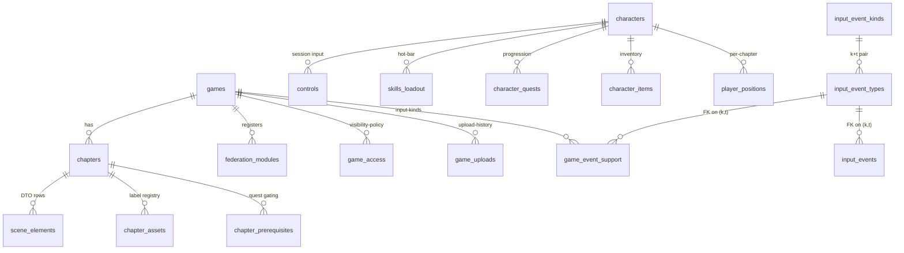

# 04 — Data model

> Mirror of [`chapters/04-data-model.tex`](../../publishing/architecture/chapters/04-data-model.tex).

PostgreSQL holds the canonical relational state. Cassandra is a write-through cross-pod cache for movement events, an audit log for game state transitions, and a session store for short-lived browser tokens. Liquibase drives schema migration through 28+ changelogs at the head of `main`; only Postgres is migrated this way — Cassandra schemas are bootstrapped by an init container.

> **Naming note** — the current schema uses `chapter` (formerly `level`) and `instant` (formerly `spell`). See [decision 006](../decisions/006-naming-rename.md). Filenames under `backend/src/main/resources/assets/levels/<slug>/` did not move; only the schema and code did.

## Core relational schema

### Games and chapters

| Table | Purpose |
|---|---|
| `games` | Umbrella row per game. `slug` is the federation key (matches `federation_modules.slug`); `current_version_dir` is the hash-prefixed directory under `app.uploads.games-dir` that the runtime serves from. |
| `chapters` | One row per WASM bundle. `asset_url` resolves to either `/api/assets/levels/<slug>/index.html` (legacy) or `/_remotes/wasm-fragment/<slug>/index.html` (federated). |
| `scene_elements` | Per-chapter DTO rows that `scene_loader.gd` pulls from `GET /api/chapters/{id}/scene`. |
| `chapter_assets` | Optional registry for runtime-loaded textures / plugins / audio, looked up by `label` from GDScript via `ApiClient.resolve_asset(chapter_id, label, cb)`. |
| `chapter_prerequisites` | Quest gating: a chapter shows as locked on the home page until its quest is complete. |

### Federation, access, and uploads

| Table | Purpose |
|---|---|
| `federation_modules` | Source of truth for the federation manifest. Rows include `kind` (`remote-shell` / `remote-game` / `fragment`), `remote_entry_url`, and `exposed_module`. Read by `FederationController`. |
| `game_access` | Per-game visibility policy. `(scope, scope_value)` can be `(all, NULL)` / `(role, ROLE_PLAY_X)` / `(user, <casdoor-id>)`; the unique constraint `uq_game_access_triple` keeps inserts idempotent. See [decision 009](../decisions/009-game-access-scopes.md). |
| `game_launches` | 256-bit URL-safe `launch_uid` per session, with a `version_dir` snapshot from `games.current_version_dir` at mint time so an in-flight launch keeps reading from its install even after a hot upload supersedes it. TTL 15 minutes; the `GameLaunchSweeper` closes stale rows. See [decision 005](../decisions/005-launch-uid-versioning.md). |
| `game_uploads` | One row per upload zip, with the `manifest_json` text (jsonb → text per migration 024-1) and a `superseded_at` timestamp on rollback. Bound by `app.uploads.versions-to-keep` via `GameUploadPruner`. |

### Players, sessions, and progression

| Table | Purpose |
|---|---|
| `characters` | One canonical character per Casdoor user, with `position_x/y/z`, `rotation_y`, HP / MP / XP, and `current_chapter_id`. |
| `skills_loadout` | Per-character skill-slot binding (key index → skill). |
| `quests`, `character_quests` | Quest catalog and per-character progress. |
| `items`, `character_items` | Inventory. |
| `controls` | Sessionised input state — at most one row per `(character_id, session_id)`; only the holder of the controller role for a session may POST. |
| `player_positions` | One row per `(character_id, chapter_id)` — Liquibase 027 promoted the legacy single-row-per-character layout into a per-chapter layout so a character traversing cave → field → cave returns to the cave coordinates they last had on re-entry instead of clobbering them across chapters. Cassandra's `character_position_cache` (composite partition `(character_id, chapter_id)`) is the cross-pod read cache that lets pod B see a position pod A wrote within one SSE round-trip; Postgres backs the cache when the 5-minute TTL drops a row. See [decision 007](../decisions/007-cassandra-position-cache.md). |
| `admin_actions` | Append-only audit ledger of admin moderation: `kick`, `ban`, `unban`. Drives the `BanGateFilter` and the `/banned` page. |

## Migration ordering

Migrations 001–017 are pre-federation. The federation work landed in:

- `018-federation-modules.xml` — `federation_modules` + seed rows for the four remotes plus `wasm-fragment`.
- `019-game-access.xml` — `game_access` + `uq_game_access_triple`.
- `020-game-launches.xml` — `game_launches`.
- `021-game-uploads.xml` — `game_uploads`.
- `022-federation-relative-urls.xml` — rewrites absolute remote URLs to relative paths.
- `023-launch-version-pin.xml` — adds `version_dir` to `game_launches`.
- `024-game-uploads-manifest-text.xml` — `ALTER manifest_json jsonb → text` plus `setval(games_id_seq, MAX(id))` (the integration test surfaced both as latent bugs).
- `025-admin-actions.xml` — kick / ban audit ledger.
- `026-input-event-kinds.xml` — generalised input surface (see below).
- `027-per-chapter-positions.xml` — `player_positions` keyed by `(character_id, chapter_id)`.
- `028-rename-chapter-instant.xml` — domain rename pass; extended in PR #24 with five follow-up changesets.
- `029-admin-actions.xml` — moderator audit ledger (kick / ban / unban).
- `030-game-sessions.xml` — `game_sessions` + `session_members` for multiplayer; partial unique indexes enforce one-active-slot-per-session and one-active-row-per-(session, casdoor).
- `031-system-settings.xml` — generic key/value table seeded with `wasm_console_debug_enabled='false'`.
- `032-mod-game-scopes.xml` — `mod_game_scopes` + `publisher_game_scopes` for per-game RBAC; seed rows for the per-game seeded users.
- `033-mod-publisher-federation.xml` — `federation_modules` rows for the new `mod` and `publisher` federated remotes.
- `036-widen-session-ids-for-sha3.xml` — widens `game_sessions.id` and `session_members.session_id` from `varchar(36)` to `varchar(64)` so the SHA3-256-derived UIDs minted by [`Crypto.mintUid()`](../../../backend/src/main/java/games/snapdragon/bff/util/Crypto.java) (43 base64url chars) fit. Old UUID-shape rows continue to fit; new rows are SHA3.

**Never edit a previously-merged changeset.** When something is missed, append a new changeset with `<preConditions onFail="MARK_RAN">` so re-runs are idempotent.

## R2DBC + JDBC coexistence

Runtime data access is non-blocking R2DBC. Liquibase needs a blocking JDBC `DataSource`, so [`JdbcDataSourceConfig`](../../../backend/src/main/java/games/snapdragon/bff/config/JdbcDataSourceConfig.java) declares an explicit `@Primary HikariDataSource` (pool size 3) just for the migration phase. R2DBC then connects in parallel against the same database via the `spring.r2dbc.url` property. See [decision 002](../decisions/002-r2dbc-jdbc-coexistence.md).

### ⚠ MVCC snapshot race

`@PostConstruct` services that touch the database can run **before** Liquibase commits, locking their R2DBC connection into a pre-migration snapshot. The fix in this codebase is `@DependsOn("liquibase")` on `GameTimeService` and `GameStateService`, plus `spring.r2dbc.pool.initial-size=0` in tests so the pool only opens connections after Liquibase finishes. Without these, the symptom is `BadSqlGrammarException: relation does not exist` from a query the test fixture clearly sets up.

## Cassandra cache

The Cassandra keyspace holds:

- **Movement events** — write-through buffer for `ControlEvent`s; the SSE stream reads from Postgres but Cassandra holds the recent N events for fast cross-pod replay.
- **Position cache** — `character_position_cache` partitioned `(character_id, chapter_id)` with 5-minute TTL. Cross-pod write-through so pod B sees pod A's position write within one SSE round-trip.
- **Audit log** — every state transition emitted by `GameStateService` is persisted with `(character_id, occurred_at)` as the primary key.
- **Session store** — short-lived per-tab tokens bound to a Casdoor user, used by the BFF to refuse `/api/controls` requests from a tab that's not currently the controller for the target session.
- **`session_membership`** — cross-pod presence index for multiplayer sessions, partition `(session_id)`, clustered by `casdoor_id`. 30 s TTL refreshed on every SSE keepalive tick so a pod crash drops the rows naturally.
- **`session_view_state`** — per-(session, slot) ring of the most recent `PlayerViewEvent`s emitted by the Rust GDExtension's `view_egress` signal. 60 s TTL; admins joining the per-session view stream see the latest sample immediately instead of waiting for the next 10 Hz tick.

A nightly `CassandraSyncService` reconciles audit-log totals back into Postgres counters so dashboards stay consistent across reboots.

## Multiplayer session schema

Five Postgres tables make up the multiplayer + RBAC surface:

| Table | Purpose |
|---|---|
| `game_sessions` | Durable session ledger — `(id UUID, name, game_slug, creator_casdoor_id, max_players, created_at, closed_at)`. `closed_at IS NULL` = open. |
| `session_members` | Membership history. `(session_id, casdoor_id, character_id, slot_index, is_creator, joined_at, left_at)`. Two partial unique indexes — one slot per session, one active row per (session, casdoor). |
| `mod_game_scopes` | Per-game mod assignments. `(casdoor_id, game_slug, granted_by, granted_at, revoked_at, revoked_by)`. Soft-delete on revoke. |
| `publisher_game_scopes` | Same shape as `mod_game_scopes` but for publisher capability. |
| `system_settings` | `(key, value, updated_at, updated_by)` — runtime-toggled flags. Seeded with `wasm_console_debug_enabled='false'`. |

See [decision 010](../decisions/010-per-session-sse-sinks.md), [decision 011](../decisions/011-mod-publisher-rbac.md), [decision 012](../decisions/012-debug-mode-gate.md).

### Identifier shape: SHA3-256, not UUID

`game_sessions.id` and every other URL-facing UID (launch tokens, session tokens, pod ids) are minted by [`Crypto.mintUid()`](../../../backend/src/main/java/games/snapdragon/bff/util/Crypto.java): a SHA3-256 digest of 64 random bytes from a BouncyCastle SP800-90A HMAC-SHA256 DRBG, encoded as URL-safe base64. The result is one 43-character token per UID — no leading entropy bytes, no version bits, no dashes.

This replaces every prior call site of `UUID.randomUUID()` and JDK `SecureRandom`. The migration was driven by three goals:

1. **One source of randomness.** `Crypto` is the only place that touches the DRBG; every other component asks it for bytes or a UID. Auditing entropy hygiene is a single-file review.
2. **NIST-aligned construction.** SP800-90A HMAC-SHA256 with SHA3-256 mixing has a clearer cryptographic chain of custody than `SecureRandom + Type-4 UUID`.
3. **Indistinguishable shape across UID kinds.** Launch UIDs, session ids, session tokens, pod ids — all the same 43-char base64url shape, so a leak through a log line is equally hard to backtrack regardless of category.

Liquibase 036 widens the legacy `varchar(36)` columns; older UUID-shape rows continue to fit and are not migrated.

### Session-scoped control authorization

Two players in different sessions may legitimately use the same `character_id` (e.g. both pick "wizard 1" in their own lobby). The unscoped `findActiveOwnerOfCharacter(character_id)` returns whichever row Postgres picks first, which means the second player's `POST /api/controls/{id}` always 403s with "character not owned by caller".

Mitigation: when a control arrives with `X-Session-Id`, the controller passes that header through to the session-scoped overload `authorizeControl(casdoorId, characterId, sessionId)` which calls [`SessionMemberRepository.findActiveOwnerInSession(sessionId, characterId)`](../../../backend/src/main/java/games/snapdragon/bff/repository/SessionMemberRepository.java). The `(session_id, character_id)` tuple is unique among active members thanks to the partial constraint on `session_members`, so the lookup deterministic.

## Generalised input event surface

The five legacy game tables (`characters`, `controls`, `skills_loadout`, …) cover JRPG-shaped gameplay; the input surface added in changeset 026 covers *everything Godot can consume*: gamepad button / axis, mouse motion / button / wheel, keyboard up / down, touch gestures, audio cues, world events, plus the legacy control commands as one kind among many.

Three reference tables anchor the schema; an append-only audit table writes against them.

| Table | Purpose |
|---|---|
| `input_event_kinds` | Reference. PK on `kind`. Closed vocabulary: `gamepad`, `mouse`, `keyboard`, `touch`, `audio`, `world`, `control`. Seeded by Liquibase 026. |
| `input_event_types` | Reference. **Composite** PK `(kind, type)`. Per-kind type vocabulary (e.g. `gamepad: button_down / button_up / axis / connected / disconnected / rumble_ack`) plus an `example_payload` (jsonb) used by the upload-time validator and the OpenAPI explorer's sample generator. |
| `game_event_support` | Per-game opt-in. **Composite** PK `(game_slug, event_kind, event_type)`, FK to `input_event_types(kind, type)`. The Snapdragon Export plugin writes one row per declared event during upload; the BFF refuses any input emit whose triple isn't enabled here, regardless of what the client sends. |
| `input_events` | Append-only audit log. FK on `(event_kind, event_type)` into `input_event_types` so a row can never reference an unknown type. Indexed on `(character_id, occurred_at)`, `(session_id, occurred_at)`, and `(event_kind, occurred_at)` for replay + analytics. |
| `games.features` | New `jsonb` column. Per-game feature flags: `instant_loadout`, `quests`, `items`, `char_progression` (the JRPG subsystems — non-JRPG games turn these off and the matching endpoints return `405`); `audio`, `gamepad`, `mouse`, `keyboard`, `touch` (input-kind gates). |

The validation flow on every input emit is three gates:

1. `(kind, type)` must exist in `input_event_types` (400 if not).
2. `games.features.<kind>` must be true for the active game (405 if not).
3. `(game_slug, kind, type)` must be present in `game_event_support` (405 if not).

Same surface persists every browser-tier gamepad poll, every WASM-iframe console line forwarded by the host shell, every audio cue the Godot bundle emits. The Rust GDExtension's `HostBridge` ships matching typed signals (`gamepad_received`, `mouse_received`, `keyboard_received`, `touch_received`, `audio_received`, plus outbound `audio_egress` and `console_egress`) so a Godot developer wires gameplay to named signals without caring whether the source was a player's USB Pro Controller, a `<kbd>W</kbd>` keypress, or an SSE emit from a cross-tab subscriber.

---

Previous: [03 — Module Federation](03-federation.md) · Next: [05 — API + service reference](05-api-reference.md).
