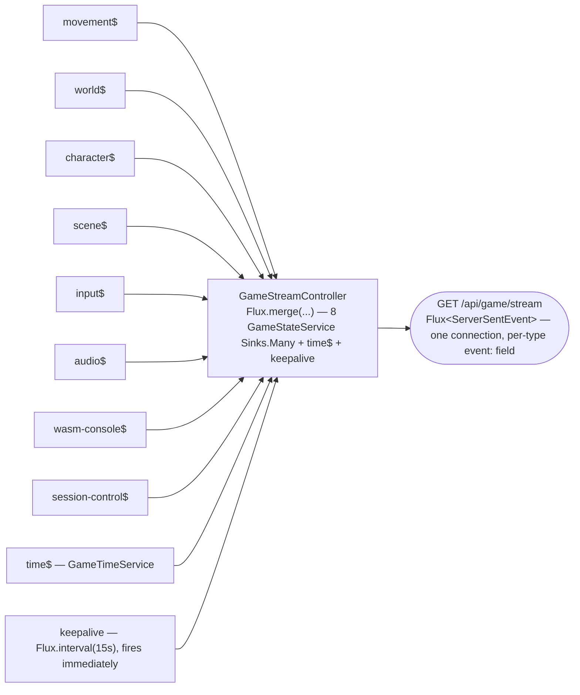
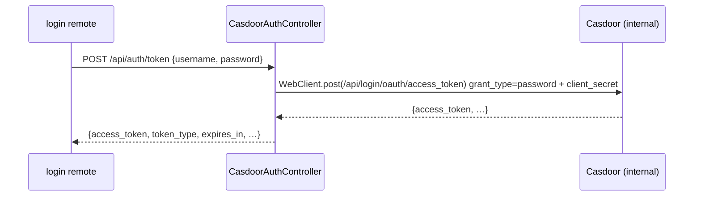
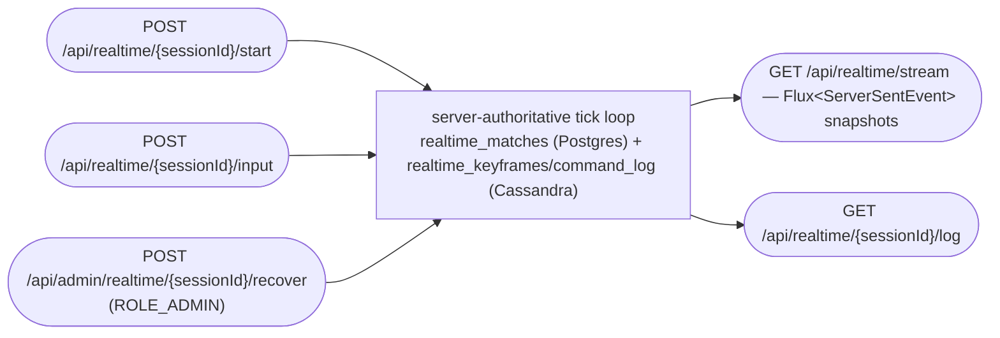
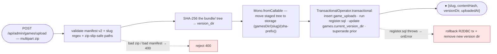
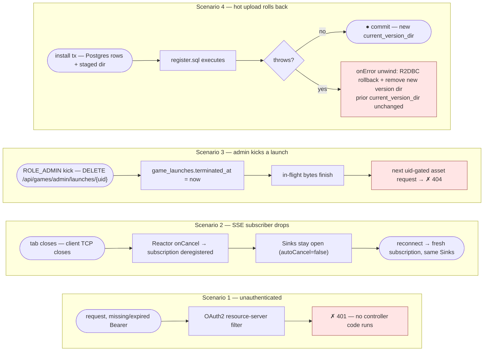

# 05 — API + service reference

> Mirror of [`chapters/05-api-reference.tex`](../../publishing/architecture/chapters/05-api-reference.tex).

This page accompanies the generated Javadoc at [`docs/publishing/javadoc-output/index.html`](../../publishing/javadoc-output/) and the live OpenAPI document at `/v3/api-docs` (public with the `dev` profile, `ROLE_ADMIN` only in prod). It lists every controller once, with its endpoints, its auth rule and a one-line contract.

The PDF version of this chapter ([`chapters/05-api-reference.tex`](../../publishing/architecture/chapters/05-api-reference.tex)) has TikZ **marble diagrams** for each reactive controller and service (sources in [`docs/publishing/architecture/marbles/`](../../publishing/architecture/marbles/), rendered to PNG by `make docs-diagrams`). On GitHub the same flows appear as the **mermaid pipeline flowcharts** below. The per-endpoint pipelines are in the [root README API reference](../../../README.md#api-reference).

> **Reading the pipeline flowcharts** — a request passes through the Reactor operators to a terminal emission. Rounded ends `([ … ])` are the request and the emitted values. Plain boxes are operators (`findById`, `map`, `flatMap`, `save`). Diamonds `{ … }` are branches. A red `✗` node is a 4xx or error terminal. A `Mono` completes after one value and a `Flux` after N. An SSE stream stays open until the client disconnects.

## Reactive pipelines at a glance

**`GameStreamController` — nine SSE channels merged onto one connection.**



**`CasdoorAuthController` — ROPC token exchange (the browser never sees `client_secret`).**



**`RealtimeController` / `AdminRealtimeController` — 🚧 server-authoritative match surface (engine wired, catalog launch deferred).**

The FPS/RTS sim cores and their Cassandra-truth tick loop are wired and verified in-JVM (Chicory), but **no FPS/RTS title is registered as a launchable catalog game yet** — see [`docs/realtime-server-authoritative-design.md`](../../realtime-server-authoritative-design.md).



**`GameUploadService` — the transactional install pipeline.**



## Public surface (no JWT required)

The heading names the group; each entry states its own rule. `ControlController`, `DiagnosticsController` and `ProducerContactController` sit here because of their neighbours, and they are not public.

### `CasdoorAuthController` — `/api/auth`

Public token exchange against Casdoor. It has one endpoint.

| Method | Path | Notes |
|---|---|---|
| `POST` | `/api/auth/token` | Exchanges username + password for a Casdoor access token via ROPC (`grant_type=password`). The `client_secret` is injected server-side — the browser never sees it. The federated `login` remote calls this directly. |

**Call example.**
```bash
curl -sS -X POST http://localhost:8080/api/auth/token \
  -H 'Content-Type: application/json' \
  -d '{"username":"player","password":"<the seed password — see .e2e-credentials or the casdoor container log>"}'
```
*200 OK*: Casdoor's token response, passed through unchanged — `{ "access_token": "eyJ…", "token_type": "Bearer", "expires_in": 3600, … }`.

### `GameStreamController` — `/api/game/stream`

SSE merge stream — nine typed channels plus a keepalive. The unscoped stream is public; `GET /api/game/state` (a snapshot for clients that cannot use SSE) sits beside it. See [02 — Runtime architecture](02-runtime.md#server-sent-events--nine-channels-on-one-stream).

```bash
curl -N http://localhost:8080/api/game/stream
```
*200 OK — `text/event-stream` (excerpt):*
```
id: 1
event: movement
data: {"characterId":1,"chapterId":1,"x":12.4,"y":0.0,"z":-3.1,"rotationY":0.0,"action":"walk","pressed":true,"tick":4421}

id: 2
event: time
data: {"dayNumber":3,"hour":18,"minute":40}

: keepalive
```
The keepalive is an SSE comment line, sent at connect and every 15 s. With `?sessionId=` the stream needs a bearer token and an active membership in that session (*401*, *403*); admins may watch any session.

**Client disconnects:** the `Sinks.Many` instances stay open (`autoCancel=false`). A reconnect gets a fresh subscription on the same sinks.

### `GameController` — `/api/games`

Public game catalog (filtered by `game_access` when a JWT is present). Composes with `ProgressionService` for quest-completion-aware unlock state.

| Method | Path | Notes |
|---|---|---|
| `GET` | `/api/games` | List of all games. |
| `GET` | `/api/games/{id}` | One game by id. |
| `GET` | `/api/games/{id}/chapters` (alias `/levels`) | Its chapters by id. |
| `GET` | `/api/games/available/{characterId}` | JWT-aware availability list with per-game lock state. |

### `ChapterController` — `/api/chapters` (also accepts `/api/levels`)

Public per-chapter metadata and scene DTOs. The `@RequestMapping({"/api/chapters", "/api/levels"})` alias keeps already-exported WASM bundles working post-rename — see [decision 006](../decisions/006-naming-rename.md).

| Method | Path | Notes |
|---|---|---|
| `GET` | `/api/chapters` | List of chapters. |
| `GET` | `/api/chapters/{id}` | Chapter row including `asset_url`. |
| `GET` | `/api/chapters/{id}/scene` | Typed `SceneDto` that `scene_loader.gd` consumes. |

### `ChapterAssetController` — `/api/chapters/{id}/assets`

Per-chapter asset registry — `GET` (list, and `/by-label/{label}`), `POST` and `DELETE` for textures / plugins / audio looked up by stable label. The path sits under the public `/api/chapters/**` rule and the controller adds no check of its own, so all three methods are public.

### `AssetController` — `/api/assets`

Public classpath asset serving (`/api/assets/{filename}`), the legacy level path `/api/assets/levels/{slug}/...` (403 when `app.assets.require-launch-uid=true`; default `false`) and the launch-uid-gated path `/api/assets/levels/{slug}/{uid}/...` for hot-uploaded bundles. The gated path resolves the version directory pinned at launch, then falls back to the current version and the classpath. A terminated, expired or wrong-slug uid gets *404*, so a caller cannot tell whether a uid exists.

### `ControlController` — `/api/controls`

Control event ingestion. `SecurityConfig.PLAYER_PATHS` requires an authenticated principal. `ControlController.receiveControl` still declares `@RequestHeader(value = "X-Casdoor-Id", required = false)` and falls back to it when no JWT is present; the JWT subject wins when both are supplied.

With `X-Session-Id`, the caller must hold an active seat that owns `characterId` in that session (*401* without an identity, *403* otherwise). Without it, the legacy single-session rule applies, and *403* means the subject isn't the controller-role holder.

**Auto-recovery:** `game_bridge.gd`'s `send_control` detects the 403 and posts `SD_SESSION_EXPIRED` to the host shell. `ApiBridgeService.handleSessionExpired()` then re-runs `session.connect()` and `session.claimControl()`, so the next keypress succeeds. This is what makes a BFF restart survivable while the Angular SPA is still mounted: restart wipes the in-memory `activeSessions` and `currentController`, but the SPA never sees the gap.

### `FederationController` — `/api/federation/manifest`

Public federation manifest. DB-backed read from `federation_modules`, ordered by `kind`/`slug`. See [03 — Module Federation](03-federation.md#the-manifest-endpoint).

### `GameTimeController` — `/api/time`

Public game-clock snapshot — same DTO that the `time` SSE channel emits.

### `DiagnosticsController` — `/api/diagnostics`

`POST /api/diagnostics/wasm-console` — forwarded WASM-iframe console lines. `ROLE_ADMIN` only, and only while the debug-mode flag is on (see `DebugModeController` below); otherwise *403*. Stamps a server timestamp and pushes onto the `wasm-console` SSE channel so admin docs explorers can mirror crashes live.

### `CspReportController` — `/api/security/csp-report`

Anonymous sink for CSP violation reports against the `Content-Security-Policy` that `frontend/nginx.conf` and `frontend/nginx-tls.conf` ship (decision 023). It accepts two content types: `application/csp-report` (the legacy `report-uri` envelope) and `application/reports+json` (the modern Reporting API array). It logs at WARN and stores nothing. `SecurityConfig.PUBLIC_PATHS` allows it, because browsers POST these without credentials. The host nginx rate-limits it in the standard `api` zone.

### `AppealContactController` — `/api/security/appeal-contact`

Anonymous resolver for the appeal email address shown to revoked users. It reads `accounts.mods` (primary on-call, then secondary), then falls back to `app.security.appeal-contact-fallback` (default `support@hugmesh.games`). It returns `{ "email": "<address>" }`. It is anonymous because a revoked user has no JWT. The `banned` remote and the host's `BannedPageComponent` both call it.

### `ProducerContactController` — `/api/producer-contacts` + admin variants

| Method | Path | Auth | Notes |
|---|---|---|---|
| `POST` | `/api/producer-contacts` | JWT | Producer / mod application submitted via the `producer-registration` federated remote. One row per submission in `producer_contacts`; status starts `PENDING`. |
| `GET`  | `/api/producer-contacts/me` | JWT | Caller's own submission history (newest first). |
| `GET`  | `/api/admin/producer-contacts` | `ROLE_ADMIN` | PENDING submissions, oldest first. |
| `POST` | `/api/admin/producer-contacts/{id}/decision` | `ROLE_ADMIN` | `{status: 'APPROVED'\|'REJECTED', reviewerNotes?}`. Records the status, the reviewer and the time; *409* if the row is no longer PENDING. It does not write `accounts.producers` / `accounts.mods` and does not grant a Casdoor role. |

## Authenticated surface (JWT required)

### `SessionController` — `/api/sessions/{connect,control,me,history}`

Legacy single-session connect / disconnect / control-claim / history — retained for the single-player path: `POST /connect`, `POST /control`, `DELETE /me`, `GET /history`. Capacity is capped by `app.session.max-players` (default 3); the first connect auto-claims the controller. Past the cap, `SessionService.tryConnect` fails with `IllegalStateException("Server is full (max N players)")`; no handler in the code maps that exception to a status code.

### `MultiplayerSessionController` — `/api/sessions` (multiplayer)

Named multiplayer sessions. Distinct from the legacy single-session path above.

| Method | Path | Notes |
|---|---|---|
| `POST` | `/api/sessions` | `{gameSlug, name, maxPlayers?, visibility?, characterId?, slotIndex?}` → mint a `Crypto.mintUid()` id + write `game_sessions` row + first `session_members` row flagged `is_creator=true`. |
| `GET` | `/api/sessions?gameSlug=` | Open sessions (`closed_at IS NULL`), optionally filtered. Used by the home-page picker. |
| `GET` | `/api/sessions/{id}` | Session detail with active members. |
| `POST` | `/api/sessions/{id}/join` | `{characterId?, slotIndex?}`. Idempotent on `(sessionId, casdoorId)`; slot collisions resolve as *409* via the partial unique index. |
| `DELETE` | `/api/sessions/{id}/me` | Leave. Auto-closes the session if the leaver was the last active member. |
| `DELETE` | `/api/sessions/{id}` | Force-close. Creator-only. |
| `POST` | `/api/sessions/{id}/pause`, `/resume` | Session-wide pause and resume; the creator or an admin. Emits `SESSION_PAUSED` / resume on `session-control`. |
| `POST` | `/api/sessions/{id}/players/me/pause`, `/resume` | Tab-takeover pause for the caller; kept in memory, not in Postgres. |

See [decision 010 — per-session SSE sinks](../decisions/010-per-session-sse-sinks.md) for the isolation contract.

### `RealtimeController` — `/api/realtime`  *(🚧 server-authoritative match surface)*

The REST surface for the server-authoritative FPS/RTS sim engines. The engines and the Cassandra-truth tick loop are wired and verified in-JVM via Chicory. **No FPS/RTS title is registered as a launchable catalog game yet**; this is engine and match plumbing, not a playable entry. See [`docs/realtime-server-authoritative-design.md`](../../realtime-server-authoritative-design.md) and [`docs/realtime-sim-wiring-p4.md`](../../realtime-sim-wiring-p4.md).

| Method | Path | Notes |
|---|---|---|
| `POST` | `/api/realtime/{sessionId}/start` | Start a server-authoritative match; the server runs the tick loop and persists truth to `realtime_matches` (Postgres) + `realtime_keyframes`/`realtime_command_log` (Cassandra). |
| `POST` | `/api/realtime/{sessionId}/input` | Submit a player input to the authoritative tick. |
| `GET` | `/api/realtime/stream` | SSE stream of authoritative snapshots (`Flux<ServerSentEvent>`). |
| `GET` | `/api/realtime/{sessionId}/log` | Replay/inspect the command log for a match. |

### `AdminRealtimeController` — `/api/admin/realtime`  *(`ROLE_ADMIN`, 🚧)*

| Method | Path | Notes |
|---|---|---|
| `POST` | `/api/admin/realtime/{sessionId}/recover` | Recover/rehydrate an authoritative match from Cassandra truth. Admin-only (`@PreAuthorize("hasRole('ADMIN')")`). |

### `SessionLogController` — `/api/session-logs`

Per-user session-history reads, with role-scoped variants.

| Method | Path | Notes |
|---|---|---|
| `GET` | `/api/session-logs/me` | The caller's own session log. |
| `GET` | `/api/session-logs/admin/{casdoorId}` | Any user's session log. Admin-only (`ROLE_ADMIN`). |
| `GET` | `/api/session-logs/scoped/{casdoorId}` | A user's session log scoped to the caller's game grants. `ROLE_MOD` / `ROLE_PUBLISHER` / `ROLE_ADMIN`. |

### `ProfileController` — `/api/profile/me/{player,producer,mod}`

Per-role profile read / write against the `accounts` schema introduced in Liquibase 041 (decision: `docs/decisions/020-per-role-schema-split.md`). Nothing in the BFF creates producer or mod rows (see [04](04-data-model.md#per-role-accounts-schema)), so the producer and mod endpoints answer *404* until a row exists.

| Method | Path | Notes |
|---|---|---|
| `GET`  | `/api/profile/me/player` | Caller's `accounts.players` row (xp / level / friend-count / block-count). Lazy-populated on first call. |
| `PUT`  | `/api/profile/me/player` | Patch the same row. |
| `GET`  | `/api/profile/me/producer` | Caller's `accounts.producers` row. `404` if the caller hasn't been approved as a producer. |
| `PUT`  | `/api/profile/me/producer` | Update display name, contact email and jurisdiction. Gated on `ROLE_PUBLISHER` or `ROLE_PRODUCER` (the GET is gated the same way). |
| `GET`  | `/api/profile/me/mod` | Caller's `accounts.mods` row. `404` if not approved as a mod. |
| `PUT`  | `/api/profile/me/mod` | Update contact email / `oncall_slot`. Gated on `ROLE_MOD` (the GET is gated the same way). |

### `UserRelationshipController` — `/api/relationships/{friends,blocks}`

Friend graph + block list, persisted in `user_relationships`. See [decision 015](../decisions/015-friends-blocks-and-session-visibility.md).

| Method | Path | Notes |
|---|---|---|
| `GET`  | `/api/relationships/friends` | Accepted friends. |
| `GET`  | `/api/relationships/friends/incoming` | Pending requests received. |
| `GET`  | `/api/relationships/friends/outgoing` | Pending requests sent. |
| `POST` | `/api/relationships/friends/request` | Send a friend request. Re-sending is a no-op; if the other user already asked, it accepts. *403* `blocked` if the target has blocked the caller. |
| `POST` | `/api/relationships/friends/accept` | Accept an incoming request. |
| `POST` | `/api/relationships/friends/remove` | Unfriend (also cancels pending). |
| `GET`  | `/api/relationships/blocks` | Caller's block list. |
| `POST` | `/api/relationships/blocks/add` | Block a user. Side-effects: cancels any pending / accepted friendship in both directions. *403* if the target is a publisher. |
| `POST` | `/api/relationships/blocks/remove` | Unblock. |

### `TelemetryController` — `POST /api/telemetry/game/{slug}`

Per-game KPI ingest from federated game remotes (decision 021, follow-up F2). Iframes POST batched samples directly; `GameKpiPublisher` ships them to the `game_kpi` Kafka topic, which ClickHouse aggregates into `kpi_rolling_avg_24h` for admin dashboards. The route is public (`/api/telemetry/**` in `PUBLIC_PATHS`): a bearer token fills `casdoor_id`, and an anonymous post is accepted with it empty. Batches are cut at 100 entries, and the answer is *202* whatever the broker does. `app.telemetry.cors.allowed-origins` covers federated origins.

### `ViewEgressController` — `POST /api/view`

Per-player camera/orientation sample ingest. Authorized through `GameSessionService.authorizeControl` — the JWT subject must be the active member who owns `characterId`. Fans out on the per-session `view` SSE channel admins watch via `/api/admin/sessions/{id}/stream`.

### `ModerationController` — `/api/mod/*` (`ROLE_MOD` or `ROLE_ADMIN`)

Per-game moderator actions. Casdoor's `mod` role grants the capability; `mod_game_scopes` decides which games. The BFF rejects every action whose target session's `game_slug` isn't in the caller's active scope.

| Method | Path | Notes |
|---|---|---|
| `GET` | `/api/mod/scopes` | Caller's active mod scopes. |
| `POST` | `/api/mod/sessions/{id}/stop` | Force-close a session; *403* if mod isn't scoped to the session's game. |
| `POST` | `/api/mod/sessions/{id}/kick` | `{targetCasdoorId, reason}`. Stamps `left_at` on the target's session_members row. |

### `PublisherController` — `/api/publisher/*` (`ROLE_PUBLISHER` or `ROLE_ADMIN`)

Per-game publisher actions. `publisher_game_scopes` decides which games.

| Method | Path | Notes |
|---|---|---|
| `GET` | `/api/publisher/scopes` | Caller's active publisher scopes. |
| `GET` | `/api/publisher/games/{slug}/mods` | List active mods for a game the caller owns. |
| `POST` | `/api/publisher/grant-mod` | `{targetCasdoorId, gameSlug}`. Idempotent. |
| `POST` | `/api/publisher/revoke-mod` | Soft-delete (`revoked_at`). |

### `CharacterController` — `/api/characters`

Character list / read / update (`PUT /{id}`) / dashboard / quest completion / use-first-item. The update path emits a `character` SSE event after persisting.

### `SkillController` — `/api/skills`

Skill catalog, per-character known skills, and hot-bar slot assignment. Casting itself is in `InstantService` (formerly `SpellService`).

### `ItemController` — `/api/items`

Inventory (`GET /api/items/character/{id}/inventory`) and equipment (`GET …/equipment`, `PUT …/equipment/{slot}?itemId=`). Equipping a slot the character has no row for answers *404*; equipping on a character the caller doesn't own answers *403*.

### `QuestController` — `/api/quests`

Quest catalog (full) and per-character started-quest list.

### `InputEventController` — `/api/input`

Generalised input ingestion — gamepad / mouse / keyboard / touch / audio / world / control. `POST /api/input/{characterId}` submits an event; `GET /api/input/character/{characterId}` and `GET /api/input/session/{sessionId}` read recent history (membership or ownership required). The web-native relay posts here (see [02](02-runtime.md#browser-side-flow--web-native-host-authoritative)). Every submit passes the validation gates described in [04 — Data model](04-data-model.md#generalised-input-event-surface); gate 3 is implemented but off by default.

| Status | When |
|---|---|
| *401* | No JWT. |
| *403* | Session-scoped submit where the caller isn't the active `session_member` owning `characterId`; OR a non-creator submitting `kind:'world'` (authority-spoof defence — only the session creator may post the authoritative world relay); OR a `gameSlug` that doesn't match the session's game. |
| *400* | `(kind, type)` not in `input_event_types`, or a missing `kind`, `type` or `gameSlug`. The upload-time validator should have caught the first. |
| *405* | `games.features.<kind>` is `false` or absent, or (for `control:cast`) the `instant_loadout` flag is; with `app.input.gate3-enabled=true`, also a `(slug, kind, type)` triple that isn't an enabled `game_event_support` row. |

### `GameLaunchController` — `/api/games/{slug}/launch` + `/api/games/admin/launches`

| Method | Path | Notes |
|---|---|---|
| `POST` | `/api/games/{slug}/launch` | Mints a `launch_uid` (15-minute TTL), snapshots `games.current_version_dir` into the row, returns `{uid, expiresAt, gameSlug}`. *403* if `game_access` hides the game from the caller. |
| `DELETE` | `/api/games/launches/{uid}` | Owner self-terminate. |
| `GET` | `/api/games/launches` | Active launches, brand-scoped. `ROLE_ADMIN`. |
| `DELETE` | `/api/games/admin/launches/{uid}` | Admin force-terminate. `ROLE_ADMIN`. |

### `RoleAdminController` — `/api/admin/role-grants/*` (`ROLE_ADMIN`)

Admin variant of the publisher role-grant endpoints, plus publisher-scope grants. Bypasses `requireOwns` since admins have global authority.

| Method | Path | Notes |
|---|---|---|
| `GET`  | `/api/admin/role-grants/{publishers,mods}` | List all active scope rows. |
| `POST` | `/api/admin/role-grants/grant-publisher` | `{targetCasdoorId, gameSlug}`. |
| `POST` | `/api/admin/role-grants/revoke-publisher` | Soft-delete. |
| `POST` | `/api/admin/role-grants/grant-mod` | Admin-grants-mod variant. |
| `POST` | `/api/admin/role-grants/revoke-mod` | Soft-delete. |

### `DebugModeController` — `/api/admin/debug-mode/*` (`ROLE_ADMIN`)

Runtime toggle for diagnostic ingest from the WASM iframe. Default OFF.

| Method | Path | Notes |
|---|---|---|
| `GET`  | `/api/admin/debug-mode` | `{wasmConsoleEnabled: boolean}`. |
| `PUT`  | `/api/admin/debug-mode/wasm-console` | `{enabled: boolean}`. Persists in `system_settings`. |

`DiagnosticsController.POST /api/diagnostics/wasm-console` is now `ROLE_ADMIN` + flag-gated; non-admin callers always get *403*. See [decision 012](../decisions/012-debug-mode-gate.md).

### `AvatarController` — `/api/avatars`, `/api/characters/{cid}/avatar`

Saved parametric avatars (decision 028): up to 12 per user, one active. Create, update, delete and select are owner-only. The rendered image and model are readable by any authenticated user, with no owner check, because an avatar exists to be seen by others; ids are unguessable 43-character tokens.

| Method | Path | Notes |
|---|---|---|
| `GET` / `POST` | `/api/avatars` | List the caller's avatars; create one from `{name, document}`. |
| `PUT` / `DELETE` | `/api/avatars/{id}` | Update or delete. |
| `POST` | `/api/avatars/{id}/select` | Make it the active avatar. |
| `PUT` | `/api/characters/{cid}/avatar` | Bind `{avatarId}` to one character. |
| `GET` | `/api/avatars/{id}/image.svg`, `/model.glb` | Rendered SVG and glTF binary. |

### `AdminSessionStreamController` — `/api/admin/sessions/{id}/stream` (`ROLE_ADMIN`)

Per-session SSE merge — movement / world / character / view channels scoped to one session id. The `view` channel is the per-player camera/orientation feed driven by the Rust GDExtension's `view_egress` signal. See [decision 013](../decisions/013-player-view-channel.md).

## Admin surface (`ROLE_ADMIN`, except as noted)

### `AdminController` — `/api/admin`

Dashboard reads, force-disconnect and character moderation, all `ROLE_ADMIN` through the `/api/admin/**` rule: `GET /sessions`, `GET /multiplayer-sessions`, `GET /stats`, `GET /characters`, `PUT /characters/{id}`, `DELETE /sessions/{casdoorId}` (force-disconnect) and `GET /stream` (an SSE merge for the dashboard).

### `GameUploadController` — `/api/admin/games`

Both endpoints take `ROLE_ADMIN` or `ROLE_PUBLISHER`; a publisher is limited to games in `publisher_game_scopes`.

| Method | Path | Notes |
|---|---|---|
| `POST` | `/api/admin/games/upload` | Multipart bundle zip; the install pipeline validates manifest schema v2 + slug regex + zip-slip-safe paths, hashes the bundle, moves the staged tree into storage (`<gamesDir>/<slug>/<sha-prefix>` on the filesystem strategy), runs the bundle's `register.sql` inside a single R2DBC transaction under the least-privilege `hugmesh_register_sql` role, and supersedes prior uploads. Returns `{slug, contentHash, versionDir, uploadedAt}`. |
| `GET` | `/api/admin/games/{slug}/uploads` | Rollback history, newest first; `supersededAt = NULL` marks the current. |

### `GameAccessController` — `/api/admin/games/{slug}/access`

| Method | Path | Notes |
|---|---|---|
| `POST` | `/api/admin/games/{slug}/access` | Body `{scope, value?}`; absorbs duplicates via `uq_game_access_triple`. |
| `DELETE` | `/api/admin/games/{slug}/access?scope=&value=` | Removes a row. |
| `GET` | `/api/admin/games/{slug}/access` | Additive list of active rows. |

### `RoleProxyController` — `/api/admin/roles`

Server-side proxy of `/api/get-roles?owner=threewizards`. The admin UI's "grant role" dropdown loads the live Casdoor catalog through it, and the browser never sees the Casdoor admin client secret. If Casdoor fails, it returns an empty list (`onErrorReturn`): the dropdown empties and the dashboard keeps running.

### `AdminActionController` — `/api/admin/actions`

Kick / ban / unban a player: `POST /api/admin/actions/{kick,ban,unban}/{casdoorId}` and `GET /api/admin/actions/{casdoorId}` (history), all `ROLE_ADMIN`. Writes to `admin_actions` and broadcasts on the per-user SSE channel `GET /api/me/admin-actions/stream`, which the host's `AdminActionsListenerService` subscribes to (it closes any open game window via `BroadcastChannel` and redirects to `/banned`). Any authenticated user can read their own status at `GET /api/me/ban-status`. See [howto/kick-or-ban.md](../howto/kick-or-ban.md).

## BFF service tier

The controllers above are thin. They decode the request, run a reactor chain through one or more services, and return a DTO. The services below do the real work.

### `GameStateService`

Owns eight `Sinks.Many`: `movement`, `world`, `character`, `scene`, `input`, `audio`, `wasm-console`, `session-control`. Every sink is built with `onBackpressureBuffer(N, /* autoCancel */ false)`, so a disconnecting subscriber doesn't end the producer side. `@DependsOn("liquibase")` makes the `@PostConstruct` init query run against the migrated schema.

### `GameTimeService`

A `Flux.interval(1s)` tick loop advances the in-memory clock by one game minute per second, persists `game_time_state` every 10 ticks, and emits a `GameTimeDto` (`dayNumber`, `hour`, `minute`) on the `time` SSE channel whenever the minute is a multiple of 5, that is every 5 real seconds. The DTO has no `phase`.

### `GameUploadService`

The transactional install pipeline behind `POST /api/admin/games/upload`. `Mono.fromCallable(...)` wraps the blocking staging and storage work. `TransactionalOperator.transactional(...)` wraps the R2DBC commit, which covers the `game_uploads` insert, `register.sql`, the `games.current_version_dir` update and the supersede of earlier uploads.

### `GameLaunchSweeper`

`@Scheduled` task (default every 5 minutes, `app.launches.sweep-fixed-rate-ms`) that terminates stale `game_launches` rows so the admin dashboard stops counting them.

### `GameUploadPruner`

`@Scheduled` task (default every hour) that keeps the last `app.uploads.versions-to-keep` version directories per slug on disk and deletes older ones inside `Mono.fromCallable`.

### `CassandraSyncService`

Every 15 s it writes a `pod_heartbeats` row (TTL 30 s) into Cassandra, so the admin dashboard can show pod liveness. Every 24 h (first run 60 s after boot) it mirrors Postgres aggregates into `daily_snapshots` for offline analytics. The Kafka → ClickHouse pipeline (decision 021) will retire it once that pipeline has proven itself in production.

### `GameAuditPublisher` / `GameEventPublisher` / `GameKpiPublisher`

Kafka producers from decision 021. `GameAuditPublisher` emits state-transition rows to `state_audit`. `GameEventPublisher` tees all 9 SSE channels to `game_events` from `GameStateService.tryEmitNext` and `emitInput`. `GameKpiPublisher` ships federated-game KPI samples from `TelemetryController` to `game_kpi`. `app.kafka.enabled` gates all three; when it is off they do nothing.

### `KafkaSessionSubscriber`

Cross-pod consumer for `game_events`. It skips events this pod published (by `pod_id`) and dispatches the rest per channel to handlers that `GameStateService.@PostConstruct` registers. It covers all 9 channels. Each handler calls `reemitToSession`, which is private to `GameStateService`:

- movement, world and character go to the global sink and the per-session sink;
- view goes to the per-session sink only;
- scene, input, audio and wasm-console go to the global sink only;
- world-native goes to the per-session `worldNative` sink only, with no global sink.

See decision 021.

### `SessionTopicManager`

Creates per-session Kafka topics (`session.<id>.events`) on session-create, so a cross-pod subscriber can hydrate only the sessions it cares about.

### `PlayerStateRecoveryService`

Queries the ClickHouse `player_state_current FINAL` table over the ClickHouse HTTP interface (WebClient) for session-reconnect recovery. The `hydrate(characterId, chapterId, gameSlug, sessionId)` overload on `GameStateService` asks this service before it tries the older Cassandra → Postgres → defaults chain. `Mono.empty()` is the expected miss, and SSE and gameplay never wait on it.

### `DistributedRateLimitService`

A cluster-wide rate limit, backed by Cassandra, on top of the local in-process `RateLimitFilter` bucket. It appends a row to `rate_limit_events` (TTL 90 s) and counts the rows in the window with `COUNT(*)` against `event_id >= minTimeuuid(now − WINDOW)`. Turn it off with `app.rate-limit.distributed.enabled=false`; it falls back to local-only when Cassandra is unreachable. The `hugmesh-gateway` is the primary rate-limit enforcement point; this is defence in depth for the BFF.

### `UploadStorage` strategy (decision 020)

`filesystem` (default) and `s3` implementations behind one interface. The `CircuitBreakerUploadStorage` decorator wraps the S3 strategy in the `s3` Resilience4j breaker. While the breaker is OPEN, reads return null and `AssetController` falls back to the classpath; writes throw `UploadStorageException`. `AssetController.tryPresignRedirect(...)` answers 302 with a short-lived pre-signed URL when `app.uploads.s3.presigned-reads=true` and the strategy returns a non-null URL.

### `SessionService`

Concurrent in-memory map of active sessions (`ConcurrentHashMap<String, SessionDto>`) capped at `app.session.max-players` (default 3), plus `AtomicReference<String>` for the current controller. Serves the legacy single-session path only.

### `GameSessionService` and `SessionMemberReaper`

`GameSessionService` owns the durable multiplayer ledger (`game_sessions`, `session_members`): create, join, leave, close, pause, resume, and the `authorizeControl` check every control and input write passes. `SessionMemberReaper` runs every 30 s (`app.sessions.reap-fixed-rate-ms`) and releases the seats of members whose `last_seen_at` is older than 3 minutes (`app.sessions.member-timeout-ms`); `app.sessions.reap-enabled=false` turns it off.

### `InstantService` (formerly `SpellService`)

Resolves a hot-bar slot to a skill, checks MP cost, drains MP, persists the character row, and emits the `character` SSE event.

### `ProgressionService`

Pure read composition of `game_access`, `player_characters` and `character_quests`. Drives the home page and `/api/games/available/{characterId}`.

### `PgNotificationService`

Cross-instance fan-out. It posts to an in-process `Sinks.Many<String>` *and* fires a `pg_notify` SQL command, so other pods on the same Postgres see the same events. `onErrorComplete()` swallows publish failures.

### `PositionCacheService`

Cassandra write-through cache for cross-pod position visibility. Keyed by `(characterId, chapterId)` with a 5-minute TTL. See [decision 007](../decisions/007-cassandra-position-cache.md).

### `AdminActionService`

Append-only writes to `admin_actions`, plus a per-user `Sinks.Many` that feeds the live SSE the kicked or banned player's host shell subscribes to.

## Recurring non-happy paths

The PDF's marble diagrams cover four scenarios beyond the happy path:

- **Scenario 1 — Unauthenticated request.** The OAuth2 resource-server filter rejects a missing or expired bearer token *before* the controller's reactor pipeline starts. The response is *401*, and no controller code runs.
- **Scenario 2 — SSE subscriber drops mid-stream.** A browser tab closes and its TCP connection closes. Reactor sees `onCancel` and deregisters the subscription. *The upstream sinks stay open*, because every `Sinks.many()` in this project sets `autoCancel=false`. A reconnect from the same client gets a fresh subscription on the same sink.
- **Scenario 3 — Admin force-revokes (kicks) a launch.** `ROLE_ADMIN` clicks *kick*; the BFF handles `DELETE /api/games/admin/launches/{uid}` by setting `game_launches.terminated_at` on the row (one `save`, no wider transaction). Bytes already in flight to the player's iframe finish; the next uid-gated asset request for that uid is answered *404*, because the lookup only matches rows with `terminated_at IS NULL`.
- **Scenario 4 — Hot upload rolls back.** The install is the most fragile path, because it writes to two stores: Postgres (the games rows) and the filesystem (the staged bundle directory). When `register.sql` throws inside the transactional block, Reactor's `onError` unwinds. The R2DBC transaction rolls back, and the service removes the new version directory from storage (best effort). The earlier `games.current_version_dir` is unchanged, and the active bundle keeps serving.



## Where to find more detail

- `make docs-javadocs` publishes the full Javadoc to [`docs/publishing/javadoc-output/`](../../publishing/javadoc-output/).
- The Angular API explorer remote ([`frontend/projects/api-docs/`](../../../frontend/projects/api-docs/)) loads the same merged OpenAPI document, lets you override the auth token in a textbox, supports binary uploads, and streams SSE responses into an in-window terminal panel. Reachable at `/admin/docs` on a logged-in admin session.

---

Previous: [04 — Data model](04-data-model.md) · Next: [06 — Build and deploy](06-build-and-deploy.md).
