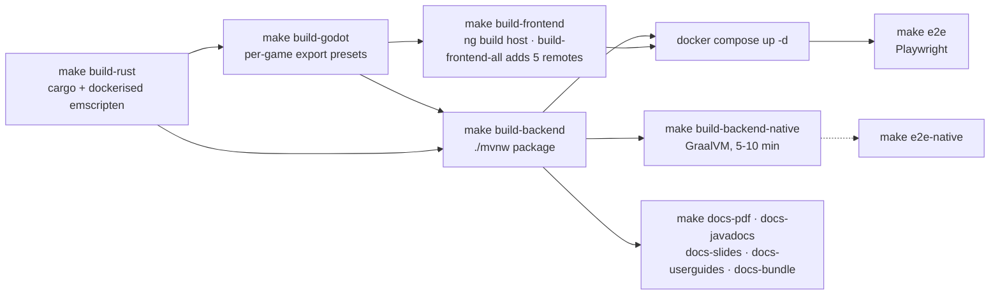

# 06 — Build and deploy

> Mirror of [`chapters/06-build-and-deploy.tex`](../../publishing/architecture/chapters/06-build-and-deploy.tex).

The root [`Makefile`](../../../Makefile) is the entry point. Every target is idempotent and safe to re-run, and so are the targets in the typeset-doc Makefile ([`docs/publishing/Makefile`](../../publishing/Makefile)).

## Build chain



## Native (Linux) build

```bash
make build-rust          # cargo build --release (native .so) + the dockerised wasm32-unknown-emscripten build
make build-godot         # exports every preset in every game project under games/<dir>/
make build-backend       # ./mvnw -q package -DskipTests
make build-frontend      # npm run build:prod: the host shell only
make build-frontend-all  # host plus the login, admin, api-docs, three-wizards and dodecahedron remotes
make build               # build-rust, build-godot, build-backend, build-frontend in that order
```

`build-rust` needs `cargo` and `docker` on `PATH`; `deps-rust` checks both and stops if either is missing. It runs three steps in order. First `build-rust-wasm` builds the `wasm32-unknown-emscripten` module inside the image from [`tools/build-rust-wasm/Dockerfile`](../../../tools/build-rust-wasm/Dockerfile) (rust + emsdk, built once and cached). Then `sync-bridge-addon` runs. Last, the native `.so` for the editor is built. Without Docker the target fails; it does not skip the WASM step.

The 14 web-native game cores build separately. `make build-games-wasm` compiles their `-wasm` shim crates to `wasm32-unknown-unknown` in the image from [`tools/build-games-wasm/Dockerfile`](../../../tools/build-games-wasm/Dockerfile), with `--offline`. It only builds. Copying a fresh `.wasm` into `games/<slug>/wasm/` and the deployed bundle stays a manual step that you review.

`make build-godot` depends on `build-rust`, needs a `godot` binary on `PATH`, and patches each exported `index.html` with `scripts/patch-godot-html.py`.

## Docker compose (recommended)

```bash
docker compose up -d            # postgres + cassandra + casdoor + bff + frontend + remotes
make e2e                        # builds the images, starts the TLS stack, runs the Playwright suite
make e2e-native                 # same, with the BFF swapped for the GraalVM native image
```

The base `docker-compose.yml` binds the frontend port to `127.0.0.1` by default (`${FRONTEND_BIND:-127.0.0.1:}${FRONTEND_PORT:-8080}`), so a fresh clone cannot expose the BFF or Postgres to the LAN by accident. Two knobs change that:

| Goal | Knob | How |
|---|---|---|
| LAN demo / multi-device playtest | `lan.properties` + `make lan-up` (or `make lan-up-tls` for HTTPS) | Set `FRONTEND_BIND=0.0.0.0:` and the frontend binds to all interfaces. `make lan-info` prints the reachable URLs. `lan.properties` is a docker-compose env-file, so `docker compose --env-file lan.properties up -d` gives the same result without make. |
| Production deploy at `hugmesh.games` | `compose.prod.yml` + `PROD_FRONTEND_BIND` | Defaults to loopback, which assumes an upstream load balancer. Set `PROD_FRONTEND_BIND=0.0.0.0:` for a single VM facing the internet. The host nginx edge rate limits are sized for about 10 000 concurrent users; see [decision 019](../decisions/019-production-rate-limits.md). |

### ⚠ Docker 29.x needs buildx

Docker 29+ deprecated the legacy in-daemon image builder. Without `docker-buildx`, `docker compose build` hangs silently. Install the v0.18+ binary into `~/.docker/cli-plugins/docker-buildx` (no sudo needed), or use your distro's `docker-buildx` package. The README's "Docker buildx required" note has the details.

### ⚠ Casdoor seed credentials

Casdoor randomises the seed credentials for each fresh database. First-time setup:

```bash
docker compose up -d
docker compose logs casdoor 2>&1 | grep -A4 "Casdoor seed credentials"
# Copy Client Secret + admin pass + player pass into a new .env at repo root:
cat > .env <<EOF
CASDOOR_CLIENT_ID=twclient001
CASDOOR_CLIENT_SECRET=<paste from log>
CASDOOR_ADMIN_PASS=<paste from log>
CASDOOR_PLAYER_PASS=<paste from log>
EOF
docker compose up -d --force-recreate api frontend
```

The BFF restart-loops on a Casdoor secret mismatch. See also [CLAUDE.md](../../../CLAUDE.md).

## GraalVM native image

GraalVM `native-image` compiles the BFF to a native binary. A `native` profile in [`backend/pom.xml`](../../../backend/pom.xml) drives it, with a Dockerfile ([`backend/Dockerfile.native`](../../../backend/Dockerfile.native)) and a compose overlay ([`docker-compose.native.yml`](../../../docker-compose.native.yml)).

```bash
make build-backend-native     # docker build -f backend/Dockerfile.native -t hugmesh-gaming-bff:native (5-10 minutes, 6-8 GB RAM)
make e2e-native               # build-backend-native, then the e2e stack with docker-compose.native.yml layered on
```

The native build needs reflection hints for the DTO records that cross the JSON boundary, and resource hints for the `assets/` tree. [`HugMeshRuntimeHints`](../../../backend/src/main/java/games/hugmesh/bff/aot/HugMeshRuntimeHints.java) lists them, so a new JSON-boundary DTO adds one entry there.

[`R2dbcConvertersConfig`](../../../backend/src/main/java/games/hugmesh/bff/config/R2dbcConvertersConfig.java) fixes a different problem. It registers the `OffsetDateTime` / `LocalDateTime` to `Instant` converters that native-image would otherwise skip.

In the native stack, Liquibase runs in a separate init container, not in the binary. See [decision 004](../decisions/004-graalvm-native.md).

## The publishing pipeline

[`docs/publishing/`](../../publishing/) produces this document, the Javadoc and the slide decks. The artefacts are git-ignored.

```bash
make docs-pdf          # docs/publishing/architecture/build/architecture.pdf
make docs-javadocs     # docs/publishing/javadoc-output/index.html
make docs-slides       # docs/publishing/slides/build/*.pptx
make docs-userguides   # docs/publishing/userguides/<name>/build/<name>.pdf
make docs-bundle       # docs/hugmesh-design-docs-<UTC-TIMESTAMP>.zip
make docs-all          # all of the above
make docs-clean        # remove every produced artefact
```

### LaTeX prerequisites

- TeX Live 2024+ with `pdflatex` (the Makefile runs two `pdflatex` passes), `tikz`, `tcolorbox`, `titlesec`, `csquotes`, `enumitem`, `inconsolata` and `fontawesome`, per [`docs/publishing/README.md`](../../publishing/README.md).
- On Debian / Ubuntu: `apt install texlive-latex-extra texlive-fonts-extra texlive-pictures`.
- On Gentoo: the `tex-live` portage package with USE `extra` produces the same set.

### Javadoc theming

[`backend/pom.xml`](../../../backend/pom.xml) tells the Maven Javadoc plugin to pass [`docs/publishing/javadoc-theme/hugmesh.css`](../../publishing/javadoc-theme/hugmesh.css) to the javadoc tool as `--add-stylesheet`. The page header is inline in the pom. The override is additive: the standard doclet's default stylesheet loads first, and the HugMesh CSS layers on top.

### PowerPoint generator

Python scripts under [`docs/publishing/slides/`](../../publishing/slides/) generate the slide decks. Each script imports `python-pptx` (through the shared `_hugmesh_deck.py`), builds the deck in code, and writes the `.pptx` file to `docs/publishing/slides/build/`. A reader who doesn't write Python can edit the slide content in the data structure at the top of each file.

### `make gen-api` poisoning `openapi.json`

If the BFF is unreachable on `:8080`, the host nginx answers any unknown path with Angular's `index.html` and HTTP 200. A naive `curl /v3/api-docs` then writes HTML into `openapi.json`. The Makefile writes the response to a temp file and replaces `openapi.json` only if it parses as JSON. If `npm run gen` fails with "end of stream" parser errors, delete `frontend/openapi.json` (it's git-ignored) and rebuild.

## CI hooks

[`docs/publishing/scripts/install-hooks.sh`](../../publishing/scripts/install-hooks.sh) (run it with `make docs-install-hooks`) installs `.git/hooks/pre-push`. The hook re-runs `make docs-pdf` on any push that touches `docs/publishing/` or `docs/PLAN-module-federation-and-native.md`, and a failed build aborts the push, so a broken build can't reach `main`. The hook is opt-in. The script is idempotent and prints what it changed.

---

Previous: [05 — API + service reference](05-api-reference.md) · Next: [07 — Extending the portal](07-extending.md).
