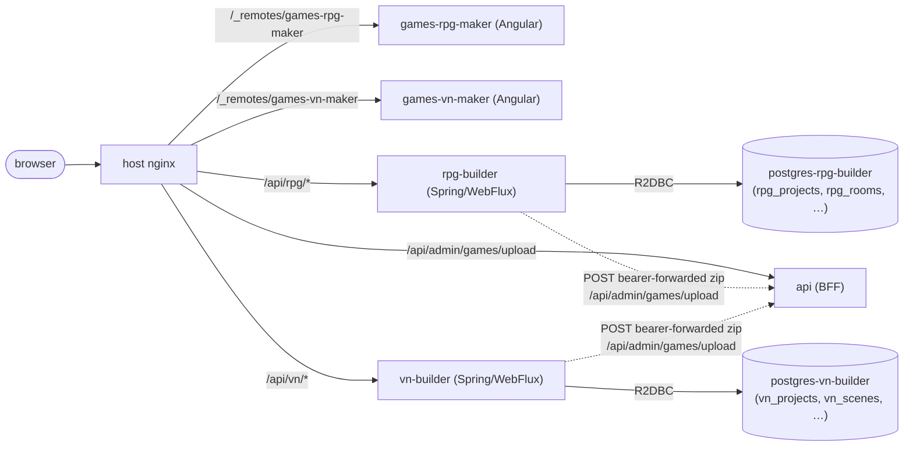
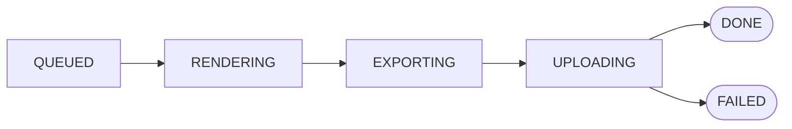

# 018 — Twin maker side services (RPG + VN)

## Context

Publishers want to author and ship games without leaving the portal or
touching Godot directly. Two genres cover ~80% of demand on the
roadmap:

- **MUD-style RPG** with rooms, areas, exits in N/S/E/W/NE/NW/SE/SW/UP/
  DOWN/TELEPORT directions, items, NPCs and per-room scripts. Mirrors
  Mudlet's editable-world domain (`TArea`, `TRoom`, `TExit`, `TScript`,
  `TKey`, `TAlias`, `TTrigger`).
- **Visual novel** with characters, backgrounds, scenes, dialogue lines
  and branching choices. Mirrors `gdquest-demos/godot-2d-visual-novel`'s
  `Character.gd` / `Background.gd` / `ScenePlayer.gd` shape.

The produced games must federate under the building user just like any
admin-uploaded bundle, must use the existing snapdragon-bridge
GDExtension (so multiplayer + per-player view channel come for free),
and must support multiple Areas / Acts so they map cleanly onto the BFF
`chapters` schema (one WASM bundle per chapter, as the host portal
already expects).

## Options considered

1. **Single side service handling both genres.** Lower service count;
   one codebase to maintain. Rejected — mixing two unrelated domains
   into one Spring Boot app produces a worse REST surface (longer
   paths, weaker package boundaries) and the user explicitly asked
   for two separate Postgres DBs, which would have meant two R2DBC
   connection factories + two Liquibase configs in one process. That
   complexity outweighs the duplication.
2. **Twin sibling services (`rpg-builder` + `vn-builder`).** Each owns
   its own DB (`postgres-rpg-builder`, `postgres-vn-builder`), its own
   REST surface (`/api/rpg/*`, `/api/vn/*`), and its own Liquibase
   changelog. Build pipelines are independent but follow an identical
   shape (BuildJob queue → renderer → Godot CLI → BFF upload). Chosen.
3. **Inline the editor + build into the BFF.** Rejected — the BFF is
   the runtime hot path (SSE per-session sinks, control authorization,
   asset streaming) and a build worker that fans out a 4 GB Godot
   container would compete for the same threads + RAM.

## Decision

Two reactive Spring Boot side services, twin remotes, separate DBs,
all schemas managed by Liquibase from day one.

## Build pipeline

Both services follow the same five-state lifecycle, persisted in a
`*_build_jobs` row claimed atomically with `FOR UPDATE SKIP LOCKED`:

- **Rendering** writes a Godot 4 project tree under `<workdir>/<job-id>/godot-src/`.
  The RPG renderer emits one `.gd` + `.tscn` pair per room; the VN
  renderer emits a per-act `scenes_data.json` the runtime ScenePlayer
  parses. Both projects bake in `snapdragon_bridge.gdextension` so the
  produced WASM speaks our HostBridge / multiplayer lobby / view
  channel out of the box.
- **Exporting** iterates the project's Areas (RPG) / Acts (VN) and
  produces one `bundle/<area-slug>/index.html` per — exactly the shape
  the BFF's existing chapters schema expects. The actual Godot CLI
  invocation is gated behind `app.build.godot-enabled`; with the flag
  off the worker writes a stub bundle so the rest of the pipeline
  (manifest.json, register.sql, zip, BFF upload) runs end-to-end without
  the multi-GB Godot image.
- **Uploading** posts the resulting zip to the BFF's
  `/api/admin/games/upload` endpoint with the originating user's
  bearer token. The BFF runs its own `PublisherService.requireOwns`
  scope check at upload time — the side services never have to know
  which slugs the user is allowed to ship.

## Why bearer-forwarding instead of a service-to-service token

A service-to-service token would let the side service POST as itself,
but then the BFF couldn't enforce per-game scope (the publisher might
not own the manifest's `game.slug`). Forwarding the user's bearer
keeps the existing `@PreAuthorize("hasAnyRole('ADMIN','PUBLISHER')")`
+ scope check intact and produces a correct audit trail
(`game_uploads.uploaded_by` = the building user).

The trade-off is that a queued build that misses its bearer expiration
window fails fast with HTTP 401 — surfaced to the editor as a clean
`error_message`. Re-running the build mints a fresh token. Acceptable
because the build queue is single-flight per pod and bundles produce
in seconds (stub) or minutes (real Godot export), well under the JWT
TTL.

## Liquibase-only schema

Every table in `postgres-rpg-builder` and `postgres-vn-builder` is
created by a numbered Liquibase changeset. No psql-init seed file, no
runtime DDL, no JPA `ddl-auto`. This matches the BFF's posture and
means any contributor's local DB drift heals on the next service
restart.

## Tests

- **Unit:** `SlugUtilTest` (regex), `RpgProjectServiceTest` /
  `VnProjectServiceTest` (every form-error path returns the right
  ResponseStatusException + the repository never sees the bad input).
- **WebFlux slice:** `RpgProjectControllerTest` /
  `VnProjectControllerTest` (auth → 401, mocked service →
  controller projects 400/201 onto the wire).
- **e2e BDD:** `features/makers/rpg-maker.feature` +
  `features/makers/vn-maker.feature` cover the launch-from-publisher
  flow, the inline form-error states (slug shape, blank name, bad
  colour, missing target scene), and the full create-→-build progress
  flow. Per-step PNG screenshots via the AfterStep hook in
  `features/support/fixtures.ts`.

## What this doesn't solve

- **Real Godot export.** The CLI invocation is stubbed behind a flag
  because export templates are 4-6 GB and the docker socket bind
  varies per host. Plumbing the sibling-container pattern is a
  follow-up; the rest of the pipeline (data model, REST, build queue,
  zip shape, BFF upload, register.sql) is fully wired and tested.
- **Asset preview in the editor.** The asset upload endpoint stores
  bytes on disk and serves them back via `GET /projects/{id}/assets/{aid}`,
  but the editor only references icons by id; preview thumbnails are
  a small follow-up.
- **Live collaborative editing.** Each project is single-author for
  now. The BFF's per-session SSE infrastructure could be reused for
  multi-author later but isn't wired yet.
