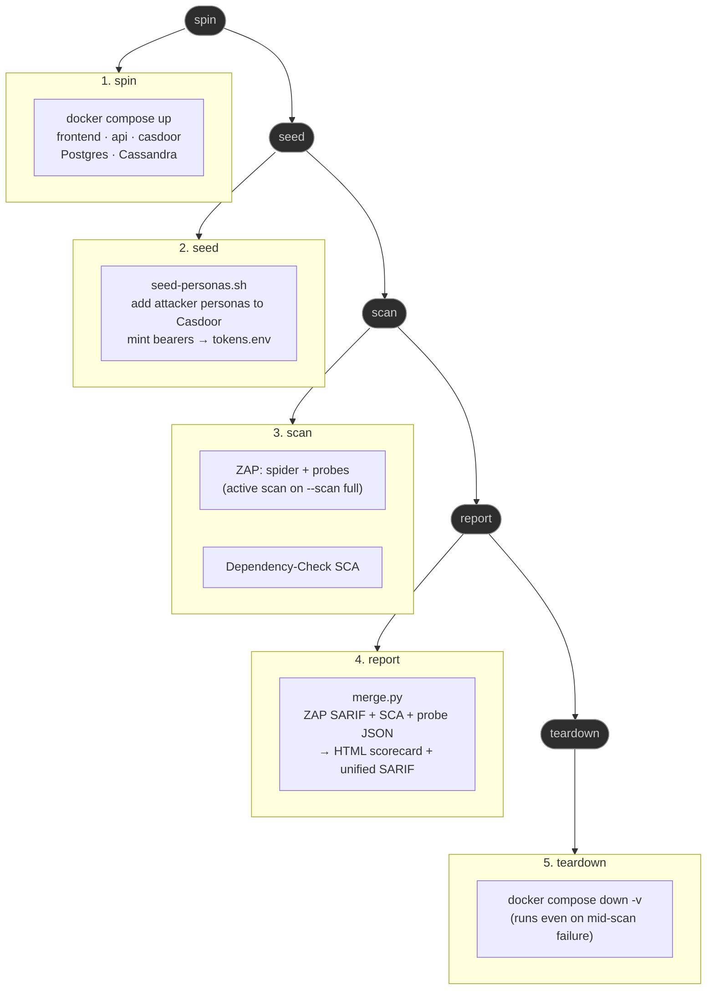

# snapdragon.games continuous pen-test harness

This is snapdragon.games' **own** OWASP pen-test pipeline — fully independent of
the main snapdragon-systems platform pipeline, as required by the
TWO-SEPARATE-WORKFLOWS rule in `snapdragon-pentest-standard`. It runs against the
games env-test-build (`docker-compose.e2e.yml`), the games Casdoor org
(`threewizards`), and the games BFF, exercising the games personas (player/user,
mod, publisher, uploader, admin).

It is a thin, games-adapted **vendored copy** of the shared platform harness at
`snapdragon-generator/tests/pentest/` (driver + ZAP plan + probe scripts + SCA
wrapper + report merge), re-targeted to the games auth scheme and BFF endpoints.

## What it does

Each invocation runs one `spin → seed → scan → report → teardown` sequence:



1. **spin** — `docker compose -f docker-compose.yml -f docker-compose.e2e.yml up`
   starts the games front door (`frontend` nginx TLS on `:8080`), the BFF (`api`),
   the games Casdoor (`casdoor`, org `threewizards`), Postgres, and Cassandra.
2. **seed** — `seed-personas.sh` creates the under-privileged **attacker** personas
   (`attacker-user` / `attacker-mod` / `attacker-publisher`) and the **load** pools
   in the games Casdoor, mints a bearer token per persona via the OIDC password
   grant, and writes them to a runtime `tokens.env` (gitignored). **No passwords
   are stored in git.**
3. **scan** — the OWASP ZAP Automation Framework runs `zap/zap-games.yaml`: a
   per-persona authenticated spider plus the custom games boundary/escalation/DoS
   probes. The active scan runs only when `--scan full` is passed. OWASP
   Dependency-Check runs in parallel via `dependency-check/run-sca.sh`.
4. **report** — `report/merge.py` merges ZAP SARIF + Dependency-Check output +
   probe JSON into a single ASVS-grouped, severity-ranked HTML scorecard and a
   unified SARIF file.
5. **teardown** — `docker compose down -v` runs unconditionally, even if the scan
   fails mid-run.

An **opt-in k6 load stage** (`--load`, off by default, also gated on
`PENTEST_LOAD=1`) runs after the scan and reads the same `tokens.env`. It
exercises realistic-mixed traffic and a stress burst designed to force the games
nginx to return 429s (**429 is a PASS; 5xx is a FAIL**), plus a nightly soak.
See [`load/README.md`](load/README.md) and
[`load/SCHEDULE-AND-GATE.md`](load/SCHEDULE-AND-GATE.md).

## Run

```bash
# MR / default branch — passive + spider + custom probes (no active scan):
tests/pentest/run-pentest.sh --env compose --scan baseline --pipeline games

# Scheduled — full active scan on top:
tests/pentest/run-pentest.sh --env compose --scan full --pipeline games

# OPT-IN k6 load (OFF BY DEFAULT; double-gated --load + PENTEST_LOAD=1):
PENTEST_LOAD=1 tests/pentest/run-pentest.sh --env compose --load --pipeline games

# Validate wiring with NO live stack:
tests/pentest/run-pentest.sh --env compose --dry-run
tests/pentest/run-pentest.sh --env compose --load --dry-run
tests/pentest/seed-personas.sh --dry-run
```

GitLab drives the same entry points from the `dast` and `sca` stages of
`.gitlab-ci.yml`. CI is GitLab — there is no GitHub Actions workflow for this
harness.

## The games deny-contracts the probes target

Every probe is grounded in a real games BFF deny-contract, cited inline in each
probe script alongside the corresponding source path under
`backend/src/main/java/games/snapdragon/bff/`. A probe **passes only when the
result is DENIED** — for escalation, IDOR, cross-tenant, and catalog probes that
means an HTTP 4xx from the BFF; for DoS probes that means a 429 (throttled)
rather than a 5xx (stack overwhelmed).

| probe | games deny-contract (cited) |
| --- | --- |
| `privilege-escalation.js` | `SecurityConfig` (`/api/admin/**`→`hasRole(ADMIN)`, `/actuator/**`→`hasRole(GAME-MASTER)`); `ModerationController` `/api/mod/**`→`hasAnyRole(MOD,ADMIN)`; `PublisherController` `/api/publisher/**`→`hasAnyRole(PUBLISHER,ADMIN)`; `RoleAdminController` `/api/admin/role-grants/**`→`hasRole(ADMIN)` (publisher cannot `grant-publisher`); `GameAccessController`/admin launch list+revoke→`hasRole(ADMIN)` |
| `idor-owner-subject.js` | `ProfileController` keys every read/write off `jwt.getSubject()`; `GameLaunchController.terminate` enforces `row.casdoorUserId == jwt.subject` |
| `reserved-prefix-smuggle.js` | `CasdoorAuthorities` `RESERVED_PREFIXES={ROLE_,DOMAIN_}` dropped from `permissions`; `SecurityConfig` validates `iss`+signature (alg=none/self-signed/unknown-iss → 401); `Roles.domainOf` fails closed on zero/>1 `DOMAIN_` |
| `domain-cross-tenant.js` | `DomainGuardFilter` 403 + `X-Domain-Denied` for a non-superadmin token whose `DOMAIN_<x>` ≠ `app.tenancy.domain` (decision 025); SUPERADMIN-only bypass |
| `catalog-brand-isolation.js` | `DomainScopeService.requireGameDomain`/`requireSessionDomain` 403 a brandA caller acting on a brandB-owned game (`games.domain`, migration 043, decision 026); `Roles.domainApplies` row predicate; wired into GameAccess/Publisher/Moderation/GameLaunch/GameUpload |
| `dos.js` | host nginx `limit_req_zone` browse/api/sse/auth/admin → 429 (decision 019) + per-pod `RateLimitFilter` + Cassandra aggregator (decision 017) + `limit_conn 40` |

`owner==subject` ownership enforcement (profiles and launch termination) and
per-brand catalog partitioning are the games-specific seams that the platform
harness at `snapdragon-generator/tests/pentest/` does not cover.

## Verified here vs needs-runner

**Verified in this checkout (no live stack):**

- `.gitlab-ci.yml` YAML parses; the `sca` and `dast` stages are additive and
  leave the existing `build` stage untouched.
- `bash -n` syntax check passes on `run-pentest.sh`, `seed-personas.sh`, and
  `dependency-check/run-sca.sh`.
- `run-pentest.sh --dry-run` resolves the wiring contract and locates the ZAP
  plan, ASVS map, merge script, and SCA wrapper.
- `seed-personas.sh --dry-run` renders the persona plan without connecting to
  Casdoor.
- `report/merge.py` compiles cleanly (`py_compile`) and emits a well-formed empty
  scorecard and SARIF when run with no inputs.
- `zap/zap-games.yaml` and `asvs/asvs-map.yaml` parse as valid YAML.

**Needs a runner (a live games env-test-build and a ZAP/Dependency-Check runtime):**

- A full ZAP scan requires the `ghcr.io/zaproxy/zaproxy` image and the seeded
  games stack reachable at `ZAP_TARGET`.
- A real seed requires `curl`, `jq`, a reachable games Casdoor admin API, and the
  throwaway TEST-realm password supplied via a CI variable.
- Dependency-Check requires its CLI or Docker image and NVD feed access (the feed
  is cached after the first run). The Rust `snapdragon-bridge` crate is inventoried
  using `--enableExperimental`.
- The `catalog-brand-isolation` and `domain-cross-tenant` probes require a second
  games Casdoor instance (`--brand-b-casdoor`) and `app.tenancy.domain` set to the
  target brand. Without this, both probes record a documented single-tenant SKIP:
  every `games.domain` defaults to `'default'`, so the gate passes by construction
  rather than by an actual cross-brand denial.

## Security invariants

- **No Casdoor passwords ever touch git.** The seed step reads passwords from CI
  variables (the `E2E_*_PASSWORD` / `PENTEST_SEED_PASSWORD` family) and writes
  only short-lived bearer tokens to a gitignored `tokens.env`. ZAP's session
  script reads that file — only throwaway access tokens reach ZAP; IdP credentials
  never do.
- **The DoS probe is request-budget-bounded.** It asserts that the games nginx
  returns 429 under load. It is sized so that it cannot take down the stack or
  affect another tenant.
- **Throwaway TEST realm only.** Never point the seed step at a production Casdoor
  instance. The `PENTEST_SEED_PASSWORD` CI variable must correspond to a throwaway
  realm.
- **Games pipeline only.** Passing `--pipeline main` is explicitly refused. The
  platform harness lives at `snapdragon-generator/tests/pentest/` and is a
  separate, independently-gated pipeline.
