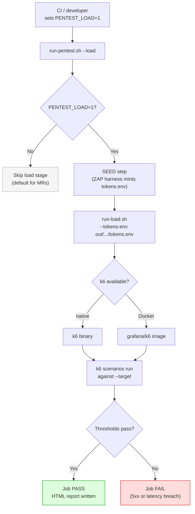

# hugmesh.games — k6 load stage (OPT-IN, dev/CI-pipeline-only)

This is the **OPT-IN** k6 load + DoS-resilience stage of the games pen-test harness.
It is **OFF BY DEFAULT**: the harness driver (`tests/pentest/run-pentest.sh --load`)
only activates it when **`PENTEST_LOAD=1`** is set. The GitLab `load` job (manual
or scheduled) sets that variable. Nothing sets it automatically on an MR because the
stage is slow and resource-heavy.

This is a dev/CI-pipeline-only stage, not a deployed runtime feature.

## Why k6

k6 is preferred over Gatling/Locust for four reasons:

1. **Single static binary** — no JVM or venv; it drops straight into the GitLab x86 runner.
2. **First-class staged ramps** — the `scenarios` block expresses ramping-vus and ramping-arrival-rate shapes natively.
3. **Threshold-gated jobs** — k6 exits non-zero when a threshold is breached, which is exactly what the test standard requires for pass/fail CI gates.
4. **Shared token table** — the JS scripting reads the **same** per-persona `tokens.env` the ZAP harness mints during the SEED step, so k6 runs as the real seeded games roles across ≥2 domains with no second login path and no IdP credentials.

## Invocation and token flow



## Files

| file | role |
| --- | --- |
| `k6-games-load.js` | the k6 entrypoint: the `scenarios` block + the request driver + `handleSummary`. |
| `lib/tokens.js` | parse the SEED step's `tokens.env` (same format the ZAP `auth-bearer.js` reads). |
| `lib/personas.js` | per-(role × domain) VU pools, their ALLOW endpoints at production-shaped ratios, and the games nginx zone rates. |
| `report/render.js` | render the test-standard-style HTML (throughput / p50–p99 / error-rate, gated-threshold badges, 429-vs-5xx budget). |
| `run-load.sh` | the runner the harness `--load` step calls (native `k6` or the `grafana/k6` Docker image). |
| `SCHEDULE-AND-GATE.md` | the GitLab Schedule setup + the gate-on-new-High/Critical policy. |

## Scenarios (`scenarios`, staged ramp)

| scenario | shape | the contract |
| --- | --- | --- |
| `realistic-mixed` | `ramping-vus` 0 → target (2 min ramp, 5 min hold). Per-(role × domain) pools hit their ALLOW endpoints at production-shaped ratios: **browse-heavy reads dominate**, with a **login burst** and **occasional admin/publisher writes**. | p50/p99 latency and non-429/5xx error-rate are gated. |
| `stress` | `ramping-arrival-rate` driven deliberately past the games nginx `limit_req` zone rates (**api 50/s, sse 30/s, auth 5/s**) to **force 429s** and verify graceful degradation. The nginx zones must shed excess load with 429, never 5xx. | **429 under stress = EXPECTED/PASS; 5xx = FAIL.** The error budget separates `expected_429s` (ungated) from `server_errors` (gated to 0). |
| `soak` | **Nightly only** (`SOAK=1` set by the schedule): `constant-arrival-rate` at a low, steady request rate held for a long duration. | Surfaces slow memory leaks and performance degradation over time. |

The zone rates used here are kept in sync with `tests/pentest/zap/scripts/dos.js`,
which explicitly defers heavy concurrent load testing to "a future gated k6 load
stage" — this is that stage.

## Run

```bash
# Through the harness (the supported path) — double-gated, opt-in:
PENTEST_LOAD=1 tests/pentest/run-pentest.sh --env compose --load --pipeline games

# Nightly (the schedule sets PENTEST_LOAD=1 + SOAK=1):
PENTEST_LOAD=1 SOAK=1 tests/pentest/run-pentest.sh --env compose --load --scan full --pipeline games

# One scenario only, directly (needs a spun+seeded games stack reachable on --target):
tests/pentest/load/run-load.sh --target https://localhost:8080 \
    --tokens-env out/pentest/<run>/tokens.env --out out/pentest/<run>/load --scenario stress

# Wiring check, no stack:
tests/pentest/run-pentest.sh --env compose --load --dry-run
```

## Gate (summary; full policy in `SCHEDULE-AND-GATE.md`)

- **5xx is always a FAIL** (`games_server_errors` gated to 0) — under stress the
  games nginx zones must shed excess load with **429**, never with 5xx.
- **429 under stress is PASS** (`games_expected_429s` ungated).
- **p50/p99 latency and error-rate** are gated via `K6_P50_MS`, `K6_P99_MS`, and
  `K6_MAX_ERROR_RATE`.
- Any threshold breach causes k6 to exit non-zero, which fails the **scheduled**
  pipeline `load` job.

## Security

No Casdoor passwords ever reach k6. The SEED step performs the OIDC password grant
out-of-band and writes only short-lived bearer tokens to the **gitignored**
`tokens.env`; k6 reads that file. The login-burst pool POSTs a valid-shaped body to
the throwaway test realm purely to stress the `auth` nginx zone and assert the 429
response — it never carries a real credential. **Targets the throwaway games TEST
realm only.**

## What is verified in this checkout vs what needs a runner

**Verified without a live stack:**
- `node --check` passes on `k6-games-load.js`, `lib/tokens.js`, `lib/personas.js`,
  and `report/render.js`.
- `bash -n` passes on `run-load.sh`; `--help` executes without k6 or a stack.
- `run-pentest.sh --load --dry-run` resolves the load runner and reports the
  `PENTEST_LOAD` gate value.
- `.gitlab-ci.yml` parses correctly; the `load` job is additive and gated on
  `PENTEST_LOAD=1`.

**Requires a live runner:**
- A real load run requires `k6` (native binary or the `grafana/k6` Docker image),
  a running and seeded games test-build reachable at `--target`, and a populated
  `tokens.env`.
- True multi-domain pools require a second games Casdoor instance seeded with
  `PUBLISHER_brandB`; a single-Casdoor compose stack runs brandA pools only and
  skips the cross-domain scenarios (this is expected and documented).
